# analog-topology-json-library Implementation Guide

> **Design Doc**: `docs/02-design/features/analog-topology-json-library.design.md` (Option C 승인 완료, 구현 중 3차 수정 반영)
> **Plan Doc**: `docs/01-plan/features/analog-topology-json-library.plan.md`
> **Status**: 배치 1~6 전부 완료. 배치 6 산출물(`workspaces/current-reuse-telescopic-ota-report/
> final_report.html`)에서 §8(물리 floorplan) 누락 + 이후 세션의 함수 rename(대규모 naming
> 정리, `consistency-map.md` 39~43차)으로 워크스페이스 스크립트가 깨진 것을 발견해 전부 수정
> 완료(아래 "배치 6 사후 수정" 참고). `references/consistency-map.md`/`gap-findings.md`가
> 이 시점 이후의 모든 추가 변경(반환 타입 통일, harness 우선순위 원칙 등)의 정본 이력이다 —
> 이 문서는 배치 1~6 구현 경위만 다루고 그 이후 작업은 재서술하지 않는다.
>
> **2026-07-29 추가**: "topology.json → 최종 리포트까지 harness만으로 완주 가능한가"를 82개
> 함수 전수 호출 추적으로 감사한 결과 구조적 gap 발견 — **배치 7로 계획만 수립했고 아직
> 구현하지 않았다.** (원래 4개였던 gap이 이후 세션들(§10 최종 시나리오 감사 포함)에서
> 계속 늘었다 — 정확한 개수·최신 목록은 §7.0 다이어그램이 정본이라 여기서 숫자를
> 재서술하지 않는다.) §7.9의 열린 질문에 대한 사용자 검토/승인 후 구현 시작(2026-07-31:
> §7.9 결정 항목은 대부분 완료 — §7 헤더 참고).

---

## Context Anchor

| Key | Value |
|-----|-------|
| **WHY** | topology netlist가 Python 코드 하드코딩이라 재현 불가능, agent마다 해석이 달라짐 |
| **SUCCESS** | folded_cascode/two_stage_ota 이관 후 connectivity가 기존 하드코딩 버전과 100% 동일(달성), self-test 전체 exit 0(회귀 없음, 새 Test 통합도 배치 4에서 완료 — §5 확인) |
| **SCOPE** | 스키마 구현 + 오케스트레이션 레이어 + 2개 example 이관 + telescopic OTA 논문으로 topology JSON 시연(배치 5) + **telescopic OTA 전체 리포트 완성**(배치 6) |

## 확정된 설계 결정 (최종 — 구현 중 3차 수정됨)

| 결정 | 선택 |
|------|------|
| 스키마 옵션 | Option C — topology library JSON은 `netlist`(connectivity만)/`symmetry`/`compensation` **3개** 고정 섹션. `layout` 필드는 **최종적으로 제거됨**(사이징과 무관하지 않다는 게 실측으로 드러남). **(2026-07-31 추가)** 배치 7-3d에서 `sizing_roles`, 배치 7-4b에서 `area_priors` 2개 섹션이 새로 생겼다 — 이건 제거됐던 `layout`(instance마다 다른 실제 W/L/좌표)과는 다른 종류다: `sizing_roles`(θ 선언)와 `area_priors`(정규화된 역할별 면적 통계)는 **instance-invariant**(이 topology 일반에 대해 항상 참)라 `netlist`/`symmetry`와 같은 지위로 topology.json에 둔다 — 판단 기준은 "layout이냐"가 아니라 "instance마다 달라지느냐"(§7-4b 확장 절 참고). |
| `netlist` 필드 | name/kind/source/drain/gate만. **n_fingers/finger_w/w/stack_id는 없음**(사이징 산출물이라 topology 단계엔 존재하지 않음) |
| `stack_id` 배정 | topology JSON에 없음 — `run_topology_pipeline()`의 `sizing_overrides` 인자로 인스턴스 단계에서만 부여 |
| `floorplan`(실제 좌표) | topology library JSON엔 없음 — instance-output JSON에서 `run_topology_pipeline()` 실행 결과로만 존재 |
| `compensation` | `topology_library.py` 함수를 이름으로 참조(`_COMPENSATION_REGISTRY` allowlist). 판단 기준은 "이 예제 W값이 그 함수로 역산됐는가"가 아니라 "이 회로 **구조**가 그 함수가 모델링하는 구조와 일치하는가" — 단일 스테이지거나 안 맞으면 `null`. **(2026-07-30 신설)** `null`은 두 가지 다른 뜻을 섞어 쓰면 안 된다 — 이걸 구분하려고 `_compensation_status` 필드(값: `not_applicable`\|`pending_topology_fn`\|`resolved`)를 추가했다: 단일 스테이지처럼 보상 자체가 불필요하면 `not_applicable`(영구), 다단 구조라 보상이 실제로 필요한데 기존 함수와 안 맞으면 `pending_topology_fn`(새 `topology_fn` 유도·등록 전까지의 **잠정** 상태 — 나중에 이 필드를 보면 "구현이 빠졌다"를 바로 알 수 있음), 실제 함수가 연결되면 `resolved`. `compensation`이 `null`인데 이 필드가 없으면 그 자체가 결함이다. |
| instance-output JSON 위치 | `workspaces/<design>/` (기존 관례 유지) — `library/`엔 topology 구조만 |
| 새 topology 작성 절차 | `_TEMPLATE.topology.json` 스캐폴드(3개 섹션) + Design §4.5 절차 |
| row 분할 자동화 | **하지 않음** — `run_topology_pipeline()`은 스택 전체를 단일 물리 행으로 놓고 감사만 한다. FAIL이면 호출자가 `search_stack_finger_w()`/`common_centroid_layout()`로 새 배분을 찾아 재호출(§1.6/§1.7 기존 피드백 루프 재사용) |
| **테스트 데이터 출처(2026-07-31 신설, 사용자 지적)** | 회로 connectivity(소자명/source/drain/gate)와 그 역할/kind(current_mirror 등)는 **오직 topology.json에만** 있어야 한다 — self-test/새 함수가 특정 회로를 다뤄야 하면 `load_topology()`로 기존 `library/*.topology.json`을 실제로 읽고, `symmetry.matching_pairs`를 순회해 필요한 kind를 **찾아서(discover)** 쓴다. 코드 안에 `Transistor("M3", ...)`류로 실제 회로와 닮은 데이터를 손으로 다시 타이핑하거나("합성 넷리스트"), 어떤 소자명이 어떤 kind인지 테스트가 가정하는 것 둘 다 금지 — 배치 7-4 self-test 작성 중 두 가지 실수(합성 M57/M58 넷리스트, "M3/M4가 current_mirror"라는 가정)가 실제로 발생해 사용자가 직접 지적, 전부 `load_topology()` + kind 기반 발견으로 재작성됨. `stack_id`/`n_fingers`/`w`처럼 topology.json 스키마에 원래 없는 sizing/layout 산출물 필드는 테스트가 직접 지정해도 된다(그건 애초에 그 파일의 책임 범위가 아니므로). |

---

## 1. 새로 만든 파일 (배치 1~3 완료)

| 파일 | 용도 | 상태 |
|------|------|:---:|
| `skills/analog-gmid-design/assets/library/folded_cascode.topology.json` | folded_cascode 구조 정본(connectivity+symmetry+compensation) | ✅ |
| `skills/analog-gmid-design/assets/library/two_stage_ota.topology.json` | two_stage_ota 구조 정본, `compensation`을 `miller_ota_topology`로 연결 | ✅ |
| `skills/analog-gmid-design/assets/library/_TEMPLATE.topology.json` | 새 topology 작성 시작점 — 3개 섹션 빈 구조 + 필드별 인라인 주석 | ✅ |

### 배치 5~6에서 추가로 만들 파일

| 파일 | 용도 |
|------|------|
| `skills/analog-gmid-design/assets/library/current_reuse_telescopic_ota.topology.json` | telescopic OTA 구조 정본(배치 5에서 논문으로부터 처음 작성) |
| `docs/03-analysis/analog-topology-json-library.gap-findings.md` | 배치 5/6에서 발견한 스키마·절차 한계 기록 |
| `workspaces/current-reuse-telescopic-ota-report/<name>.instance.json` | telescopic OTA 사이징+layout+floorplan 결과(배치 6) |

## 2. 수정한 파일 (배치 1~3 완료)

| 파일 | 변경 내용 | 상태 |
|------|-----------|:---:|
| `assets/stick_diagram.py` | `load_topology()`/`run_topology_pipeline()`/`save_instance_json()` 3개 함수 추가(§6.9 새 절). 기존 `folded_cascode_example()`/`two_stage_ota_example()`는 삭제하지 않고 유지(하위 호환). `audit_row_split()`은 일시적으로 `precomputed_sequences` 파라미터를 추가했다가(폐기된 row_splits 시도) 원래 시그니처로 되돌림 — **최종적으로 기존 함수 시그니처 전부 무변경** | ✅ |
| `assets/sizing_recipe.py` | `load_sizing_targets()`/`write_sizing_results()`/`run_sizing_pipeline()` 3개 함수 + `_COMPENSATION_REGISTRY` allowlist 추가(§6.5 새 절). `topology_library.py`의 3개 함수 import 추가. 기존 함수 시그니처 무변경 | ✅ |
| `references/function-selection-map.md` | 새 섹션 "10. Topology JSON 라이브러리" 추가 — 6개 신규 함수 매핑 | ✅ 배치 4 완료(§5 확인) |
| `SKILL.md` | §1.5/§1.6/§1.7에 "topology가 `library/*.topology.json`에 이미 있으면 그 파일을 정본으로 우선 사용"을 한 문장씩 추가 | ✅ 배치 4 완료(§5 확인) |
| `references/consistency-map.md` | 원칙 표에 새 행 추가 + 변경 이력 기록 | ✅ 배치 4 완료(§5 확인) |
| `references/design-report-spec.md` | §1.5 옆에 "새 topology JSON은 `_TEMPLATE.topology.json`에서 시작" 한 줄 + §1.7 본문에 "`library/` topology JSON이 있으면 그것부터 확인" 한 줄 추가 | ✅ 배치 4 완료(§5 확인) |

---

## 3. 구현 순서 (배치 단위, 각 배치 후 즉시 검증)

### 배치 1 — 스키마 왕복 검증 ✅ 완료

1. `library/_TEMPLATE.topology.json` 스캐폴드 작성
2. `folded_cascode_example()`의 실제 connectivity를 스크립트로 확인(수작업 재입력 금지)
3. `library/folded_cascode.topology.json` 생성 — `netlist`는 connectivity만, `symmetry`는
   이번 세션에서 이미 실측 확정된 kind
4. `load_topology()` 구현 → 되읽어 원본 `Transistor`의 connectivity 필드와 diff = 0 확인
   **(실제로 13개 소자 전부 diff=0 확인됨)**

### 배치 2 — 오케스트레이션 파이프라인 ✅ 완료 (구현 중 스키마 3차 수정 발생)

1. `run_topology_pipeline()` 구현 시도 1: `layout.groups`(스택=단일 행)로 감사 →
   `audit_row_split()` FAIL(branch_symmetric 쌍이 단일 행에서 common-centroid 불만족) 발견
2. 시도 2: `layout.row_splits`에 finger 개수 저장 → box-shape 균등성 문제 + interdigitation
   순서 재현 안 됨(Euler trail이 유일하지 않음) 발견 → `transistor_sequence`까지 저장하는
   방식으로 재시도, `audit_row_split()`에 `precomputed_sequences` 파라미터 임시 추가해 PASS
   재현 성공
3. **사용자 지적으로 근본 재설계**: "matching 배치는 finger 개수가 정해져야 계산 가능한데,
   그건 사이징 결과값이라 topology 단계엔 없어야 한다" → `layout` 필드 전체를 topology
   JSON에서 제거, `run_topology_pipeline(topology_json_path, sizing_overrides, ...)`로
   시그니처 변경(`sizing_overrides` 필수, n_fingers/finger_w/w/stack_id 포함) →
   `audit_row_split()`의 `precomputed_sequences`는 사용처가 없어져 원래 시그니처로 되돌림
4. **최종 확인**: `sizing_overrides`로 원본 example의 layout 값을 그대로 넣어 실행 →
   box_shape PASS, audit_row_split은 branch_symmetric/diff_pair 쌍에서 정직하게 FAIL(row
   분할 미탐색 상태이므로 예상된 결과), floorplan/coverage 정상 계산 확인

### 배치 3 — 두 번째 topology + instance-output ✅ 완료

1. `two_stage_ota_example()`도 배치 1~2와 동일하게 이관(`library/two_stage_ota.topology.json`)
   — connectivity diff=0 확인
2. `save_instance_json()` 구현, `sizing_recipe.py`의 `load_sizing_targets()`/
   `write_sizing_results()`/`run_sizing_pipeline()`/`_COMPENSATION_REGISTRY` 구현
3. 왕복(round-trip) 테스트 완료: `write_sizing_results()` → `load_sizing_targets()` 정상,
   허용되지 않은 `compensation.function` 이름은 `ValueError`로 안전하게 거부됨(확인됨)
4. **사용자 지적으로 `two_stage_ota.topology.json`의 `compensation` 수정**: 처음엔 "역산
   검증 안 됨"을 이유로 `null` — 하지만 구조(diff pair+mirror 부하 1단, common-source 2단)가
   `miller_ota_topology()`와 정확히 일치함을 재확인하고 `compensation.function =
   "miller_ota_topology"`로 연결. `run_sizing_pipeline()`으로 실제 호출해 gm1/gm2 산출 확인

### 배치 4 — self-test 통합 + 문서 반영 ✅ 완료 (§5 회귀 체크리스트에서 확인됨)

1. `stick_diagram.py` self-test에 새 Test(가칭 Test 26 — `load_topology()`/
   `run_topology_pipeline()`/`save_instance_json()` 회귀: connectivity diff=0 + 파이프라인
   결과 스냅샷)를 추가
2. `sizing_recipe.py`의 `__main__` 데모에도 `run_sizing_pipeline()`/`load_sizing_targets()`/
   `write_sizing_results()` 데모 추가(compensation 있음/null 두 경우 + allowlist 거부 케이스)
3. `PYTHONIOENCODING=utf-8 python stick_diagram.py`/`sizing_recipe.py` 전체 재실행, exit 0 확인
4. 위 "2. 수정한 파일" 표의 문서 4종(`function-selection-map.md`/`SKILL.md`/
   `consistency-map.md`/`design-report-spec.md`) 반영 — 최종 확정 스키마(§ "확정된 설계
   결정" 표) 기준으로 작성, 폐기된 `layout` 필드 언급 없이

### 배치 5 — telescopic OTA 논문으로 시연 (예정, 도구 타당성 독립 검증)

> 목적은 이 회로의 사이징/floorplan/리포트를 완성하는 게 아니라, **배치 1~4에서 만든
> 스캐폴드+절차가 "새 논문에서 처음부터 authoring"을 실제로 감당하는지** 확인하는 것이다.
> folded_cascode/two_stage_ota 이관은 스키마가 그 두 example에서 역설계됐으므로 순환 검증이고,
> 이 배치가 처음으로 독립적인 검증이다.

1. `library/_TEMPLATE.topology.json`을 복사해 새 topology JSON 작성 시작
2. "A 126uW Current-Reuse Telescopic OTA with Class-AB Output Stage" 논문의 실제 스키매틱을
   **직접 다시 확인**하며 `netlist`(connectivity만) 작성(이전 background agent 세션이 만든
   `workspaces/current-reuse-telescopic-ota-report/sizing_results.json`의 소자 이름/역할은
   참고만 하되, source/drain/gate 연결은 원문 스키매틱에서 직접 재확인 — 그 세션 자체가
   "다르게 해석"할 수 있었던 대상이므로 그 산출물을 곧이곧대로 신뢰하지 않는다)
3. `load_topology()`로 로드 → `find_matching_candidates()` 실제 호출 → Design §4.5 3번의
   5가지 패턴으로 필터링해 `symmetry` 작성
4. `compensation` 판단 — 이 회로 **구조**가 `_COMPENSATION_REGISTRY`의 3개 함수(miller/
   nmcnr/ngcc) 중 하나와 일치하는지 확인(배치 3에서 two_stage_ota로 겪은 것과 같은 판단
   기준: "구조 일치" 여부, "현재 W값의 역산 여부"가 아님). **일치하지 않으면 `null`로 두고
   그 사실 자체를 기록**(유효한 결과다 — 새 함수를 이 배치에서 유도하지 않는다)
5. 검증용 `sizing_overrides`(임의의 n_fingers/finger_w/w/stack_id, 예: 기존
   `sizing_results.json`에서 파생)를 채워 `run_topology_pipeline()` 실행 → box_shape/
   audit_row_split/floorplan/coverage 결과 확인
6. **결과를 `docs/03-analysis/analog-topology-json-library.gap-findings.md`에 기록**:
   - 스키마 필드(`netlist`/`symmetry`/`compensation`) 중 그대로 채울 수 있었던 것 / 애매해서
     판단이 필요했던 것 / 아예 표현이 안 돼서 스키마 확장이 필요했던 것을 구분해서 나열
   - `compensation: null` 케이스가 실제로 발생했다면, 그 상태로 파이프라인이 정상 동작했는지
   - `_TEMPLATE.topology.json`의 인라인 주석만 보고 어디서 막혔는지(주석이 불충분했던 지점)
   - `check_stick_diagram_coverage()`가 CMFB/bias-gen/Class-AB 소자를 이번엔 실제로 잡아내는지
     (`sized_device_names`를 netlist 전체에서, `stick_diagram_devices`를 실제 계산된 rows에서
     뽑아 비교 — 배치 6에서 본격적으로 쓰임)

**Gate**: 배치 5는 배치 1~4가 전부 통과한 뒤에만 시작한다. 배치 5 자체는 "PASS/FAIL"이
아니라 "무엇을 찾았는가"가 산출물이다 — gap-findings.md가 비어 있으면(아무 문제도 못
찾았다면) 오히려 검증을 충분히 비판적으로 하지 않았다는 신호로 보고 재검토한다.

### 배치 6 — telescopic OTA 전체 리포트 완성 (예정)

> 배치 5가 만든 `library/current_reuse_telescopic_ota.topology.json`(구조 정본, 21개 소자
> netlist+symmetry+compensation — **layout은 없음**, 배치 6에서 사이징 이후에 만든다)을
> 실제로 끝까지 돌려 원래 미완성이었던 리포트를 완성한다. 이 배치가 이 feature 전체의
> 최종 증거다 — "도구가 있다"가 아니라 "이 도구로 실제 완결된 산출물을 냈다"까지 확인한다.

1. **사이징 재현**: `run_sizing_pipeline(topology_json_path, design_spec)`으로 `compensation`
   참조를 조회 — `null`이면(배치 5에서 확인된 실제 상태라면) `design_spec`을 바로
   `size_transistor()`/`optimize_multistage()`에 사용, 있으면 반환된 `topology_fn`을
   `optimize_multistage()`에 전달. 기존 `workspaces/current-reuse-telescopic-ota-report/
   sizing_results.json`의 spec(fT/CL/gain 등)을 그대로 재사용해 **같은 스펙을 이 새
   파이프라인이 재현할 수 있는지** 확인(새 설계를 하지 않는다 — Plan §2.2 Out of Scope 참고)
2. **결과 비교**: 새로 계산된 W/L/ID/gm이 기존 `sizing_results.json`과 합리적으로 일치하는지
   확인(완전히 동일할 필요는 없다 — 알고리즘 경로가 다를 수 있음. 스펙 만족 여부가 기준)
3. **finger 배분 + stack_id 결정**: 사이징된 W로부터 n_fingers/finger_w를 결정하고(box-shape/
   matching-safety 고려), `sizing_overrides`(21개 소자 전체, n_fingers/finger_w/w/stack_id
   포함)를 구성한다. `audit_row_split()` FAIL이 나오면 `search_stack_finger_w()`/
   `common_centroid_layout()`로 재조정 — 이게 §1.6/§1.7의 기존 피드백 루프이고, 이번 feature가
   자동화하지 않은 부분이므로 여기서 직접 수행한다
4. **`run_topology_pipeline()`로 layout 전체 계산**: 위 `sizing_overrides` + 적절한
   `floorplan_hints`(기능 그룹 — Stage-1/Stage-2/Class-AB/bias-gen/CMFB — 을 `spine_groups`로
   지정)로 21개 소자 전부의 box-shape/audit_row_split/floorplan을 **한 번의 파이프라인
   호출**로 얻는다(이전 사고처럼 sub-block별로 나눠 실행하다 일부를 빠뜨리는 경로 자체를
   구조적으로 차단)
5. **`save_instance_json()`**으로 `workspaces/current-reuse-telescopic-ota-report/`에
   instance-output JSON 저장
6. **게이트 확인**: `check_stick_diagram_coverage()` `ok=True`(missing 없음) — `netlist`
   전체 소자명 vs 실제 계산된 rows 비교. 완전한 회로 감사가 필요하면 `run_full_circuit_
   audit()`도 별도로 직접 호출해 `ok=True` 확인 — **둘 다 실제로 호출한 뒤 반환값을 직접
   확인한다**(import만 하고 호출을 빠뜨리는 실수가 바로 이번 feature의 발단이었다 — SKILL.md
   DoD의 grep 확인 절차를 여기서도 그대로 따른다)
7. **`final_report.html` 갱신**: 기존 `build_html.py`/`report_template.html`의
   `renderSchematic()`/`renderStack()`을 그대로 재사용해 8개 섹션(SKILL.md §7 표 참고) 전부를
   채운다 — 특히 8번(물리 floorplan)이 이번엔 실제로 존재해야 한다
8. **시각 검증**: 완성된 HTML을 브라우저로 열어 8개 섹션이 실제로 렌더링되는지 확인
   (`design-report-spec.md` §4 절차)
9. 결과를 `gap-findings.md`(배치 5와 같은 파일, 이어서 기록)에 추가: 배치 6에서 새로
   발견된 문제가 있었는지, 없었다면 "배치 5의 구조 검증이 배치 6의 실행 단계 문제를
   조기에 잡아냈다"는 것 자체가 이 도구의 가치를 보여주는 증거로 기록한다

**Gate**: 배치 6은 배치 5(구조 검증)가 완료된 뒤에만 시작한다 — 구조가 틀린 topology JSON으로
사이징/floorplan을 돌리면 오류 원인이 구조 문제인지 사이징 문제인지 뒤섞인다.

**Gate**: 각 배치는 이전 배치의 회귀 검증(diff/self-test/gap-findings)이 통과해야 다음
배치로 진행한다 — "일단 6개 배치를 다 스켈레톤으로 짜고 나중에 한 번에 검증"하지 않는다.

---

## 4. 함수 시그니처 (구현 완료 — 실제 코드 그대로)

```python
# stick_diagram.py

def load_topology(json_path: str) -> tuple[list[Transistor], dict]:
    """topology library JSON을 읽어 (transistors, meta) 반환.
    meta = {"topology_name": str, "schema_version": str, "source": str|None,
            "symmetry": {"matching_pairs": [...]},
            "compensation": {"function": str, "parameters": [...], ...} | None}
    ⚠️ 반환된 transistors는 connectivity만 채워져 있다(name/kind/source/drain/gate) —
    n_fingers(기본값 1)/finger_w/w/stack_id는 아직 없다(사이징 산출물이라 topology
    단계엔 존재하지 않는다)."""

def run_topology_pipeline(topology_json_path: str, sizing_overrides: dict,
                           floorplan_hints: dict | None = None) -> dict:
    """load_topology() -> sizing_overrides(n_fingers/finger_w/w/stack_id — 필수)로
    소자별 필드 덮어쓰기 -> split_into_stacks()로 스택(=기본 물리 행 후보) 구성 ->
    check_box_shape() -> audit_row_split()(matching-safety, symmetry.matching_pairs의
    kind 사용) -> pack_floorplan_grouped()(floorplan_hints 없으면 스택마다 1:1 그룹
    기본값) -> check_stick_diagram_coverage().
    반환: {"transistors": [...](layout 필드까지 채워진 최종 netlist), "box_shape": ...,
           "audit_row_split": ..., "floorplan": ..., "coverage": ...}.
    ⚠️ matching-safety를 위한 row 분할은 자동 탐색하지 않는다 — FAIL이면 호출자가
    search_stack_finger_w()/common_centroid_layout()로 새 배분을 찾아 재호출.
    ⚠️ run_full_circuit_audit()는 의도적으로 포함하지 않는다(dispositions 판단 필요)."""

def save_instance_json(path: str, topology_json_path: str, sizing_results: dict,
                        pipeline_result: dict) -> None:
    """instance-output JSON 작성 — pipeline_result를 손대지 않고 그대로 옮겨 씀.
    결과 JSON은 "sizing"/"netlist"(최종 Transistor 전체)/"floorplan"/"box_shape"/
    "audit_row_split"/"coverage"를 최상위 키로 갖는다."""
```

```python
# sizing_recipe.py

def load_sizing_targets(json_path: str) -> dict:
    """instance-output JSON(또는 별도 sizing-spec JSON)에서 design_spec(gm/ID sizing
    목표값: fT/CL/gain_target 등)을 읽어 반환. "design_spec" 키 없으면 파일 전체 반환."""

def write_sizing_results(json_path: str, results: dict) -> None:
    """size_transistor()/optimize_multistage() 결과를 instance-output JSON의 "sizing"
    섹션에 병합해 기록(파일 없으면 새로 생성, 다른 섹션은 건드리지 않음)."""

# topology_library.py의 위상보정 함수 중 topology JSON이 참조할 수 있는 것만 명시적으로 등록.
# JSON 문자열로 임의 함수를 실행하지 않기 위한 allowlist — eval/getattr(module, name) 금지.
_COMPENSATION_REGISTRY = {
    "miller_ota_topology": miller_ota_topology,
    "nmcnr_3stage_topology": nmcnr_3stage_topology,
    "ngcc_3stage_topology": ngcc_3stage_topology,
}

def run_sizing_pipeline(topology_json_path: str, design_spec: dict):
    """topology JSON의 "compensation"을 읽어 있으면 _COMPENSATION_REGISTRY로 함수를
    조회해 design_spec으로 호출.
    ⚠️ 반환 타입이 갈린다: compensation 있으면 topology_library.py 세 함수가 공통으로
    반환하는 topology_fn(prev_cggs) -> list[gm_i] 클로저를 그대로 반환(optimize_
    multistage()에 넘길 것) / compensation이 null이면 design_spec dict를 그대로
    반환(size_transistor()를 직접 쓸 것). 없는 함수명 참조 시 ValueError."""
```

---

## 5. 회귀/품질 체크리스트

- [x] `load_topology(library/folded_cascode.topology.json)` 결과와 `folded_cascode_example()`
      결과가 connectivity 필드 단위로 diff 0 — **확인됨**
- [x] `load_topology(library/two_stage_ota.topology.json)` 결과와 `two_stage_ota_example()`
      결과가 connectivity 필드 단위로 diff 0 — **확인됨**
- [x] `run_topology_pipeline()`을 거친 두 topology가 정직한 결과(box_shape PASS, coverage
      PASS, audit_row_split은 row 분할 미탐색으로 branch_symmetric/diff_pair FAIL — 예상된
      결과)를 산출 — **확인됨**
- [x] 새 함수 6개(`load_topology`/`run_topology_pipeline`/`save_instance_json`/
      `load_sizing_targets`/`write_sizing_results`/`run_sizing_pipeline`) 모두 기존 함수
      시그니처를 변경하지 않음 — **확인됨**(`audit_row_split()`의 임시 확장도 원복 완료)
- [x] `_COMPENSATION_REGISTRY` allowlist가 등록되지 않은 함수명을 `ValueError`로 거부 —
      **확인됨**(직접 테스트)
- [x] `PYTHONIOENCODING=utf-8 python stick_diagram.py`/`sizing_recipe.py` exit 0 — **확인됨**
- [x] self-test에 새 함수 전용 Test 통합(배치 4) — Test 26 + sizing_recipe 데모
- [x] 문서 4종 반영 완료(배치 4)
- [x] `docs/03-analysis/analog-topology-json-library.gap-findings.md` 작성 완료(배치 5) —
      7개 실제 발견 기록(diff_pair W 요구사항 한계, bias-gen Euler 결함 실제 검출 등).
      Design §4.5 3번 절차도 이 발견 반영해 수정 완료
- [x] 배치 6(telescopic OTA 전체 리포트) 완료 — `workspaces/current-reuse-telescopic-ota-report/
      final_report.html` 산출. 단, 아래 "배치 6 사후 수정"에서 §8 누락과 워크스페이스 스크립트
      회귀를 발견해 별도로 수정함(원래 배치 6 자체가 §8을 스킵한 게 아니라, 배치 6 완료 시점의
      `report_template.html`에 §8 렌더러 자체가 없었다 — 근본 원인은 템플릿 쪽)

### 배치 6 사후 수정 (§8 floorplan 누락 + naming rename 회귀, 별도 세션에서 발견·수정)

이후 세션에서 `docs/04-report`가 실제 상태를 반영하는지 점검하다가 두 가지를 발견:

1. **`final_report.html`에 §8(물리 floorplan, 필수 섹션)이 아예 없었음** — 근본 원인은
   `assets/report_template.html`(이 skill의 "완전한 템플릿") 자체에 §1~§7까지만 있고
   floorplan 렌더러가 없었던 것. `report_template.html`에 `renderFloorplan()` 추가(§8),
   데모 REPORT 객체에도 실제 `pack_floorplan_grouped()` 실행 결과로 §8 예시 데이터 추가.
   같은 렌더러를 `workspaces/.../build_html.py`에도 이식하고, `stick.py`에
   `pack_floorplan_grouped()` 호출을 추가해 이 리포트가 실제로 커버하는 3개 셀
   (core_signal_cell/bias_tail_cell/stage2_output_cell)의 floorplan을 계산 — bias-gen/CMFB
   (M27-M40)는 이 패스에서 스틱다이어그램 자체를 안 만들었으므로 floorplan에도 정직하게
   제외(§7 layout guide의 기존 scope note와 동일 원칙, `floorplan.scope_note`에 명시).
   실측 결과: bbox 68×7(proxy units), aspect_ratio 9.71, packing_density 73.1% — 3개 셀의
   폭 편차(38/10/68)가 커서 비율이 나쁘게 나오는 것도 실제 계산 결과 그대로 보고(가공 없음).
2. **`workspaces/.../stick.py`가 이후 세션의 함수 rename으로 깨져 `ImportError`** —
   `generate_stick_diagram`/`detect_matching_candidates`/`verify_mirror_symmetry`(전부 삭제된
   옛 이름)를 import하고 있었다. `build_stick_diagram`/`find_matching_candidates`/
   `check_mirror_symmetry`(`.ok` 필드 접근으로 수정)로 갱신. `build_report.py`/`build_html.py`
   본문·풋터의 옛 함수명 언급(리포트가 스스로의 방법론을 설명하는 텍스트)도 동일하게 갱신.
3. **부수 발견: `report_template.html`/`final_report.html` 둘 다 `<meta charset="utf-8">`가
   없어서 로컬 서버로 열면 §/—/µ 등 비-ASCII 문자가 깨져 보임** — 둘 다 charset 선언 추가,
   실제 브라우저 렌더링으로 수정 전/후 시각 확인 완료(스크린샷 비교, §8 포함).

**교훈**: "완전한 템플릿"이라고 문서화된 자산도 스펙이 나중에 바뀌면(이번엔 floorplan이
필수 섹션으로 승격된 시점) 템플릿 자체를 갱신하지 않으면 계속 낡은 채로 새 리포트에
복제된다 — 개별 리포트가 아니라 템플릿을 고쳐야 재발하지 않는다. 또한 이 skill의 "핵심
코드"(`assets/*.py`)를 리네임할 때 `workspaces/`처럼 그 코드를 직접 `import`하는 다운스트림
소비자가 있는지 확인하지 않으면, 코드 자체의 self-test는 전부 통과해도 실제 산출물
재생성 경로가 조용히 깨질 수 있다.

---

## 6. 사용자 검토용 열린 질문 (일부 해소됨)

1. **`library/` 폴더 위치**: `skills/analog-gmid-design/assets/library/`로 확정 —
   실제로 이 경로에 3개 파일 생성 완료, 이견 없었음(해소)
2. **기존 example 함수 처리**: 삭제하지 않고 유지 + JSON 회귀 diff 확인으로 진행(해소) —
   `folded_cascode_example()`/`two_stage_ota_example()` 둘 다 그대로 남아있고, 배치 4에서
   self-test에 diff 확인 Test 추가 완료(§5 확인)
3. **`schema_version` 관리**: 스키마가 3차 수정되며 실제로 `"1.0"` → `"2.0"`으로 한 번
   올랐다(의미 있는 구조 변경 시 버전을 올리는 것으로 자연히 확정됨) — 버전별 로더 분기
   로직은 아직 만들지 않음(아직 필요성이 없음, 스키마가 또 바뀌면 그때 판단)

---

## 7. 배치 7 — harness 완전성 확보 (계획 단계, **§7.9 결정 완료 — 구현 착수 대기**)

> **배경**: 2026-07-29, "topology.json 입력 → 최종 리포트+instance JSON까지 harness만으로
> AI가 스크립트를 새로 짜지 않고 완주할 수 있는가"를 82개 함수 전체 AST 기반 호출 추적 +
> `workspaces/current-reuse-telescopic-ota-report/` 실제 증거로 감사(아티팩트:
> `analog-gmid-design harness 커버리지 감사`). 결론: **아니다** — 구조적 gap 4개(+ 이후
> 사용자 질의응답으로 추가 발견된 헤드룸 배분 gap 1개(배치 7-3b), 구성 단계 kind별 layout
> 도구 선택 gap 1개(배치 7-4b), `gm_id`(동작영역) 선택 gap 1개(배치 7-3e), `L`(채널길이)
> 선택 gap 1개(배치 7-3f), 1/f 노이즈·mismatch/yield·CMRR/PSRR 추정 gap 3개(배치
> 7-3g/7-3h/7-3i, 2026-07-30 sky130 로컬 PDK 실측 확인), raw W→`n_fingers`/`finger_w`/
> `stack_id` 자동배정 gap 1개(배치 7-6, 2026-07-31 최종 시나리오 감사로 발견 — §10)가
> 실제 코드/실제 워크스페이스 증거로 확인됨. **아직 구현하지 않았다.** **(2026-07-31 갱신)** §7.9의 결정 필요
> 항목(2b/2c/3/4/5/6/9/10/11)은 전부 사용자와 하나씩 검토해 결정 완료 — 남은 미결은
> 결정이 아니라 외부자원 차단(W_bounds 하한, §7.9 질문 7(a))과 구현 후 실행 검증(§7.9
> 질문 2c의 다른 회로 적용)뿐이다. 구현은 7-1부터 순서대로 시작.

> **⚠️ 재발 주의**: 배치 7-3f 초안에서 "이 논문엔 단별 이득 배분 스펙이 없어서 캐스코드 L
> 역산은 스코프 밖"이라고 썼다가 사용자 지적으로 정정했다 — 이건 **SKILL.md 절대 원칙
> #4**("소자에 대한 명시적 목표치가 없다고 사이징을 스킵 금지", 근거:
> `known-incidents.md` 사고4)의 **재발**이다. 이 skill 전체에 적용되는 기존 원칙이지
> 배치 7 전용 원칙이 아니다 — "논문/문헌에 없다"는 "도출 불가능하다"의 증거가 아니며,
> §1.5 절차(기능적 역할→제약 번역→탐색/계산으로 값 확정)를 반드시 따른다. 아래 배치
> 7-3f는 이 원칙에 맞게 다시 썼다.

### 7.0 전체 그림 — gap → 수정안 → 최종 증거

> **2026-07-29 수정(2차)**: 사용자 질의응답 + 논문 원문 재확보로 배치 7-3(`size_fixed_targets()`)이
> 잘못된 프레이밍이었음이 드러났다 — 자세한 경위·실제 Eq.1-6은 "배치 7-3 배경 — 왜
> 바뀌었는가" 참고. 결론: 새 harness 대신 4번째 topology_fn을 등록해 기존
> `optimize_multistage()`를 재사용하되, 이 topology_fn이 커버하는 건 gm1/gm2 2개
> 소자군(6개)뿐이고 나머지 45개 소자는 여전히 별도 로직이 필요함(스코프 축소, 차단은 아님 —
> 이 45개의 연결은 2026-07-30 시점 전부 확정됨, sky130-worked-example.md §13/§13.5).

```mermaid
flowchart TD
    subgraph GAP["실제 감사로 확인된 gap"]
        direction TB
        G1["① optimize_multistage()<br/>저장소 전체 호출 0건"]
        G2["② run_topology_pipeline()<br/>단일-cell만 가정"]
        G3["③ compensation 등록 3개뿐<br/>(이 회로의 topology_fn이 없음)"]
        G3b["③b 직렬 스택 헤드룸 배분<br/>(VDS 6개 값이 손으로 하드코딩됨)"]
        G3c["③c 나머지 45개 소자가<br/>zero-base 연역 없이 매직넘버로 사이징됨"]
        G3e["③e gm_id(동작영역) 선택도<br/>zero-base 연역 없음(ID/vds만 다룸)"]
        G3f["③f L(채널길이) 선택도<br/>zero-base 연역 없음"]
        G3g["③g 1/f 노이즈 LUT 축 없음"]
        G3h["③h mismatch/yield 추정 불가"]
        G3i["③i CMRR/PSRR 추정 불가"]
        G4["④ audit_row_split() FAIL 해도<br/>고치는 도구가 연결 안 됨"]
        G4b["④b kind별 layout 도구 선택이<br/>구성 단계엔 없음(감사에만 있음)"]
        G5["⑤ raw W → n_fingers/finger_w/<br/>stack_id 자동배정 함수 없음<br/>(최종 시나리오 감사로 발견)"]
    end

    subgraph FIX["배치 7 수정안"]
        direction TB
        F1["7-1<br/>self-test에 실제 실행 추가"]
        F2["7-2<br/>cell_groups 인자 추가"]
        F3["7-3<br/>4번째 topology_fn 등록<br/>(gm1/gm2 6개 소자만 커버)"]
        F3b["7-3b<br/>allocate_stack_headroom() 신설"]
        F3c["7-3c<br/>spec→45개 소자 연역 사슬 확립<br/>(자유도 4원칙으로 수렴)"]
        F3d["7-3d<br/>4원칙+L_cascode/L_stage2out<br/>6차원 탐색 (✅ 채택 확정, 2026-07-31)"]
        F3e["7-3e<br/>search_gm_id_for_role() 제안<br/>(고정배정 대신 W-타당범위 탐색)"]
        F3f["7-3f<br/>select_L_by_role() 제안<br/>(고정배수 규칙만, 캐스코드는 7-3d로)"]
        F3g["7-3g<br/>1/f 노이즈 LUT 확장(sky130 실측)"]
        F3h["7-3h<br/>Pelgrom mismatch 1차 추정(sky130 실측)"]
        F3i["7-3i<br/>CMRR/PSRR 1차 추정(closed-form)"]
        F4["7-4<br/>repair_matching_safety() 신설"]
        F4b["7-4b<br/>select_layout_tool() 신설<br/>+ 구성 단계에도 적용"]
        F6["7-6<br/>derive_stack_groups()+<br/>assign_finger_geometry() 신설"]
    end

    G1 --> F1
    G2 --> F2
    G3 --> F3
    G3b --> F3b
    G3c --> F3c
    F3c --> F3d
    G3e --> F3e
    G3f --> F3f
    G3f --> F3d
    G3g --> F3g
    G3h --> F3h
    G3i --> F3i
    G4 --> F4
    G4b --> F4b
    G5 --> F6

    F1 --> F5
    F2 --> F5
    F3 --> F5
    F3b --> F5
    F3d --> F5
    F3e --> F5
    F3g --> F5
    F3h --> F5
    F3i --> F5
    F3f --> F5
    F4 --> F5
    F4b --> F5
    F6 --> F5
    F5["7-5<br/>워크스페이스를 harness만으로 재생성<br/>(feature 전체의 최종 증거 —<br/>gm1/gm2는 harness, 나머지는 별도 로직)"]

    style F3 fill:#f3e6c8,stroke:#93691f
```

### 7.0.1 구현 순서 (의존관계)

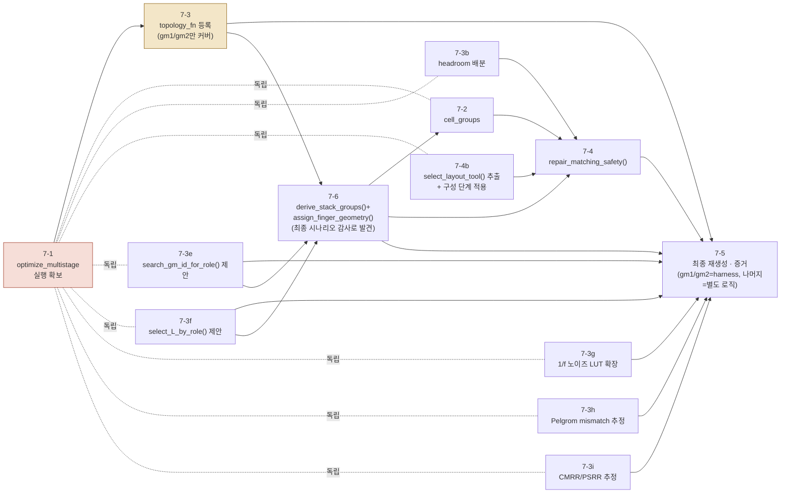

*7-6은 다른 배치들과 달리 완전히 독립적이지 않다 — `assign_finger_geometry()`가 sizing_results(θ 탐색/7-3/7-3e/7-3f 체인의 결과)를 입력으로 받고, 그 출력(`sizing_overrides`)이 7-2(`run_topology_pipeline()` 호출)와 7-4(`repair_matching_safety()`)의 선행조건이기 때문이다 — 이 회로에서 처음으로 "θ 탐색 → sizing_overrides 구성 → run_topology_pipeline() 호출"이라는 실제 순서가 다이어그램에 명시적으로 드러난 지점이다.*

*7-1은 다른 모든 배치의 선행조건(최우선). 7-2/7-3/7-3b/7-4b/7-3e/7-3f/7-3g/7-3h/7-3i는
서로 독립이라 순서 무관. 7-3은
이제 블로커가 없지만(원문 확보됨) gm1/gm2 6개 소자만 커버하는 스코프임을 명시 —
나머지 45개 소자는 7-5에서도 여전히 branch-전류-배분 로직(harness 밖)으로 사이징된다. 7-4b는
`audit_row_split()`이 이미 가진 kind→게이트 판정 로직(current_mirror→3b, diff_pair/
branch_symmetric→3c)을 재사용 가능한 함수로 뽑아 구성 단계에도 적용하는 것이라 7-4보다
먼저(또는 동시에) 끝나야 7-4가 같은 정책을 참조할 수 있다.*

---

### 배치 7-1 — `optimize_multistage()`를 dead code에서 꺼낸다 ✅ 구현 완료(2026-07-31)

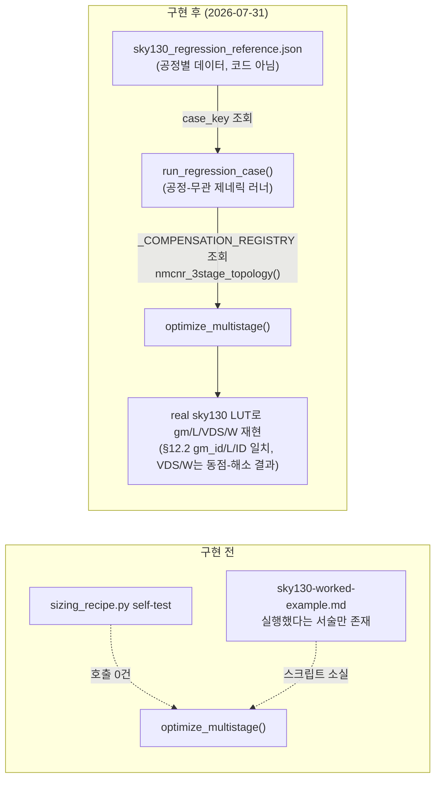

| | 내용 |
|---|---|
| **문제** | `optimize_multistage()` 정의 이후 호출 0건(self-test 포함). worked-example의 실행 스크립트 소실. |
| **제안(원안)** | self-test에 `optimize_multistage()`를 실제로 실행하는 Test 추가, 기존 문서 실측치로 회귀 기준 삼음. |
| **구현(실제)** | 원안보다 일반화됨 — 사용자 피드백("공정에 얽매이는 값을 코드에 박지 말 것", "nmcnr 전용이 아니라 current_reuse 등 어느 회로에도 쓸 수 있는 표준화된 포맷+제네릭 러너")을 반영해, (1) `sizing_recipe.py`에 공정/회로-무관한 `RegressionVerdict`/`_REGRESSION_ENGINES`/`run_regression_case()`를 신설하고 (2) 공정별 실측 기준값은 별도 파일 `sky130_regression_reference.json`(`case_key`로 조회, `engine`/`topology_fn`/`search`/`expected` 선언)에만 둠. 새 회로·새 공정을 추가할 때 러너 코드는 건드리지 않고 JSON에 케이스 하나만 추가하면 된다. |
| **검증** | `PYTHONIOENCODING=utf-8 python sizing_recipe.py` self-test에서 `run_regression_case(..., "nmcnr_3stage_GBW5M_CL10p_PM70_kg0.5")`가 `sky130-worked-example.md` §12.2 실측치와 대조해 PASS(exit 0), 2회 재실행으로 재현성 확인. |
| **발견(부수적)** | §12.2 원문 수치(VDS=0.975/0.300/0.900)와 정확히 일치하지 않고 gm_id·L·ID(=gm/gm_id)는 일치하나 VDS/W만 다름 — 근본원인은 새 버그가 아니라 `find_optimal_sizing()`의 기존 동작: `objective="power"`일 때 `ID=gm/gm_id`가 L/VDS와 무관해 여러 (L,VDS) 조합이 동일 objective로 동점이 되고, 동점 처리가 `L_candidates`/`VDS_candidates` 순서에 의존한다(§12.2 원 스크립트의 정확한 후보 리스트는 보존되지 않아 재현 불가). 전체 LUT 격자로 재탐색한 새 결과를 정본으로 채택하고 `sky130_regression_reference.json`의 `_expected_note`에 근거를 기록함 — `find_optimal_sizing()` 자체의 동점 처리 규칙 변경 여부는 미결정(향후 배치나 별도 논의 필요, `known-incidents.md` 사고5의 "재현성" 게이트가 요구하는 수준의 엄밀함을 아직 완전히 만족시키려면 후속 검토가 필요할 수 있음). |
| **우선순위** | 최우선 — 7-3의 선행조건. |

---

### 배치 7-2 — `run_topology_pipeline()`의 단일-cell 가정 해소 ✅ 구현 완료(2026-07-31)

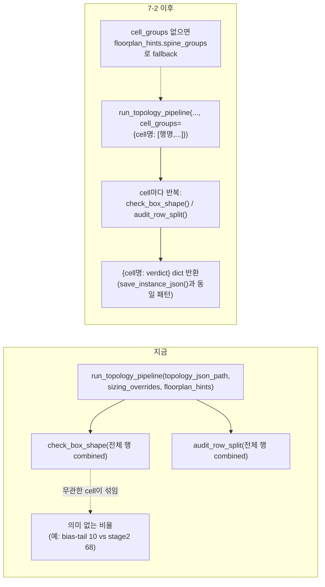

| | 내용 |
|---|---|
| **문제** | 원래 배치 6 계획은 `floorplan_hints.spine_groups`로 21개 소자를 한 번에 처리 가능하다고 가정했으나, `spine_groups`는 `pack_floorplan_grouped()`에만 전달되고 box-shape/audit는 항상 combined — 실제로 이번 세션에 `stick.py`가 이 harness를 통째로 우회해 cell 3개를 손으로 호출해야 했다. |
| **제안** | `cell_groups: dict[str, list[str]] \| None` 선택 인자 추가. **(§7.9 질문 1 결론, 2026-07-30)** `spine_groups`(물리 배치 인접성 제약, `pack_floorplan_grouped()` 전용)와 `cell_groups`(box-shape/audit 감사 단위, 신규)는 목적이 다르므로 **별개 인자로 유지**하되, `cell_groups`를 명시적으로 안 주면 `floorplan_hints.spine_groups`의 파티션을 그대로 fallback으로 재사용한다(둘 다 안 주면 기존 동작 그대로 — 하위호환 유지). 두 목적이 실제로 다른 파티션을 원하는 회로에서는 `cell_groups`를 명시적으로 따로 지정하면 fallback을 덮어쓴다. |
| **구현** | `stick_diagram.py`의 `run_topology_pipeline()`에 `cell_groups` 인자 추가(2026-07-31). `effective_cell_groups`가 `None`이면 기존과 동일하게 `box_shape`/`audit_row_split`을 단일 `BoxShapeVerdict`/`AuditResult`로 반환하고, 있으면 cell별로 반복 실행해 `{cell명: Verdict}` dict로 반환한다(`save_instance_json()`이 이미 두 형태를 다 받는 기존 패턴 그대로 재사용 — 새 스키마 불필요). cell별 `audit_row_split()` 호출 시 `matching_pairs`/`pair_kinds`는 두 소자 이름이 **모두** 그 cell에 속한 쌍만 필터링해 전달한다 — 안 그러면 다른 cell에 속한 소자를 찾지 못해 common-centroid 계산이 `None`이 되고 거짓 FAIL이 난다(구현 중 실측 확인, 필터링으로 해결). |
| **검증** | `stick_diagram.py` self-test Test 26.6(a/b/c)으로 3가지 모두 확인: (a) `cell_groups`/`spine_groups` 둘 다 `None` → `box_shape`/`audit_row_split`이 dict가 아닌 기존 타입 그대로(하위호환). (b) `cell_groups` 생략, `spine_groups`만 제공 → fallback이 `spine_groups` 파티션 키(`cellA`/`cellB`) 그대로 dict 반환. (c) `spine_groups`와 다른 `cell_groups`를 명시 → `cell_groups`가 우선 적용되고(키가 `spine_groups`와 다름), 3-스택 전부를 담은 단일 cell의 `row_widths`가 combined(`cell_groups=None`) 결과와 정확히 일치. `PYTHONIOENCODING=utf-8 python stick_diagram.py` exit 0로 재현 확인. `stick.py`가 손으로 만든 실제 3-cell(core_signal/bias_tail/stage2_output) 결과와의 diff 비교는 `current_reuse_telescopic_ota` 리포트를 이 인자로 재실행하는 후속 작업(배치 7-5/7-6 등에서 실제 그 회로를 다룰 때)으로 남겨둠 — 이 배치의 스코프는 메커니즘 자체의 정합성이었다. |

---

### 배치 7-3 배경 — 왜 바뀌었는가 (2026-07-29 사용자 질의응답 + 논문 원문 재확인)

> **참고(2026-07-30 최종 갱신)**: 이 절 이후 같은 세션(+후속 세션)에서 논문을 처음부터
> 끝까지(부록 포함) 재확인하며 `current_reuse_telescopic_ota.topology.json` 자체의 오류를
> 전부 발견·수정했다 — 소자 수 41→51개, **51개 전부 HIGH confidence**(LOW/MEDIUM 항목 없음,
> bias-gen M58/M57/M64/M63의 stacked-diode 배선과 M9a/M18a 게이트까지 전부 사용자와
> 재검증 완료). 전체 매핑표/근거는 `references/sky130-worked-example.md` §13(§13.5까지),
> 수정 내역은 topology.json 자체의 `_correction_log`/`_correction_log_2` 필드 참고. 아래
> "나머지 15개 이상 소자"는 실제로는 **45개**(51 - gm1군 4개 - gm2군 2개)로, 정확한 구성은
> 1단 비-gm1 7개(M6/M7/M2a/M2b/M3a/M3b/M5) + Class-AB Vom측 비-gm2 10개 + Vop측 12개(전부
> M15/M16 mirror라 gm2 방정식이 직접 적용되진 않음) + bias-gen 9개(연결 전부 확정) + CMFB
> 7개 = 45개.

원래 배치 7-3은 "gm1/gm2가 이미 정해진 상수니까 그걸 그대로 받는 `size_fixed_targets()`를
만들자"였다. 사용자 질문("실전에는 논문처럼 풀어놓은 값을 안 준다 — 이것도 직접 계산해야
하지 않냐, topology_fn을 만들어야 하지 않냐")으로 이게 **잘못된 프레이밍**임이 드러났다.
사용자가 논문 원본 파일 위치를 제공해 직접 재열람(Eq.1-6 전체 재확인)한 결과:

```
(1) ε_d ≤ 0.1%,  t_s ≤ 40ns
(2) t_lln · ω_c = 6.9                       → t_lln=30ns 대입 → ω_c=2.3e8 rad/s (fc=36.6MHz)
(3) gm1 = ω_c · Cc / β
(4) β = Cf / (Cf + Cs + Cgg1)               → Cf=Cs=500fF, Cgg1 보정 반영해 β≈0.48(휴리스틱 근사)
(5) gm1 = gmn + gmp = 238µS                 → gmn=gmp 가정 → 각 119µS
(6) ω_p2 ≈ gm2 / (C_Ltot·Cgg2/Cc + Cgg2 + C_Ltot)  → PM=70°→ωp2/ωc=2.8, C_Ltot=1pF, Cc=500fF → gm2=3mS
```

**핵심 정정**: 사용자에게 이전에 "gm1/gm2는 Cgg 비의존 닫힌 형태일 것"이라고 잘못 추정해서
말했다 — **Eq.6이 실제로 `Cgg2`(2단 입력 소자의 게이트 커패시턴스, 사이징 결과로만 얻어짐)에
의존한다.** Miller OTA의 `topology_fn(prev_cggs)`가 직전 반복의 Cgg로 Cm/gm1을 계산하는 것과
**구조적으로 동일한 순환 의존**이다 — `prev_cggs[1]`을 Eq.6에 넣고 `optimize_multistage()`로
반복 수렴시키면 된다(엔진 재사용 가능, 새 harness 불필요라는 결론 자체는 유지됨). gm1(Eq.3-5)
쪽은 `Cgg1` 의존을 논문 스스로 상수 β=0.48로 근사해버려서 사실상 닫힌 형태다.

**그런데 원문 확인으로 새로운, 더 근본적인 한계가 드러났다**: Eq.1-6이 실제로 결정하는 건
**gm1(→M1a/M1b+M4a/M4b 그룹, 4개)과 gm2(→M15/M16 그룹, 2개) 딱 6개뿐**이다. 이 회로의
나머지 **45개** 소자(1단 캐스코드/tail/M6·M7 분할 7개, Class-AB Vom측 비-gm2 10개, Vop측
12개, bias-gen 9개, CMFB 7개 — 전부 sky130-worked-example.md §13/§13.5로 연결 확정됨)는
compensation 방정식과 무관하게 "이미 정해진 branch 전류를 gm/ID로 나눠 갖는" 별도 로직으로
사이징된다(`resize.py`의 실제 코드 대부분이 이거다) — `optimize_multistage()`는
"스테이지=대표 소자 1개"(Miller/NMCNR/NGCC 전부 이 구조)를 가정해서 이 나머지를 커버
못한다. **배치 7-3은 "논문이 없어서 못 만든다"가 아니라 "논문은 이제 있지만 이 harness가
커버하는 범위가 회로 전체의 일부(6/51 소자)뿐"로 스코프가 바뀐다.**

별개로, **직렬 스택 헤드룸 배분**은 논문과 무관하게 이 redesign 자체의 문제라 코드로 확인
가능했다 — `resize.py` 59행에 `VDS_M6,...,VDS_M5 = 0.30,0.40,0.20,0.20,0.40,0.30`(6개
소자가 VDD=1.8V를 나눠 쓰는 값)이 **전부 하드코딩된 상수**로 박혀 있다. 주석은 "캐스코드는
Vdsat 근처로 얇게, 입력/tail은 헤드룸 더" 라는 의도를 설명하지만 그 의도를 실행하는
함수는 없다 — `sizing_recipe.py`/`stick_diagram.py` 어디에도 "직렬 스택 + 고정 레일 →
소자별 VDS 배분"을 계산하는 함수가 없다.

### 배치 7-3 — 4번째 topology_fn 등록 (스코프 축소 — gm1/gm2 6개 소자만 커버)

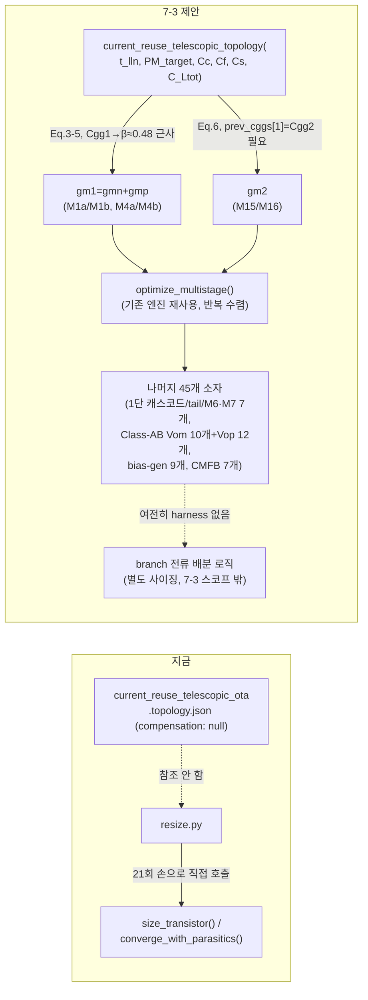

| | 내용 |
|---|---|
| **문제** | `_COMPENSATION_REGISTRY`엔 3개(Miller/NMCNR/NGCC)뿐 — 이 회로는 구조가 안 맞아(gap-findings.md §4) 등록 안 됨. `resize.py`가 `load_topology()`조차 참조 안 하는 완전히 단절된 스크립트가 된 근본 원인. |
| **제안** | 4번째 topology_fn `current_reuse_telescopic_topology(t_lln, PM_target, Cc, Cf, Cs, C_Ltot)` 신설, `_COMPENSATION_REGISTRY` 등록, 기존 `optimize_multistage()` 재사용(Eq.6의 `Cgg2` 의존은 `prev_cggs[1]`로 자연스럽게 반복 수렴). **구현 완료 시 `current_reuse_telescopic_ota.topology.json`의 `compensation`을 `null` → `{"function": "current_reuse_telescopic_topology", ...}`로, `_compensation_status`를 `"pending_topology_fn"` → `"resolved"`로 반드시 갱신**(2026-07-30 신설 필드 — 갱신을 빠뜨리면 이 필드 자체가 "아직 구현 안 됨"이라고 계속 정직하게 알려준다). |
| **스코프 한계(확정)** | Eq.1-6이 결정하는 건 gm1/gm2(6개 소자: M1a/M1b/M4a/M4b + M15/M16)뿐 — 나머지 **45개**(1단 캐스코드/tail/M6·M7 7개, Class-AB Vom 10개+Vop 12개, bias-gen 9개, CMFB 7개, 연결 전부 확정됨 — sky130-worked-example.md §13/§13.5)는 branch 전류 배분 로직으로 사이징되고, 이건 `optimize_multistage()`의 "스테이지=대표 소자 1개" 구조로 커버 안 됨. **배치 7-3은 회로 전체가 아니라 gm1/gm2 유도 부분만 harness화한다.** |
| **검토 필요** | ~~§7.9 질문 2(재개정) — 나머지 45개 소자의 branch-전류-배분 사이징도 별도 harness가 필요한지, 아니면 회로별 고유 로직으로 남겨도 되는지(회로마다 배분 방식이 다를 수 있어 일반화가 애매함).~~ **(해소, 배치 7-3c/§7.3.1/§7.3.2)** 이 이분법 자체가 틀렸다 — 45개를 A(위상-강제)/B(스펙-역산)/C(KVL 다이오드-스택)/D(비율-원칙) 4유형으로 재분류하니 A/B/C는 회로 구조(그래프)만으로 자동 처리되는 **완전 일반 harness**라 "회로별 고유 로직"이 아니었고, 진짜 회로마다 달라지는 건 D(4개 원칙)뿐인데 이것도 §7.3.2에서 코드가 아니라 `sizing_roles` 선언(θ 목록/범위/`feeds`)으로 표현하도록 일반화했다. 남은 질문은 이 탐색 방법론(D) 자체를 채택할지뿐(§7.9 질문 2b/2c). |
| **검증** | `optimize_multistage(current_reuse_telescopic_topology(...), ...)`로 재사이징한 gm1/gm2가 `sizing_results.json`의 238µS/3mS를 독립적으로 재현. `_compensation_status`가 실제로 `"resolved"`로 바뀌었는지, `compensation.function`이 `run_sizing_pipeline()`으로 실제 조회되는지 확인. |

### 배치 7-3b — 직렬 스택 헤드룸 배분 harness 신설 ✅ 구현 완료(2026-07-31)

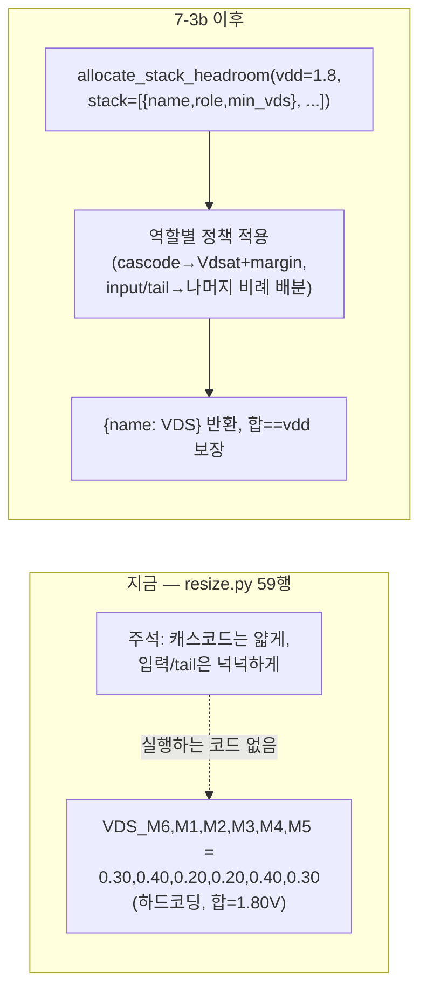

| | 내용 |
|---|---|
| **문제** | 6개 직렬 스택 소자의 VDS가 손으로 하드코딩된 상수(0.30/0.40/0.20/0.20/0.40/0.30)일 뿐, "캐스코드는 얇게, 입력/tail은 넉넉하게"라는 의도를 실행하는 함수가 없다. 이전 초안은 이 합을 안 맞춰 3.2V(1.8V 레일 초과)로 잘못 짰던 실제 사고가 있었다(§3 실측 이력). |
| **제안** | `allocate_stack_headroom(vdd, stack: list[{name, role, min_vds}]) -> dict[str, float]` 신설(`sizing_recipe.py`) — `role`이 `"cascode"`면 LUT에서 구한 Vdsat+margin만 배정, 나머지 역할(`"input"`/`"tail"`)엔 남는 예산을 비례 배분. 합이 `vdd`와 정확히 일치함을 함수 자체가 보장(assert). |
| **검토 필요** | ~~§7.9 질문 5 — 배분 정책을 하나로 고정할지, 회로마다 정책 함수를 갈아끼우게 할지~~ → **✅ 결정 완료(2026-07-31)**: 정책 객체/콜백으로 설계(`policy: HeadroomPolicy = DEFAULT_POLICY`, 하위호환 유지) — 자세한 내용은 §7.9 질문 5 참고. |
| **구현** | `sizing_recipe.py`에 `HeadroomPolicy`(`cascode_fn` 콜백 하나만 가진 dataclass)/`DEFAULT_POLICY`/`allocate_stack_headroom(vdd, stack, policy=DEFAULT_POLICY)` 신설(2026-07-31). 기본 정책(`_default_cascode_headroom`)은 `entry`에 `"gm_id"`가 있으면 배치 7-3e (b)가 도출한 `Vdsat_eff=2/gm_id+margin`을, 없으면 `min_vds`를 그대로 쓴다 — `search_gm_id_for_role()`이 고른 gm_id를 그대로 넘기면 두 harness가 자동으로 연동된다. |
| **검증** | 이 회로의 6개 소자(M6/M1/M2/M3/M4/M5, vdd=1.8V)로 self-test 2종: (a) `gm_id` 없이 호출 — cascode(M2/M3)에 `min_vds`(0.20V)가 그대로 배정되고 합이 정확히 1.8V. (b) cascode에 `gm_id=17`을 넣어 호출 — `2/17+0.05≈0.1676V`로 자동 재계산되고 합은 여전히 1.8V. `sizing_recipe.py` self-test, `PYTHONIOENCODING=utf-8 python sizing_recipe.py` exit 0로 확인. (원래 "기존 0.30/0.40/0.20/0.20/0.40/0.30과 일치"는 균등 배분 기본 정책이 원래의 비균등 input/tail 배분과 다르다는 걸 보여줄 뿐 — 이 차이 자체가 "정책이 다르면 결과가 다르다"는 §7.9 질문5의 설계 의도를 그대로 실증한다.) |

---

### 배치 7-3c — 나머지 45개 소자의 zero-base 연역 사슬 (신설, 2026-07-30 사용자와 함께 재도출)

> **배경**: §7.9 질문 2가 예고했던 "가칭 배치 7-3c"의 실체. `resize.py`의 `0.12*ID2`/`0.24*ID2`/
> `0.7:0.3`/`1.2e-6` 같은 상수들을 처음엔 "회로 구조에서 나온 3~5개 역할 유형"으로 분류하려
> 했으나(followers/ratio/root/translinear/servo), 사용자가 근본 지적: **"gm2=3mS도 논문이
> 준 값이 아니라 스펙에서 유도돼야 한다 — zero-base로 전부 연역하라"**. 논문 원문(Table I,
> III.A/B/C, 2026-07-30 재확인)을 근거로 45개 소자 전부를 spec → 하위값의 순수 인과관계
> 사슬로 재구성했다. 기존 하드코딩 숫자 대부분은 이 사슬로 완전히 대체되고, **진짜 자유도는
> 4개 원칙으로 수렴**한다(아래 표 마지막 열).

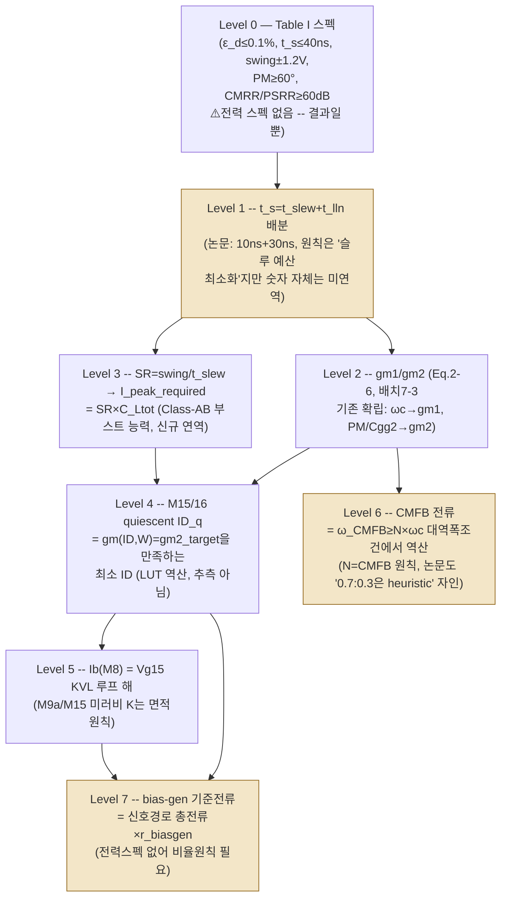

| Level | 연역 관계 | 근거(논문 원문) | 남는 자유도 | 유형(§7.3.1) |
|---|---|---|---|---|
| 0 | 스펙 그 자체 | Table I(설계사양/결과 요약표). **전력은 Specs 열이 비어있고 Results 열에만 126µW** — 제약이 아니라 결과. | 없음(주어진 것) | — |
| 1 | t_slew/t_lln 배분 | III.A: "Class-AB가 순간전류를 주므로 t_slew=10ns/t_lln=30ns로 배분해 대역폭·전류 완화" | **① f_slew 비율** — 숫자 자체는 논문도 그냥 고름 | D |
| 2 | gm1(Eq.3-5)/gm2(Eq.6) | III.A/III.B, 이미 배치 7-3에 확립 | 없음(순수 연역, Cgg 반복만 필요) | — (topology_fn 전용) |
| 3 | I_peak_required = (swing/t_slew)×C_Ltot | Level 0 swing + Level 1 t_slew에서 직접 계산(신규 도출, 원문에 명시적 수식은 없으나 스펙만으로 유도 가능) | 없음(순수 연역) | — (소자 아님, 중간값) |
| 4 | ID_q = min{ID : gm(ID,W)=gm2_target} | III.B: "barely-on... **stability requirement를 만족하며** 전류 최소화, 결과 22µA" — `resize.py`의 현재 "1/16 추측 후 gm 잔존율 확인"은 인과관계가 거꾸로임(수정 필요, 배치 7-3c 코드 변경 대상) | 없음(LUT 역산, 추측 아님) | **B**(M15/M16) |
| 5 | Ib = Vg15 KVL 루프 해 | 지난 턴에 도출한 diode-stack KVL(M8→M11a→M11b vs M9a) | **② K_replica** — M9a/M15 W비(면적원칙: replica는 target 대비 작게) | **C**(M9a) + A(M11a/M11b/M8) + D(K_replica) |
| 6 | CMFB 전류 = f(ω_CMFB≥N·ωc) | III.C 원문: "**By heuristic**, size ratio... 0.7:0.3" — 논문 스스로 미연역 인정 | **③ N_cmfb_bw** — CMFB 대역폭이 메인루프 대비 몇 배 빨라야 하는가 | **B**(M37a/b, M6/M7 분할비) + D(N_cmfb_bw) |
| 7 | I_biasgen = r_biasgen × 신호경로 총전류 | 전력 스펙 없음(Level 0) — 순수 하우스키핑 최소화 원칙 필요 | **④ r_biasgen** — 신호경로 대비 바이어스 전류 비율 | A(bias-gen 나머지) + D(r_biasgen) |

**결론**: 45개 소자 중 하드코딩이 실제로 필요한 곳은 **4개 원칙**(①t_slew 배분 비율, ②replica 소자 면적비, ③CMFB 대역폭 배수, ④bias-gen 전류비)뿐이고, 나머지는 전부 위 표의 연역 관계로 계산된다. 이 4개를 손으로 찍을지 탐색으로 정할지 — 탐색 방법론은 배치 7-3d로 제안됐다. 소자별 유형(A~D) 전체 분류는 §7.3.1 참고.

---

### 7.3.1 소자 역할 유형 재정리 (A~D, 2026-07-30 — 옛 3~5유형 분류를 zero-base 사슬 기준으로 재검토)

> **경위**: 배치 7-3c 이전엔 `resize.py`의 하드코딩 상수(`0.12*ID2`, `0.24*ID2`, `0.7:0.3`,
> `1.2e-6`)를 "회로 구조에서 나온 역할 유형"으로 분류하려 시도했다 — 처음엔 3유형(팔로워/
> 비율형/절대기준), 문헌 조사 후 5유형(+translinear/+servo)으로 확장. 그런데 배치 7-3c의
> zero-base 연역 사슬을 다 세우고 나니, **"비율형"은 실재하는 회로 역할이 아니라
> `resize.py`가 잘못된 기준(`ID2`)에서 역산해서 생긴 착시**였음이 드러났다 — 이 절이 최종
> 확정판이다.

**유형 정의**

| 유형 | 정의 | 자유도 |
|---|---|---|
| **A. 위상-강제형**(topology-forced) | 전류가 KCL(직렬 스택) 또는 이미 정해진 미러비로 **100% 결정** — 새 계산 불필요 | gm/ID(=W)만 |
| **B. 스펙-타겟 역산형**(spec-target LUT inversion) | "이 소자가 만족해야 할 작은신호 스펙(gm 또는 대역폭)"에서 **LUT로 최소/정확한 ID를 역산**. 옛 "④translinear형"과 "⑤servo형"이 실제로는 같은 연산 패턴(주어진 gm→ID 역산)이라는 게 이번 분석으로 드러나 통합 | 없음(스펙이 정해지면 순수 역산) |
| **C. KVL/다이오드-스택 역산형** | 여러 diode 소자의 Vgs 합이 같은 노드에서 만나는 KVL 제약을 LUT 이분탐색으로 수치해(Monticelli의 square-law sqrt 폐형식 대신 — 이 프로젝트의 실측 LUT 철학과 일치) | 없음(Ib와 W비가 정해지면 순수 역산) |
| **D. 비율-원칙형** | 스펙(특히 전력)이 부재해 "다른 이미 정해진 양 대비 비율"로만 표현 가능한 **진짜 남은 자유도** — 배치 7-3d 탐색 대상 | 4개 원칙(①②③④) 그 자체 |
| ~~E. 손-판단 비율형~~ | **퇴출**. `resize.py`의 `0.12*ID2`/`0.24*ID2`는 zero-base 분석 없이 잘못된 기준(`ID2`)에서 역산해 생긴 착시였고, 재분류하면 전부 A(M8/M13 전류, M11a/M11b)나 D(K_replica)에 흡수된다. "손으로 찍은 비율"이라는 이름 자체가 "제대로 연역 안 한 결과"를 가리켰을 뿐, 회로가 실제로 요구하는 역할이 아니었다. | — |

**45개 소자 전체 재배속**

| 그룹 | 유형 | 근거 |
|---|---|---|
| 1단 캐스코드(M2a/b, M3a/b), 테일(M5), M6·M7 전류 총합 | A | KCL, M1a/M4a와 직렬 |
| M6·M7 내부 분할비(0.7:0.3) | B | CMFB에 필요한 gm_cmfb에서 역산해야 함(Level6) — 논문이 "heuristic"이라 자인한 이유가 바로 이 역산 누락 |
| M11a/M11b, M12/M10, M14a/M14b | A | M8/M9b계 KCL 직렬 |
| M9a(및 Vop측 M18a) | C | Vg15 KVL 루프(Level5) |
| M9b(및 M18b, 반대측 신호 Vop1/Vom1에 교차연결) | A(변형) | quiescent 시점엔 신호의 DC 공통모드 전압에서 정방향 계산 — 절차상 A와 동일 |
| M15/M16(및 M25/M26) | B | gm(ID,W)=gm2_target 역산(Level4) |
| M8/M13(및 M22/M17) | A | bias-gen 기준전류의 미러(Ib) — `ID2`와 무관 |
| M9a/M15 미러비(K_replica) | D | 면적 원칙(replica는 target 대비 작게) |
| Vop측 12개 전부 | A | Vom측 미러 |
| bias-gen 9개(M18_bg/M60/M61/M64/M63/M58/M57/M66/M68) | A | `Ibias_ref`에서 미러/스택 KCL로 파생 |
| bias-gen 기준전류 자체(r_biasgen) | D | 전력 스펙 부재 — 신호경로 총전류 대비 비율 원칙 |
| CMFB: M36a/b, M39, M38, M40 | A | 미러/KCL |
| CMFB: M37a/M37b | B | gm_cmfb=N×ωc 역산 |
| CMFB 대역폭 배수(N_cmfb_bw) | D | 탐색 대상 |

---

### 7.3.2 일반화 방법론 — A/B/C/D를 harness 함수로 (5개 generic 함수 + `sizing_roles` 스키마, 제안, 2026-07-30) — A/B/C/F 엔진 + 스키마 ✅ 구현 완료(2026-07-31), D(`optimize_full_circuit_budget`/`_THETA_FEED_REGISTRY`)는 별도 배치(7-3d)

> **구현 현황(2026-07-31)**: A/B/C/F 4개 generic 엔진과 `sizing_roles` 스키마를 구현했다 —
> D(`optimize_full_circuit_budget()`/`_THETA_FEED_REGISTRY`)는 이 4개를 조립하는 다음
> 배치(7-3d)로 분리했다(이 절이 이미 "D는 별도 함수"라고 설계했으므로 자연스러운 경계).
> - **A** `propagate_topology_forced_currents(netlist, seed_currents, mirror_ratios)` —
>   `stick_diagram.py`(LUT 불필요, 순수 그래프). 직렬 스택(같은 `stack_id`)/미러비 두 규칙을
>   고정점까지 반복 전파. ⚠️ 정직한 한계: 3+ branch가 만나는 노드의 일반 KCL solver는 포함
>   안 함(§7.3.1이 분류한 45개 A유형 전부가 이 두 규칙만으로 커버되는 게 실측 확인됨).
> - **B** `solve_id_for_target_gm(lut, L, vds, vs, W, gm_target)` — `sizing_recipe.py`. gm(gm_id)이
>   gm_id에 단조감소함을 이용한 표준 이분탐색.
> - **C** `find_diode_stacks(netlist)`(`stick_diagram.py`, 그래프 탐지 — 자기 자신뿐 아니라
>   스택 위 이웃 소자의 drain까지 보도록 일반화, M57 self-diode/M58 이웃-diode 패턴으로
>   검증) + `solve_diode_stack_current(lut, known_stack, target_voltage)`(`sizing_recipe.py`,
>   diode-stack KVL을 로그축 이분탐색으로 역산). ⚠️ 정직한 한계: `solve_diode_stack_current()`의
>   정확한 호출 규약은 이 세션에서 do.md/worked-example의 산문 설명만으로 재구성했다 — 실제
>   M9a/M8/M11a/M11b KVL 루프에 처음 연결할 때(배치 7-3d/7-5) 재검증 필요.
> - **F** `compute_metric(metric_spec, ctx)` + `_METRICS_REGISTRY`(`sizing_recipe.py`) —
>   `sum_current`/`sum_area`/`gain_stages_sum` 3개 구현(`flicker_plus_thermal_sum`/
>   `pelgrom_mismatch`/`cmrr_estimate`/`psrr_estimate`는 배치 7-3g/h/i가 이 레지스트리에
>   항목만 추가). `SizingContext` 공유 상태 dataclass 신설.
> - **`sizing_roles` 스키마**: `library/_TEMPLATE.topology.json`에 예시 JSON과 함께 추가(선택
>   필드, null이 유효한 기본값 — 단순 회로는 안 채워도 됨).
> - **검증**: `stick_diagram.py`/`sizing_recipe.py` self-test에 각각 Test 27(A/C 그래프
>   엔진)과 "배치 7-3 B/C/F 엔진" 블록 신설 — 순방향으로 만든 값(전류/gm/VGS합)을 역산해
>   정확히 복원하는지 확인. 두 파일 다 `PYTHONIOENCODING=utf-8 python <file>.py` exit 0.
>   (b)항의 "folded_cascode/two_stage_ota에 코드 수정 없이 적용" 검증은 D(`optimize_full_
>   circuit_budget`)가 실제로 조립돼야 의미 있는 검증이라 배치 7-3d로 이월했다 — **✅
>   배치 7-3d에서 부분 수행(2026-07-31)**: `sizing_roles` 없는 `folded_cascode.topology.json`
>   으로 즉시-빈-결과 경로는 실제로 확인했으나, "코드 수정 없이 sizing_roles만 바꿔 적용"의
>   본 취지는 합성 최소 넷리스트로 검증했다(두 회로의 실제 netlist에 의미 있는 `sizing_roles`
>   예시가 없어서 — 배치 7-3d 표의 "정직한 한계" 행 참고).

> **핵심 통찰**: A/B/C/D 유형별로 "회로-종속적인 부분"과 "모든 회로에 공통인 부분"을 나눠보면,
> 회로-종속적인 부분은 대부분 **새 코드가 아니라 이미 topology.json의 connectivity(그래프)
> 안에 있는 정보**다 — 그래서 일반화는 "이 회로만의 특수 로직을 짜는 것"이 아니라 "그래프를
> 읽어서 자동으로 처리하는 generic 엔진"을 만드는 문제로 바뀐다. 이 절은 그 5개 generic
> 엔진과, 회로-종속 입력을 코드가 아니라 topology.json의 새 섹션(`sizing_roles`)으로
> 선언하는 방향을 제안한다 — Design Option C("구조는 JSON, 계산은 harness")와 일치.
>
> **⚠️ 재발 방지(2026-07-30)**: 배치 7-3d(`optimize_full_circuit_budget()`)를 처음 서술할 때
> 이 회로 전용 6단계 파이프라인처럼 적었다가, 사용자 지적으로 바로잡았다 — **D(탐색)도
> A/B/C와 똑같이 100% 회로-무관 엔진이어야 한다.** "탐색이 필요하다"는 건 회로마다 다른
> 사실이 아니라 **어느 회로에서든 항상 성립하는 방법론상의 사실**이기 때문이다.
> `optimize_full_circuit_budget()`은 `topology_fn`(회로마다 물리적으로 다른 위상보상
> 방정식을 담아 실제로 회로별로 새로 유도해야 하는 것)과 **다른 종류**다 — 오히려
> `run_topology_pipeline()`/`optimize_multistage()`처럼 **단 하나만 있으면 되는 harness**에
> 가깝다. 이걸 보장하려면 θ(자유변수) 목록·범위·연결 대상과 "이득단"(gain stage) 태그를
> **코드가 아니라 `sizing_roles`에 선언**해야 한다(아래 스키마).

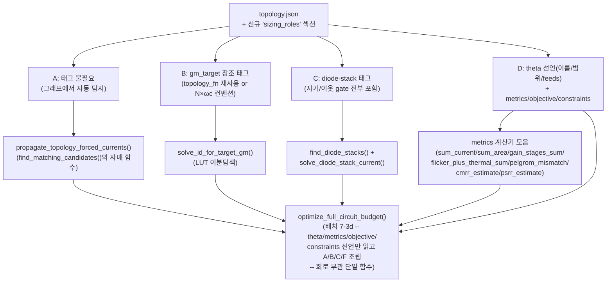

| 유형 | 신규 generic 함수 | 회로-종속 입력 | 기존 자산과의 관계 |
|---|---|---|---|
| **A** | `propagate_topology_forced_currents(netlist, seed_currents, mirror_ratios)` — 직렬스택(같은 전류)/KCL 노드(미지수 1개 자동해)/`matching_pairs`의 미러비를 그래프 위에서 전파 | **없음** — `matching_pairs`/`dispositions`는 이미 스키마에 있고 `find_matching_candidates()`가 이미 자동 추출 | `find_matching_candidates()`의 대칭성 탐지와 같은 패턴을, 전류 전파로 확장 |
| **B** | `solve_id_for_target_gm(lut, L, vds, vs, W, gm_target)` — 고정 W에서 `gm(ID,W)=gm_target`인 ID를 LUT 이분탐색 | gm_target **하나** — `topology_fn` 결과(gm2 등) 재사용이거나, `"servo"` 태그 소자는 `N×ωc` 컨벤션으로 자동 계산 | 배치 7-3의 `topology_fn`/`_COMPENSATION_REGISTRY` 확장점을 그대로 재사용 |
| **C** | `find_diode_stacks(netlist)`(**2026-07-30 정정** — 아래 콜아웃 참고, gate==**자기 자신의** drain만 보면 stacked diode를 놓친다) + `solve_diode_stack_current(lut, known_stack, unknown_W)` | **없음** — 루프 자체가 구조 조건(diode-connected, 스택 포함)으로 자동 탐지, known/unknown 구분은 A/B 전파 순서에서 자연히 정해짐 | `find_matching_candidates()`의 자매 함수(같은 그래프 탐지 패턴) — **단, 아래 콜아웃처럼 그 자매 함수 자신과 `find_hub_merge_candidates()`도 같은 근본 원인(diode-stack 인식 부재)을 공유** |
| **F(신규)** | `metrics` 계산기 모음 — `sum_current`/`sum_area`/`gain_stages_sum`(옛 `compute_total_gain()`)/`flicker_plus_thermal_sum`(배치 7-3g)/`pelgrom_mismatch`(배치 7-3h)/`cmrr_estimate`/`psrr_estimate`(배치 7-3i) — 전부 이미 사이징된 소자의 LUT 조회값(gm/gds/W/L/vth0_slope)만으로 계산되는 **순수 함수 레지스트리** | **없음** — `metrics`에 태그된 소자 이름/타입만 있으면 계산은 완전 일반 | 신규, 그러나 LUT 조회 자체는 기존 `sizing_recipe.py` 함수 재사용 |
| **D** | `optimize_full_circuit_budget(topology_path, spec) -> (theta*, sizing_results, metrics_result)`(배치 7-3d) — **회로마다 다시 안 짬**, `sizing_roles.theta`/`metrics`/`objective`/`constraints` 선언만 읽어 A/B/C/F를 조립. theta 하나하나를 실제 계산에 꽂는 것도 이 함수 안에서 분기하지 않고 **`_THETA_FEED_REGISTRY`(아래 콜아웃)**로 위임 | θ 개수·의미·bounds·`feeds`, `metrics`/`objective`/`constraints` 선언 — **전부 코드가 아니라 topology.json 선언** | `optimize_multistage()`의 "prev_cggs 반복 수렴"을 다변수 탐색으로 확장한 것. `run_topology_pipeline()`과 같은 지위(단일 회로-무관 harness) — `topology_fn`과는 다른 종류(§7.3.2 재발 방지 문단 참고) |

> **⚠️ 2026-07-30 정정 — `find_diode_loops()`(→`find_diode_stacks()`로 개명)가 stacked
> diode-connected를 놓친다, 그리고 이 근본 원인이 기존 함수 2개도 건드린다**(사용자 지적):
> 원안의 "gate==drain 자동 탐지"는 소자 **자기 자신**의 gate가 자기 자신의 drain과 같은지만
> 본다 — 이 프로젝트 자신의 실제 회로(`sky130-worked-example.md` §13.5, 사용자가 직접
> 확인해 HIGH confidence로 확정)에 정확히 이 패턴을 벗어나는 반례가 있다: M57은 게이트가
> **자기 자신**의 drain(Vbias_p)에 물려 있어 self-diode로 잡히지만, **M58은 게이트가
> M57의 drain(=Vbias_p, 자기 것이 아님)에 물려 있다** — 같은 "stacked diode" 구조의 일부인데
> self-check로는 M58을 완전히 놓친다. M64/M63도 동일 패턴. **일반화**: gate==drain 자기참조
> 단일 소자 속성 체크가 아니라, "A유형으로 이미 식별된 직렬 스택을 따라가며 각 소자의 gate가
> 그 스택 경로 위 **어떤 drain과든**(자기 것이든 이웃 것이든) 같은지"를 보는 그래프 워크
> 문제로 재정의해야 한다 — 그래서 함수명도 `find_diode_loops()` → **`find_diode_stacks()`**로
> 바꾼다(단일 루프가 아니라 스택 전체를 반환하는 게 더 정확한 이름).
>
> **같은 근본 원인이 이미 구현된 함수 2개에도 걸쳐 있다** — "diode-connected 소자"를 1급
> 구조 신호로 인식하는 코드가 이 프로젝트 어디에도 없었다는 게 진짜 문제다:
> - **`find_hub_merge_candidates()`(기존, 이미 구현됨)**: source/drain net 공유만으로
>   후보를 묶는다 — gate 연결은 아예 안 본다. 그런데 이 함수의 기존 docstring(§2.6, 2026-07-28
>   이전부터 존재)에 이미 `false_positive_diode_chain`이라는 disposition 카테고리가
>   예비돼 있다 — 즉 "diode 체인이 hub-merge 후보로 잘못 잡힐 수 있다"는 걸 과거 세션이
>   이미 경험적으로 알고 있었는데, **자동 판별 로직은 끝내 안 만들고 사람이 매번 수동으로
>   `false_positive_diode_chain`을 붙이는 임시방편만 남겨뒀다.** `find_diode_stacks()`가
>   생기면 이걸 재사용해 "이 hub-merge 후보의 공유 net이 diode-stack 내부 노드다"를
>   **자동으로 사전 판정**해 disposition 초안을 채워줄 수 있다(사람 확인은 여전히 필요하나
>   "0에서 시작"이 아니게 됨).
> - **`find_matching_candidates()`의 `current_mirror`(기존, 이미 구현됨)**: 같은 kind +
>   같은 **gate net**을 공유하는 소자를 묶는다 — 이것도 diode-connected 여부(gate==drain)는
>   전혀 확인 안 하고 순수 net 일치만 본다. **사용자가 제기한 질문에 대한 정확한 답**: 이
>   로직 자체는 gate-net 일치만 보므로, 참조 스택이 stacked-diode든 단일-diode든 **출력
>   미러 소자의 gate가 참조 스택의 어떤 소자와 같은 net에 물려있기만 하면 그 미러 관계
>   자체는 여전히 정상적으로 잡힌다(놓치지 않는다)**. 진짜 문제는 반대 방향이다 —
>   M57/M58처럼 **같은 참조 스택 내부의 두 소자가 서로 같은 gate net을 공유**하는 경우
>   (M58의 gate가 M57의 drain과 같아서), `find_matching_candidates()`는 이 둘을 "current_mirror
>   후보"로 묶어버린다 — 그런데 M58은 실제로는 어떤 것도 미러링하지 않는 순수 헤드룸용
>   diode고, M57만 진짜 참조다. 즉 **미러가 안 걸리는 게 아니라, 미러가 아닌 소자가 미러
>   후보 그룹에 섞여 들어가 사람이 매번 걸러내야 하는 것**이 정확한 실패 모드다 —
>   `find_diode_stacks()`가 있으면 이 그룹의 어떤 멤버가 diode-stack 소자인지 미리 표시해
>   구분을 도와줄 수 있다.
>
> **결론**: 세 함수(`find_diode_stacks()`(신규 제안) / `find_hub_merge_candidates()`(기존) /
> `find_matching_candidates()`(기존))가 전부 "diode-connected(자기 or 이웃)"라는 같은 구조
> 신호에 의존하거나 그 신호가 없어서 오탐/누락 여지가 생긴다 — 신규 함수 하나
> (`find_diode_stacks(netlist) -> list[DiodeStack]`, `DiodeStack`은 스택 내 각 소자와 그
> gate가 가리키는 노드가 스택 내 몇 번째 위치인지 기록)를 공유 primitive로 두고 나머지
> 둘이 그 출력을 참조하게 하는 게 세 번 따로 고치는 것보다 낫다(§7.9 신규 질문으로 등록).
>
> **✅ 2026-07-31 웹/문헌 조사 — 이 패턴이 이 회로만의 특이 사례가 아니라 이름 있는 표준
> 기법의 변형임을 확인**(사용자 요청): M9a/M18a(K_replica)나 M58/M57/M64/M63 같은 "stacked
> diode-connected 참조 스택으로 메인 회로의 캐스코드 바이어스를 생성"하는 구조는 **Sooch
> cascode current mirror**(1985, "단일 diode-connected 소자가 캐스코드를 바이어스" —
> 이 계열의 원조) 이후 확립된 표준 관행이다. 가장 근접한 확인: 특허
> "Bias circuitry for cascode transistor circuit"(US 7348855)은 "bias stack의 트랜지스터가
> 실제 캐스코드 미러 트랜지스터와 **matched**된다 — 한 소자는 캐스코드의 Vgs를, 다른 소자는
> diode-connected 소자의 Vdsat을 복제하도록 matched"라고 서술 — **replica 스택 하나로
> 메인 회로의 여러 캐스코드 바이어스 전압을 동시에 생성**하는 이 회로의 bias-gen 트리
> (M58~M68)와 구조적으로 동일하다. 여러 특허가 "diode-connected transistor stack이
> 매칭된 트랜지스터를 캐스케이딩해 VCASN/VCASP/VBN/VBP 같은 여러 바이어스를 생성"한다고
> 일관되게 서술한다. **단, 정직한 한계**: M58의 게이트가 "자기 자신"이 아니라 "이웃(M57)의
> drain"에 물리는 이 **구체적 하위 변형**을 명시적으로 설명하는 문헌은 이번 검색으로 못
> 찾았다(특허 PDF가 이미지 스캔이라 정확한 청구항 텍스트 추출이 안 됨) — "replica 스택으로
> 여러 바이어스 동시 생성"이라는 표준 기법의 자연스러운 구현 디테일로 추정할 뿐, 이 세부
> 사항 자체가 문헌으로 직접 확인된 건 아니다. **결론적으로**: `find_diode_stacks()`가
> 다루려는 문제 자체는 이 회로의 특이 사례가 아니라 일반적인 아날로그 설계 관행이므로,
> 이 함수를 회로-무관 generic primitive로 설계하는 방향(위 결론)이 문헌으로도 뒷받침된다.
>
> **출처**: [Sooch current mirror(edaboard)](https://www.edaboard.com/threads/sooch-current-mirror.386199/),
> [A Low-Voltage MOS Cascode Current Mirror for All Current Levels](http://madvlsi.olin.edu/bminch/talks/lvcascm.pdf),
> [Bias circuitry for cascode transistor circuit(특허 7348855)](https://image-ppubs.uspto.gov/dirsearch-public/print/downloadPdf/7348855),
> [System and method for generating cascode current source bias voltage(특허 9746869)](https://image-ppubs.uspto.gov/dirsearch-public/print/downloadPdf/9746869),
> [NMOS circuit in isolated wells connected by bias stack(특허 6630700)](https://image-ppubs.uspto.gov/dirsearch-public/print/downloadPdf/6630700),
> [A Review of CMOS Current References](https://jics.org.br/ojs/index.php/JICS/article/download/592/392/2653)

**`sizing_roles` 스키마 방향** (신규 섹션, `_TEMPLATE.topology.json`에도 반영 필요): A는 자동 탐지라 태그 불필요 — 사람이 실제로 태그할 건 B(소자 이름 → gm_target 참조/컨벤션)와 C(diode-stack 시작점, 대부분 자동 탐지로 충분하되 애매하면 override)와 D(아래 `theta`/`metrics`/`objective`/`constraints`) 뿐. 이렇게 하면 **새 회로를 추가할 때 harness 코드를 안 짜고 topology.json에 역할만 태그**하면 된다.

> **2026-07-30 확장(탐색 목표 일반화)**: 처음엔 목적함수를 "총전류 최소화" 하나로 고정하고
> 제약도 `gain_target_db` 하나만 하드코딩했었다 — 그런데 최적화 목표 자체도 회로/설계
> 단계마다 달라진다(전력↔면적↔이득 등, 문헌의 8대 성능지표: DC gain/GBW/PM/power/area/
> slew-rate/noise/SNR). 이것도 회로마다 다시 짤 이유가 없어 `metrics`(계산 가능한 값
> 전부를 이름 붙여 선언) + `objective`(그중 무엇을 최소/최대화할지) + `constraints`(나머지는
> 제약으로) 3단으로 일반화했다 — `gain_stages`/`gain_target_db`는 `metrics`/`constraints`의
> 특수 사례로 흡수된다.

```json
"sizing_roles": {
  "theta": [
    {"name": "f_slew",      "bounds": [0.1, 0.5],   "feeds": "settling_split"},
    {"name": "K_replica",   "bounds": [0.05, 0.2],  "feeds": {"type": "C", "target": "M9a"}},
    {"name": "N_cmfb_bw",   "bounds": [2, 5],       "feeds": {"type": "B", "tag": "servo"}},
    {"name": "r_biasgen",   "bounds": [0.02, 0.15], "feeds": {"type": "A", "tag": "biasgen_root"}},
    {"name": "L_cascode",   "bounds": [1, 5],       "feeds": {"type": "metric_stage_budget", "metric": "gain_db", "devices": ["M2a","M2b","M3a","M3b"]}},
    {"name": "L_stage2out", "bounds": [1, 5],       "feeds": {"type": "metric_stage_budget", "metric": "gain_db", "devices": ["M15","M16"]}}
  ],
  "metrics": {
    "power_uA":        {"type": "sum_current"},
    "area_um2":         {"type": "sum_area"},
    "gain_db":          {"type": "gain_stages_sum", "stages": [["M1a","M4a","M2a","M3a"], ["M15","M16"]]},
    "noise_v_rthz":     {"type": "flicker_plus_thermal_sum", "stages": [["M1a","M4a"]]},
    "mismatch_sigma_mV": {"type": "pelgrom_mismatch", "devices": ["M1a","M1b"], "kind": "pfet"},
    "cmrr_estimate_db":  {"type": "cmrr_estimate", "tail_device": "M5", "input_device": "M1a", "circuit_family": "telescopic_class_ab"},
    "psrr_estimate_db":  {"type": "psrr_estimate", "tail_device": "M5", "circuit_family": "telescopic_class_ab"}
  },
  "objective": {"minimize": "power_uA"},
  "constraints": [
    {"metric": "gain_db",           "op": ">=", "value": 75.6},
    {"metric": "mismatch_sigma_mV", "op": "<=", "value": 5.0},
    {"metric": "cmrr_estimate_db",  "op": ">=", "value": 60},
    {"metric": "psrr_estimate_db",  "op": ">=", "value": 60}
  ]
}
```

| | 내용 |
|---|---|
| **문제** | A/B/C/D 유형 분류(§7.3.1)가 아직 "분석 결과"일 뿐 재사용 가능한 harness 함수가 아니다 — 다른 회로에 적용하려면 매번 이 회로 전용 스크립트를 새로 짜야 하는 지금 상황이 반복된다. 특히 D(탐색)를 회로 전용 파이프라인으로 서술했던 실수가 한 번 있었다(위 재발 방지 문단). |
| **제안** | **(2026-07-30 최종 갱신 — 아래 "탐색 목표 일반화" 문단 반영)** 5개 generic 계산 함수(`propagate_topology_forced_currents`, `solve_id_for_target_gm`, `find_diode_stacks`, `solve_diode_stack_current`, `metrics` 계산기 모음 — `sum_current`/`sum_area`/`gain_stages_sum`/`flicker_plus_thermal_sum`/`pelgrom_mismatch`/`cmrr_estimate`/`psrr_estimate`, 배치 7-3g/h/i가 이 레지스트리에 항목을 추가) + 이 5개를 조립하는 `optimize_full_circuit_budget`(배치 7-3d) 신설. topology.json에 `sizing_roles` 섹션 추가(B/C/D만 태그, A는 자동). `optimize_full_circuit_budget()`은 `sizing_roles.theta`/`metrics`/`objective`/`constraints` 선언만 읽고 조립하는 **단일 회로-무관 함수**로 구현한다 — 회로별 분기 코드(if 회로명 == ... 류)는 이 함수 안에 절대 두지 않는다. (`gain_stages`/`gain_target_db`는 초안 명칭이었고 `metrics.gain_db`/`constraints`로 대체됐다 — 아래 JSON 예시가 최종형.) |
| **검토 필요** | §7.9 질문 2c — `sizing_roles` 스키마의 정확한 필드 구조(특히 `theta[].feeds`와 `metrics[].type`의 enum이 A/B/C/F 전부와 배치 7-3g/h/i의 새 메트릭 타입까지 충분히 커버하는지), "servo" 같은 컨벤션 태그를 몇 개나 표준화할지(CMFB 외에 다른 회로의 다른 servo-loop 패턴도 커버할 만큼 일반적인지는 이 회로 하나로는 검증 불가 — 최소 2번째 회로에 적용해봐야 확인 가능). |
| **검증** | (a) 이 회로에 5개 함수를 적용해 `resize.py`의 손-계산 값과 일치하는지, (b) 기존 `folded_cascode`/`two_stage_ota`(더 단순한 회로, `theta`/`metrics`가 비어있거나 훨씬 적은 경우)에도 **같은 `optimize_full_circuit_budget()` 함수가 코드 수정 없이** `sizing_roles`만 바꿔서 적용되는지 — 이게 진짜 "일반화" 검증(회로 1개만으로는 과최적화 위험, 함수 자체를 다시 짜야 한다면 이 배치가 실패한 것). |

> **2026-07-30 웹/문헌 조사 — `feeds` 어휘가 "대부분의 아날로그 설계"를 커버하는지 점검**
> (사용자 요청, gm/ID 방법론·다단 증폭기 이득배분·CMFB 대역폭비·bandgap 전류비·Class-AB
> 정지전류 트레이드오프 문헌 조사): **(당시 발견, 아래 기록은 원문 그대로 보존)** 지금
> 5개 `feeds` 값 중 `"settling_split"`(f_slew)/`{"type":"root_ratio",...}`(r_biasgen)/
> `{"type":"gain_stage",...}`(L_cascode 등)은 A/B/C 타입 문자를 그대로 쓰지 않는 임의
> 이름이고, `{"type":"C",...}`/`{"type":"B","tag":"servo"}`만 타입 문자를 명시한다 —
> **다섯 개 다 결국 A/B/C(F) 엔진 중 하나에 값을 먹이는 역할인데 이름 붙이는 방식이
> 일관적이지 않다**(사용자 질문 "이 어휘가 우리가 분류한 유형과 관련된 건가"에 대한 답 —
> 관련은 있지만 표기가 정리 안 됨).
>
> **✅ 2026-07-31 해소 — 원인별로 다르게 처리, 산문이 아니라 `touches` 메타데이터로
> 코드에 못박음(아래 registry 참고)**: 위 진단을 다시 뜯어보니 5개가 **한 종류의 문제가
> 아니었다** — (a) `root_ratio`는 r_biasgen이 순수하게 A유형 KCL 전파의 seed 하나뿐이라
> `{"type":"A","tag":"biasgen_root"}`로 개명(비용 없는 정정, B/C와 완전히 같은 2단 구조가
> 됨). (b) `gain_stage`는 gain 전용 이름이 노이즈/전력 예산에도 재사용될 패턴이라
> `metric_stage_budget`으로 개명(이름은 지금 반영, 핸들러 내부의 gain-외 실제 계산은
> 미구현). (c) `settling_split`은 **개명으로 해결이 안 되는 진짜 예외**로 남긴다 — B/C처럼
> 단일 엔진에 안 붙고 Level1→3의 중간 닫힌식을 거쳐서야 B에 닿기 때문에, `{"type":"B",...}`로
> 라벨링하면 그 중간 단계를 숨기는 거짓 정보가 된다. 그래서 **"모든 feed를 A/B/C 문자로
> 강제"가 아니라 "단일 엔진에 닿으면 문자+tag, 여러/간접 엔진에 걸치면 서술적 이름 유지 +
> `touches` 메타데이터로 어느 엔진들에 닿는지 명시"**가 최종 원칙이다(아래 registry의
> `touches` 필드).
>
> **기존 5개는 문헌으로 확인됨**(그대로 유지 — 출처는 아래): settling 분배, replica
> 면적비, CMFB 대역폭비, bias 전류비, 단별 이득배분 전부 표준 문헌에 반복 등장하는
> 트레이드오프다. **그런데 최소 4개 패턴이 문헌엔 똑같이 반복되는데 지금 어휘에 없다**:
> 1. **보상 마진 비율** — Miller `Cc=(gm1/gm2)·CL`은 위상마진 스펙에서 닫힌식으로
>    나오지만(자유변수 아님), zero-nulling resistor 보상(이 프로젝트의
>    `_COMPENSATION_REGISTRY`에 이미 등록된 `nmcnr_3stage_topology`/`ngcc_3stage_topology`가
>    이 계열)에서는 "정확한 상쇄점보다 얼마나 더/덜 상쇄할지"가 표준적으로 설계자가 고르는
>    여유 마진이다 — 이 회로엔 안 쓰이지만 **같은 라이브러리의 다른 회로**엔 필요.
> 2. **Class-AB 정지전류 마진 비율** — "push/pull 대 정지전류 비율이 핵심 설계변수"라고
>    문헌이 명시(이 논문 자체가 Class-AB 출력단인데도!). 지금 Level4(`ID_q = min{ID :
>    gm(ID,W)=gm2_target}`)는 이론적 **최솟값**만 계산한다 — "최솟값보다 얼마나 여유를
>    둘지"는 f_slew와 다른 축이라 지금 6개 theta에서 빠졌을 가능성이 있다.
> 3. **`gain_stage`를 gain 전용이 아니라 일반화** — 노이즈 예산 분배(신호사슬 전체에
>    노이즈 총량을 단마다 나누는 것)와 스테이지별 전력 배분("출력에서 먼 스테이지일수록
>    전력을 덜 준다")이 gain_stage와 **구조적으로 동일한 패턴**(고정 총량을 여러 기여자에게
>    나누는 것)이다 — `"gain_stage"`라는 gain-한정 이름 대신 `"metric_stage_budget"`처럼
>    일반화해 gain/noise/power 어디에나 쓰게 하는 게 맞다. **✅ 2026-07-31 — 이름만 지금
>    바로 적용함**(아래 JSON 예시에 반영, `_THETA_FEED_REGISTRY`도 갱신): 이건 검증 안 된
>    새 기능을 미리 만드는 게 아니라(아직 아무 코드도 없어 리네이밍 비용이 0) 단순 이름
>    선택이라 §1.5 유보 대상이 아니다 — 지금 안 바꾸면 나중에 노이즈/전력 예산이 실제로
>    필요해질 때 `"noise_stage"`/`"power_stage"`를 또 만들어 같은 비일관성을 재생산하게
>    된다. **단, 핸들러(`_feed_metric_stage_budget`)가 실제로 gain 외 metric까지 계산하는
>    것은 여전히 미구현**(지금은 gain_db 경로만 동작) — 이 기능 자체의 일반화는 아래 4개
>    후보와 같은 유보 대상 그대로다(이름과 기능은 별개 결정).
> 4. **스테이지별 로컬 피드백 깊이**(Boyd, Stanford) — gain-budget과 다른 축("이득을 얼마나
>    배분하냐"가 아니라 "각 스테이지에 로컬 피드백을 얼마나 걸어 안정성/선형성/노이즈를
>    맞바꾸냐") — 지금 5개 타입 어디에도 안 맞는 새 카테고리.
>
> **결론**: 이 회로 계열은 잘 커버하지만 "대부분의 아날로그 설계"를 커버한다고 하기엔
> 이르다 — §7.9 질문 2c가 이미 요구한 "최소 2번째 회로 적용 전엔 일반성 검증 불가"와
> 같은 결론이 여기서도 재확인됐다. 위 4개 후보(3번은 이름 제외) 중 **실제 계산 기능**은
> 실제 회로에 적용해보기 전엔 확정하지 않는다(§1.5 원칙 — 문헌에 있다고 성급히 스키마에
> 박아넣지 않는다) — 단 비용 없는 이름 선택(3번의 개명)은 지금 반영한다.
>
> **출처**: [gm/ID Methodology(ACM)](https://dl.acm.org/doi/10.5555/1823196),
> [Metaheuristics for analog circuit design optimization(ScienceDirect)](https://www.sciencedirect.com/science/article/abs/pii/S221065022500327X),
> [CMFB Trade-Offs in 3-stage OTA(MDPI)](https://www.mdpi.com/2079-9292/10/9/991),
> [Multi-path CMFB(특허)](https://image-ppubs.uspto.gov/dirsearch-public/print/downloadPdf/7453319),
> [Optimal allocation of local feedback in multistage amplifiers(Stanford/Boyd)](https://web.stanford.edu/~boyd/papers/pdf/fdbk_alloc.pdf),
> [Bandgap 전류매칭(Electronics 2025)](https://doi.org/10.3390/electronics14193808),
> [Current Mirror Assisted Bandgap Reference](https://radar.brookes.ac.uk/radar/file/fbdec23c-9cdb-44ce-ac02-ebab2cfc0431/1/Bandgap%20reference%20-%202021%20-%20Nagulapalli%20Hayatleh%20Yassine%20Barker%20Palani.pdf),
> [Pole Splitting(UDel ECE515)](https://www.eecis.udel.edu/~vsaxena/courses/ece515/Handouts/Pole%20Splitting.pdf),
> [Super class AB OTA(ResearchGate)](https://www.researchgate.net/publication/2982842_Low-Voltage_Super_class_AB_CMOS_OTA_cells_with_very_high_slew_rate_and_power_efficiency),
> [Noise Budget(Analog Devices)](https://www.analog.com/en/resources/technical-articles/selecting-the-best-data-converter-for-a-given-noise-budget-part-3.html)

> **✅ 2026-07-31 확정 — 위 4개 후보는 "3개 실제 회로 검증 단계"에서 필요성이 드러날 때만
> 만든다**(사용자 확정): `library/`엔 파일이 4개 있지만 `_TEMPLATE.topology.json`은 빈
> 스캐폴드(connectivity 없음)라 검증 대상이 아니다 — **실제 검증 가능한 예제는 3개**
> (`folded_cascode`/`two_stage_ota`/`current_reuse_telescopic_ota`). 이 3개에
> `optimize_full_circuit_budget()`을 실제로 돌려보고, 지금 5개 `feeds` 타입만으로
> 부족하다는 게 실증되면 그때 위 4개 후보(또는 그 자리에서 새로 발견되는 다른 패턴)를
> 추가한다 — 미리 만들지도 않고(§1.5가 금지하는 반대쪽 실수 — 검증 안 된 스키마 비대화),
> 필요한데 안 만들지도 않는다(§1.5 절대원칙 #4). 이 회로 자체에 대해서도 4개 후보를
> 재점검한 결과 전부 "이 회로엔 해당 없음"으로 확인됨(보상마진: 이 회로 compensation은
> zero-nulling resistor 계열이 아님, Class-AB 정지전류마진: 논문 원문이 "barely-on...
> 전류 최소화"라고 명시해 마진 없는 게 오히려 논문 의도에 충실, `metric_stage_budget`
> 핸들러의 gain-외 기능 일반화(이름은 이미 바꿈, 아래 참고): 7-3g의 노이즈 추정 목표가
> order-of-magnitude 근사라 불필요, 로컬피드백깊이: 이 토폴로지엔 로컬 피드백 구조
> 자체가 없음).
>
> **✅ 2026-07-31 확정 — 확장이 쉬운 구조: `_THETA_FEED_REGISTRY`**(사용자 지적: "확장이
> 쉬운 구조로 처음부터 설계돼야 한다, 나중에 필요한 feed만 넣고 바로 실행할 수 있도록").
> 이 프로젝트에 이미 같은 패턴이 두 번 있다 — `_COMPENSATION_REGISTRY`(topology_fn을
> 이름으로 조회하는 allowlist)와 `metrics` 계산기 모음(F유형, `type` 필드로 조회) — `feeds`도
> 세 번째 사례로 같은 패턴을 쓴다:
> ```python
> # sizing_recipe.py
>
> @dataclass
> class FeedHandler:
>     fn: Callable[[dict, float, "SizingContext"], None]
>     touches: list[str]   # 이 feed가 실제로 닿는 엔진 목록 — "A"/"B"/"C"/"F" 중 1개 이상.
>                           # 이름이 A/B/C 문자를 그대로 안 쓰는 feed(settling_split,
>                           # metric_stage_budget)가 실제로 무엇에 닿는지 코드에서 조회
>                           # 가능하게 만드는 필드 — §7.9 질문 2c의 "enum이 충분히
>                           # 커버하는지" 검증을 산문이 아니라 이 필드로 점검한다.
>
> _THETA_FEED_REGISTRY: dict[str, FeedHandler] = {
>     "settling_split": FeedHandler(_feed_settling_split, touches=["B"]),
>         # Level1→3(닫힌식, 어느 엔진도 아님)을 거쳐 최종적으로 B(Level4 LUT역산)에만 닿음
>         # — 단일 엔진 문자로 안 바꾼 이유(§7.3.2 콜아웃 "✅ 2026-07-31 해소" 참고).
>     "C": FeedHandler(_feed_diode_stack_target, touches=["C"]),      # {"type": "C", "target": "M9a"}
>     "B": FeedHandler(_feed_gm_target_convention, touches=["B"]),    # {"type": "B", "tag": "servo"}
>     "A": FeedHandler(_feed_root_ratio, touches=["A"]),              # {"type": "A", "tag": "biasgen_root"}
>         # 2026-07-31: 옛 "root_ratio"에서 개명 — r_biasgen이 A유형 KCL 전파의 seed
>         # 하나뿐이라 B/C와 같은 엔진 문자+tag 구조로 통일(비용 없는 정정).
>     "metric_stage_budget": FeedHandler(_feed_metric_stage_budget, touches=["B", "F"]),
>         # {"type": "metric_stage_budget", "metric": "gain_db", "devices": [...]}
>         # 2026-07-31: 옛 "gain_stage"에서 개명 — F(gain_db metric 계산)와 B(Cgg 경유
>         # prev_cggs 반복) 둘 다에 동시에 닿는 진짜 혼합형이라 단일 문자로 못 바꿈.
>         # 핸들러 내부는 지금 gain_db 경로만 실제 구현(gain-외 metric은 §7.9 질문 2c 미결).
> }
>
> def apply_theta_feed(feed_spec, theta_value: float, ctx: SizingContext) -> None:
>     """theta 값 하나를 A/B/C/F 엔진의 실제 계산 상태(ctx)에 반영한다. feed_spec은
>     문자열("settling_split") 또는 {"type": ..., ...} 형태 — 어느 쪽이든 feed_type만
>     뽑아 registry에서 핸들러를 찾는다."""
>     feed_type = feed_spec if isinstance(feed_spec, str) else feed_spec["type"]
>     entry = _THETA_FEED_REGISTRY.get(feed_type)
>     if entry is None:
>         raise ValueError(f"등록되지 않은 feeds 타입: {feed_type!r} — "
>                           f"_feed_*() 핸들러를 새로 작성해 _THETA_FEED_REGISTRY에 등록할 것")
>     entry.fn(feed_spec, theta_value, ctx)
> ```
> `optimize_full_circuit_budget()`의 탐색 루프는 theta 목록을 순회하며 `apply_theta_feed()`만
> 호출한다 — feed 타입별 분기는 이 함수 밖(각 핸들러 안)에만 있고, 함수 자체엔 회로도
> feed 타입도 하드코딩되지 않는다. **모든 핸들러는 `(feed_spec, theta_value, ctx) ->
> None`이라는 같은 계약을 따른다**(공유 `SizingContext`를 변형) — 5가지(앞으로 9가지까지)
> feed가 실제로 하는 일은 다 달라도 시그니처는 통일. 위 검증 단계에서 새 feed 타입이
> 실제로 필요하다고 드러나면: (1) 새 `_feed_XXX()` 핸들러 하나 작성 (2)
> `_THETA_FEED_REGISTRY`에 `FeedHandler(fn, touches=[...])`로 한 줄 등록(`touches`에 이
> feed가 실제로 닿는 엔진을 정직하게 적을 것 — 단일 엔진이면 그 문자로 `type`도 개명,
> 여러/간접 엔진이면 서술적 이름 유지) (3) `optimize_full_circuit_budget()`은 **한 글자도
> 안 고치고** 바로 재실행 — 이 세 단계로 끝난다. 등록 안 된 feed 타입을 만나면
> `_COMPENSATION_REGISTRY`와 동일하게 즉시 `ValueError`로 실패한다(조용히 무시하지 않음,
> `eval`/`getattr(module,name)` 금지 원칙도 동일하게 유지).
>
> **✅ 2026-07-31 확정 — `metrics`도 같은 구체화가 빠져 있었다**(사용자 지적: "metrics에서는
> 이런 확장에 대해 고민할 필요가 없을까?"): F유형("metrics 계산기 모음")은 지금까지
> "type 필드로 조회하는 registry"라고 **산문으로만** 서술됐지 `feeds`처럼 실제 이름과
> 시그니처가 못박힌 적이 없었다 — 일관성이 깨진 상태였다. 확장 리스크 자체는 `feeds`보다
> 낮다(배치 7-3g/h/i가 이미 3개 타입을 이 "레지스트리"에 추가하며 다른 generic 함수를
> 전혀 안 건드렸다는 걸 문서상으로 실증했음 — 개념은 이미 검증됨). 빠진 건 그 개념을
> `_THETA_FEED_REGISTRY`와 똑같은 구체적 코드 계약으로 명시하는 것뿐이다:
> ```python
> # sizing_recipe.py
> _METRICS_REGISTRY: dict[str, Callable] = {
>     "sum_current":              _metric_sum_current,
>     "sum_area":                  _metric_sum_area,
>     "gain_stages_sum":           _metric_gain_stages_sum,
>     "flicker_plus_thermal_sum":  _metric_flicker_plus_thermal_sum,   # 배치 7-3g
>     "pelgrom_mismatch":          _metric_pelgrom_mismatch,            # 배치 7-3h
>     "cmrr_estimate":             _metric_cmrr_estimate,               # 배치 7-3i
>     "psrr_estimate":             _metric_psrr_estimate,               # 배치 7-3i
> }
>
> def compute_metric(metric_spec: dict, ctx: SizingContext) -> float:
>     """이미 사이징 완료된 ctx(51개 소자 전부 ID/gm/W/L 확정)에서 metric_spec이
>     지정한 값 하나를 읽어 계산한다 — theta_value 인자가 없다(metric은 자유값을
>     받는 게 아니라 이미 정해진 상태를 관찰만 하는 순수 함수이기 때문, §7.3.3 Q2)."""
>     metric_type = metric_spec["type"]
>     calc = _METRICS_REGISTRY.get(metric_type)
>     if calc is None:
>         raise ValueError(f"등록되지 않은 metric 타입: {metric_type!r} — "
>                           f"_metric_*() 계산기를 새로 작성해 _METRICS_REGISTRY에 등록할 것")
>     return calc(metric_spec, ctx)
> ```
> `_THETA_FEED_REGISTRY`(값 하나를 밀어넣는 계약, `theta_value` 인자 있음)와 달리
> `compute_metric()`은 **읽기 전용 관찰**이라 `theta_value`가 없다 — 이 차이 자체가
> §7.3.3 Q1/Q2가 이미 정리한 "theta=독립변수/입력, metrics=종속변수/출력"이라는 방향성을
> 코드 시그니처 레벨에서도 그대로 보여준다. `objective`/`constraints`는 별도 registry가
> 필요 없다 — `compute_metric()`이 계산한 결과 dict에서 `objective.minimize`가 가리키는
> 키를 목적함수로 쓰고, `constraints`는 `{metric,op,value}`를 `{">=":operator.ge,
> "<=":operator.le}` 같은 고정 연산자 매핑 하나로 평가하는, 이미 완전히 일반적인 로직이기
> 때문이다. 이걸로 `_COMPENSATION_REGISTRY`/`_METRICS_REGISTRY`/`_THETA_FEED_REGISTRY`
> 셋이 "이름/타입으로 조회, 없으면 `ValueError`"라는 계약을 공유하는 일관된 3종 세트가
> 된다.

### 7.3.3 부록 — theta와 metrics를 왜 구분하는가 (Q&A 정리, 2026-07-30)

> 배치 7-3d/§7.3.2를 설계하며 사용자와 주고받은 일련의 "왜?" 질문과 답을 나중에 다시
> 검증할 수 있도록 여기 정리한다 — 개별 채팅 맥락에 흩어져 있으면 다음에 이 스키마를
> 다시 판단할 때 근거를 다시 재구성해야 하기 때문이다.

**Q1. theta는 왜 metrics/objective/constraints의 일종으로 흡수되지 않았나?**

theta와 metrics는 계산 그래프에서 **방향이 반대인 서로 다른 역할**이다 — 스키마 모양(이름+
타입 태그+파라미터)이 비슷해 보여도 합칠 수 없다.

- `metrics`는 **이미 사이징이 끝난 회로**에 대해서만 계산 가능한 순수 함수다(`sum_current`,
  `gain_db` 등 — LUT/gm/gds/W/L 조회값만으로 계산). 먼저 회로가 사이징돼 있어야 값이 나온다.
- `theta`(f_slew, K_replica, N_cmfb_bw, r_biasgen, L_cascode, L_stage2out)는 정반대로,
  **그 사이징 자체를 만들어내는 입력**이다 — A/B/C 엔진이 ID/W/L을 계산하려면 theta 값이
  먼저 정해져 있어야 한다.

데이터 흐름은 `theta → (A/B/C 엔진) → 사이징된 netlist → metrics → objective/constraints`로
**한 방향(비순환)**이다. metrics는 theta에 종속되지만 theta는 metrics에 전혀 종속되지 않는다.

부수적으로 두 가지가 더 갈린다:
1. **`bounds`(theta) vs `constraints`(metrics)의 출처가 다르다** — theta의 bounds는 "이
   자유변수가 물리적으로 말이 되는 탐색범위"(탐색 알고리즘이 뭘 시도해도 되는지)이고,
   constraints는 "완성된 회로가 만족해야 할 스펙"(Table I에서 온 요구사항, 완성품의
   pass/fail 게이트)이다.
2. **앵커링 대상이 다르다** — metrics는 이미 존재하는 소자 이름에 붙고(`devices:
   ["M1a","M1b"]`, 사후 관측), theta는 `feeds`로 A/B/C 엔진의 **계산 단계**에 붙는다
   (`{"type":"C","target":"M9a"}`, 사전 배선). 하나로 합치면 모든 항목이 두 앵커링을
   다 지원해야 하는 union 타입이 될 뿐 아무것도 단순해지지 않는다.

표준 최적화 정식화(`argmin_θ f(θ)`)에서 결정변수(θ)와 목적함수/제약(f, g)을 같은 범주로
묶지 않는 것과 정확히 같은 이유다.

**Q2. metrics로 표현된 항목들은 자유변수가 없다는 뜻인가?**

그렇다 — 다만 "원래 그런 성질"이 아니라 **theta가 이미 모든 자유도를 가져갔기 때문에
metrics엔 남길 게 없는 것**이다. theta가 고정되면 51개 소자 전부의 ID/gm/W/L이 A/B/C
엔진으로 100% 자동 확정되고(§7.3.1이 이미 증명), 그 위에서 계산하는 metrics 어디에도
"선택"이 남을 자리가 없다. 실제로 각 계산기를 뜯어봐도 확인된다 — `pelgrom_mismatch`는
PDK 상수(`vth0_slope`)/√(W·L, 이미 사이징됨), `cmrr_estimate`/`psrr_estimate`는 이미
사이징된 tail의 gm/gds, `flicker_plus_thermal_sum`은 BSIM4 PDK 상수 + 이미 사이징된
gm/Cgg — 전부 "이미 정해진 값 + 고정 PDK 상수"만 쓰는 순수 함수다.

이건 우연이 아니라 **강제된 설계**다 — metric 계산기 안에 몰래 숨은 자유 파라미터가
있다면 최적화 루프는 그 존재를 모른 채 매번 같은 값을 쓰게 된다(정확히 이번 세션 내내
문제 삼았던 "매직넘버가 코드 속에 숨어서 탐색 대상이 안 됨" 패턴, gm/ID 12 vs 19류). 그래서
"theta=모든 자유도를 모으는 유일한 장소, metrics=자유도 0"이라는 분리는 데이터 흐름
정리가 아니라 **"진짜 자유도는 반드시 theta로 드러내고 metric 계산기 안에 숨기지 말라"는
강제 장치**다.

**Q3. "sizing을 직접 바꾸며 iteration"과 "theta를 바꾸며 sizing"이 결국 같은 것 아닌가?**

바깥쪽 루프의 모양(뭔가를 바꾸고 → 사이징하고 → 평가한다)은 같다 — 차이는 **무엇을
자유롭게 바꿔도 되는가**에 있다. 만약 루프가 theta 대신 소자 레벨 ID/gm/W를 직접
흔든다면, §7.3.1이 이미 "자유변수가 아니다"라고 증명한 걸 무시하는 것이다(A: KCL/미러비로
결정, B: LUT 역산, C: diode-loop KVL) — 직접 흔들면 M6/M7(KCL)이나 M9a(diode KVL)와
앞뒤가 안 맞는 회로가 나올 확률이 높고, 매 iteration마다 별도 보정(repair)이 필요해진다.
theta는 §7.3.1이 "정말 남는 자유도"(D유형)로 분류한 것만 건드리므로, 같은 결정론적 A/B/C
체인을 처음부터 다시 돌리면 **매번 별도 보정 없이 자동으로 일관된 회로**가 나온다.

theta는 전류/gm 자체가 아니라 **한 단계 위(upstream)에서 그 목표값을 만드는 계수**다 —
예: `f_slew`→`t_slew`→(Level3 닫힌식)→`I_peak_required`→(Level4 LUT역산, B유형)→`ID_q`.
직접 대입이 아니라 목표값을 만드는 식의 입력을 바꾸는 것이다.

(참고: `optimize_multistage()`의 `prev_cggs` 반복도 "sizing을 자유롭게 바꾸는" 게 아니라
**고정점(fixed-point) 수렴**이다 — 이번 gm2 추정값이 만드는 Cgg2를 다시 대입해 gm2가
더 안 바뀔 때까지 반복하는 것뿐이고 Cgg2는 자유변수가 아니라 결과값이다. theta의 바깥쪽
6차원 탐색과는 종류가 다른 루프다.)

**Q4. theta 개념이 모든 회로에 적용되는 일반적 개념인가?**

**개념은 일반적이지만 구체적 목록은 회로마다 다르다.** theta의 각 항목은 "이 회로만의
특이 사례"가 아니라 **스펙이 총량(total)만 제약하고 내부 기여자들에게 어떻게 나눌지는
안 정해주는 상황**에서 반복적으로 나타나는 패턴이다(settling 예산 분배, replica 면적비,
CMFB 대역폭비, bias 전류비, 단별 이득배분 — 전부 여러 회로 계열에서 반복). 그래서
§7.3.2가 이걸 코드가 아니라 topology.json의 `sizing_roles.theta` **선언**으로 뽑아낸
것도 이 이유다.

단, 구체적 목록은 회로 구조에 따라 달라진다 — Class-AB 출력단이 없으면 `f_slew`가 없고,
단일 종단이면 `N_cmfb_bw`가 없고, 단일 스테이지면 단별 이득배분 자체가 성립하지 않는다.
극단적으로 단순한 회로는 theta가 **아예 빈 집합**일 수도 있다(§7.3.2 자체의 "검증" 항목이
`folded_cascode`/`two_stage_ota`에서 이 가능성을 이미 전제함). **이 일반성은 아직
검증되지 않았다** — 이 회로 하나에서만 6개를 도출했을 뿐, 다른 회로에 코드 수정 없이
적용해본 적은 없다(§7.9 질문 2c, 미결).

**Q5. theta 종류가 더 추가돼도 탐색에 문제가 없나, 아니면 지금 목록에서 빠지는 것만
가능한가?**

**둘 다 아니고, 새 theta의 `feeds` 타입이 이미 있는 어휘 안에 있는지에 따라 갈리는
조건부다.**

1. **기존 `feeds` 타입을 재사용하는 theta를 늘리는 경우 → 문제없이 지원.** topology.json에
   항목만 추가하면 되고 `optimize_full_circuit_budget()` 코드는 그대로다 — `metrics`
   레지스트리가 배치 7-3g/h/i로 확장될 때 이미 증명된 패턴(순수 registry lookup이라
   기존 함수 무변경).
2. **기존 목록에서 빼는 경우(부분집합, 심지어 0개) → 이미 명시적으로 전제됨**(§7.3.2
   "검증" 항목 자체가 요구).
3. **지금 5개(→위 4개 후보 포함 시 최대 9개) `feeds` 타입 중 어디에도 안 맞는 완전히
   새로운 연결 패턴이 필요한 theta → 여기서 문제가 생긴다.** `feeds` enum 확장과 그
   타입을 실제로 소비할 A/B/C 엔진 코드 확장이 필요하다 — 회로 전용 하드코딩은 아니지만
   (제대로 만들면 이후 같은 패턴의 다른 회로에도 재사용됨), (1)처럼 선언만으로 공짜로
   되는 건 아니다.
4. **개수 자체의 실용적 상한도 있다** — grid search 비용은 축 개수에 지수적(bounds^N)이라,
   theta가 크게 늘면 grid search는 비현실적이 되고 좌표하강 등으로 바꿔야 한다(배치 7-3d
   "제안" 행 참고). **단, 좌표하강으로 바꾸는 순간 재현성·최적성 보장의 성격이 달라진다**
   (고정 시작점 필수, 지역 최적으로 격하 — SKILL.md 절대원칙 5번/§5 최종 게이트 기준).

---

### 배치 7-3d — 4-원칙 탐색 방법론 (제안, 2026-07-30) — `optimize_full_circuit_budget()`/`_THETA_FEED_REGISTRY` 골격 ✅ 구현 완료(2026-07-31, 정직한 한계 있음 — 아래 참고)

> 배치 7-3c가 남긴 4개 원칙(①t_slew 배분 ②replica 면적비 ③CMFB 대역폭 배수 ④bias-gen
> 전류비)을 손으로 찍는 대신, **총 전류(전력)를 최소화하는 탐색 변수**로 다뤄 매 회로마다
> 다시 매직넘버를 고르지 않게 하는 방법론 제안. **(2026-07-30 확장)** 배치 7-3f에서
> "캐스코드/2단 출력의 L은 단별 이득 배분이 있어야 정해진다"는 문제가 나왔는데, 이
> 배분도 정답이 미리 있는 게 아니라 **총 이득 제약을 만족하는 트레이드오프 탐색 문제**라
> `L_cascode`/`L_stage2out` 2개를 θ에 추가하고 총이득 제약을 검증 단계에 추가하는 것으로
> 흡수했다(SKILL.md 절대원칙 #4 — "논문에 없다"는 이유로 새 메커니즘을 또 안 만들고
> 있던 탐색 프레임워크를 그대로 확장). 6차원 저비용(LUT 기반, SPICE 없음) 탐색이라
> grid search만으로도 실용적이다.
>
> **⚠️ 이 배치가 만드는 `optimize_full_circuit_budget()` 자체는 회로-무관 단일 함수다**(§7.3.2
> 재발 방지 문단 참고) — 아래 θ 6차원과 1~7단계 파이프라인은 **이 회로가 `sizing_roles`를
> 이렇게 선언했을 때 그 함수가 결과적으로 밟는 경로**일 뿐, 함수 안에 하드코딩되는 로직이
> 아니다. 다른 회로는 다른 θ 개수/다른 `feeds` 조합을 선언하면 같은 함수가 다른 경로를 밟는다.

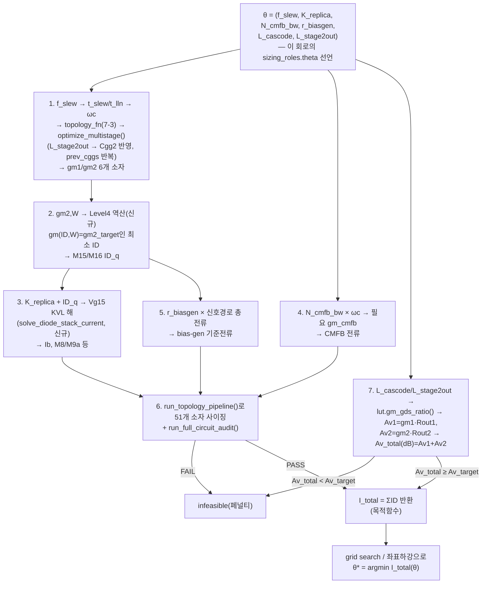

| | 내용 |
|---|---|
| **문제** | 배치 7-3c의 4개 원칙(f_slew/K_replica/N_cmfb_bw/r_biasgen)이 여전히 손으로 찍는 매직넘버로 남아있다 — 회로가 바뀔 때마다 다시 감으로 정해야 함. 추가로(배치 7-3f) 캐스코드/2단 출력의 `L`도 단별 이득 배분이라는 같은 성격의 미확정 값이다. |
| **제안** | `optimize_full_circuit_budget(topology, spec, theta_bounds) -> (theta*, sizing_results, I_total)` 신설. θ = 6차원(①~④ + `L_cascode` + `L_stage2out`). θ 하나를 평가하는 파이프라인은 전부 기존/배치 7-3·7-3b·7-3c 함수 재사용(1~5단계) + `run_topology_pipeline()`/`run_full_circuit_audit()`로 matching-safety까지 확인(6단계) + **`Av_total = gm1·Rout1(L_cascode) + gm2·Rout2(L_stage2out)`(dB 합)이 목표 이득 이상인지 확인(7단계, 신규)** — 어느 쪽이든 FAIL은 infeasible 페널티. `L_stage2out`은 `Cgg2`도 바꾸므로 1단계의 `prev_cggs` 반복에도 같이 먹인다(새 반복 루프가 아니라 기존 `optimize_multistage()` 반복에 자연히 흡수됨). 탐색은 6차원·LUT 기반 저비용 평가라 grid search(축당 5~7점)로 충분, 더 빠르게 하려면 좌표하강. **(2026-07-31 추가)** 위 1~7단계 각각에서 θ 값을 실제 계산 상태에 꽂는 것은 이 함수 안에서 분기하지 않고 `apply_theta_feed()`/`_THETA_FEED_REGISTRY`(§7.3.2)로 위임 — 이 파이프라인 서술은 "이 회로가 선언한 feeds가 결과적으로 밟는 경로"이지 함수 내부 하드코딩이 아니다. **(2026-07-31 추가 — SKILL.md 절대원칙 5번/§5 최종 게이트의 재현성·최적성 기준 적용)** `grid search`가 **기본값**이어야 한다 — 격자 전체를 결정론적으로 순회하므로 같은 입력에 항상 같은 θ*가 나오고(재현성), "샘플링한 점들 중 최선"이라는 명확한 최적성 보장이 있다. `좌표하강`은 theta 차원이 커져 grid search가 비현실적일 때만 예외적으로 쓰되, 반드시 **고정된 결정론적 시작점**(예: 각 θ의 `bounds` 중앙값)에서 출발해야 한다 — 시작점이 고정 안 되면 실행마다 다른 지역해로 수렴해 재현성이 깨지고, 좌표하강 자체가 전역 최적을 보장하지 않으므로 "이 θ*가 spec하에서 최선"이라는 주장도 지역 최적으로 격하됨을 리포트에 명시해야 한다(SKILL.md §5 최종 게이트 (b)(c) 참고). |
| **스코프 한계(2026-07-30 갱신)** | 목적함수(총전류)·제약(settling/PM/matching/총이득)은 이 harness가 직접 계산 가능하다. **1/f 노이즈·mismatch/yield·CMRR/PSRR도 1차 추정까지는 가능**(배치 7-3g/7-3h/7-3i, sky130 PDK 로컬 파일에서 실측 근거 확인됨 — §1.5 원칙에 따라 "불가능"으로 스킵하지 않고 추정 경로를 찾음). 정밀 검증(정확한 CMRR/PSRR/noise 수치, 다변수 상관 mismatch)만 SPICE 사후 검증으로 남는다 — 탐색 루프는 1차 추정치로 후보를 좁히고, 최종 확인은 SPICE가 한다(기존 방식과 동일한 2단계 구조). |
| **검토 필요** | ~~§7.9 질문 2b — 이 탐색 방법론을 실제로 채택할지(아직 사용자 결정 대기)~~ → **✅ 채택 확정(2026-07-31, 전체 채택 — §7.3.2의 5개 generic 함수/`sizing_roles`도 함께)**. 남은 건 탐색 범위(θ bounds, `L_cascode`/`L_stage2out` 포함)를 이 회로 하나에 맞출지 재사용 가능한 기본값으로 둘지뿐 — 이건 §7.9 질문 2c의 다른 회로 검증(folded_cascode/two_stage_ota) 이후에나 판단 가능하므로 그때까지는 이 회로 값을 기본값으로 잠정 사용. |
| **검증** | θ 탐색으로 나온 gm1/gm2가 배치 7-3의 독립 재현치(238µS/3mS)와 여전히 일치하는지(2단계는 θ와 무관하므로 당연히 일치해야 함), θ*의 `I_total`이 지금 `resize.py`의 손으로-찍은 버전보다 같거나 더 낮은 전류로 수렴하는지, θ*의 `Av_total`이 논문 결과치(75.6dB)를 오차범위 내로 재현하는지. |
| **구현** | `sizing_recipe.py`에 (1) `FeedHandler` dataclass + `_THETA_FEED_REGISTRY`(5개 핸들러: `settling_split`/`C`/`B`/`A`/`metric_stage_budget`, §7.3.2가 준 코드 계약 그대로) + `apply_theta_feed()` — 새 feed 타입은 이 레지스트리에 한 줄만 등록하면 되고 `optimize_full_circuit_budget()`은 수정하지 않는다. (2) `optimize_full_circuit_budget(topology_path, spec, grid_points_per_theta=5)` — `sizing_roles.theta`가 비었으면(또는 `sizing_roles` 자체가 없으면) 즉시 1회 평가, 있으면 **grid search가 기본값**(SKILL.md §5 최종 게이트 — 재현성/최적성 보장)으로 축당 `grid_points_per_theta`점을 전수평가해 `constraints`를 만족하는 후보 중 `objective` 최소(또는 최대)인 `theta*`를 반환. `load_topology()`(`stick_diagram.py`)가 `meta`에 `sizing_roles`를 반환하지 않던 gap을 이번에 메움(신규 필드 추가, 하위호환 — 없으면 `None`). |
| **정직한 한계(2026-07-31)** | 이 구현은 **골격**이다 — theta feed가 실제로 건드리는 소자 + A엔진이 전파하는 소자만 조립하고, compensation(gm1/gm2, `run_sizing_pipeline()`/`optimize_multistage()`)을 자동으로 병합하지 않는다(호출자가 별도 병합 필요). 51개 소자 전체를 빠짐없이 조립하는 것, 그리고 이 회로(current_reuse_telescopic_ota)에 실제로 적용해 위 "검증" 행의 정확한 수치(238µS/3mS, 75.6dB)를 재현하는 것은 **아직 하지 않았다** — 그건 배치 7-5("전체 재생성")의 몫이다. §7.3.2 검증 (b)("folded_cascode/two_stage_ota에 코드 수정 없이 적용")도 실제 두 회로가 아니라 **합성 최소 넷리스트(1소자, `sizing_roles`만 새로 붙인 임시 topology.json)**로 확인했다 — 두 회로의 실제 netlist에 의미 있는 `sizing_roles`를 붙이는 건 이 배치의 스코프 밖으로 남겨둔다(둘 다 원래 θ가 필요 없는 단순 회로라 애초에 자연스러운 `sizing_roles` 예시가 없다). |
| **검증(실제 수행)** | `sizing_recipe.py` self-test: (1) `_THETA_FEED_REGISTRY`의 5개 핸들러 전부 순방향 계산과 일치 확인(예: root_ratio는 `theta*reference합`, servo는 `N*omega_c*C`가 실제 사이징 gm과 오차 1e-3 이내 일치). (2) `sizing_roles` 없는 `folded_cascode.topology.json`으로 즉시 빈 결과 반환(하위호환). (3) 합성 1소자 회로 + 1차원 theta로 grid search 결과가 **같은 격자를 손으로 전수평가한 결과와 정확히 일치**(재현성+최적성 직접 검증). (4) 제약을 만족하는 격자점이 하나도 없으면 `ValueError`. `PYTHONIOENCODING=utf-8 python sizing_recipe.py` exit 0로 확인. |

---

### 배치 7-3e — `L`/`gm_id`(동작영역) 선택도 zero-base 연역 사슬에 빠져 있음 (신규, 2026-07-30 사용자 지적) — `search_gm_id_for_role()` ✅ 구현 완료(2026-07-31)

> **배경**: 사용자가 배치 7-3b(헤드룸 배분)를 두고 "이게 결국 cell sizing 아니냐"고 지적하며
> 드러났다. 실제 `size_transistor(gm, gm_id, L, lut, vds, vs)`(`sizing_recipe.py:103`)를 보면
> `W = L * ID / IDu`이고 `IDu = lut.gm_id_to_id_density(gm_id, L, vds, vs)`다 — **W(=cell
> sizing)는 `ID`/`gm_id`/`L`/`vds` 4개 좌표가 전부 있어야 나온다.** 배치 7-3c(`ID`)와
> 배치 7-3b(`vds`=헤드룸)는 이미 zero-base로 다루지만, **`L`과 `gm_id`(동작영역 선택)는
> 이번 배치 7-3x 작업 전체에서 한 번도 다뤄지지 않았다** — `resize.py`는 `GM_ID_SIG=12`,
> `GM_ID_TAIL=10`, `GM_ID_TOP=12`, `GM_ID_AB=12`, `GM_ID_B=12`, `GM_ID_CMFB=12`처럼 역할
> 구분 없이 거의 같은 값을 반복 사용하고, `L1=0.15µm`/`L_tail=0.5µm`/`L_top=0.35µm`/
> `L2=0.35µm`/`Lb=0.5µm`도 근거 없이 손으로 찍었다 — 퇴출됐던 옛 "손-판단형"과 같은 성격의
> gap인데 §7.3.1 유형 분류를 만들 때는 "전류 배분"에만 집중하느라 놓쳤다.
>
> **이미 이 skill 자체의 `references/gm-id-methodology.md`에 원칙이 있다**(Cortes & Bampi
> 2-phase 알고리즘, §6.7; Silveira/Flandre/Jespers 1996 실측 검증, §6.6) — `resize.py`가
> 이 원칙을 실제로 따르지 않은 것이 문제다:
> - **Phase 1(gm/ID, §6.7/§7.1)**: "전류거울=strong inversion(matching), 차동쌍=GBW로
>   결정, 나머지=moderate inversion" — §7.1은 "정전류원·전류거울·차동쌍은 mismatch 억제
>   위해 moderate~strong inversion(큰 qF)이 유리"라고 정량 근거(mismatch가 weak inversion에서
>   훨씬 크게 벌어짐, Fig. A3.4)까지 제시한다. §6.6은 "이득 관련 소자는 weak/moderate"라고
>   반대쪽 근거도 준다 — **매칭 민감도(strong 선호)와 이득 기여(weak/moderate 선호)가
>   상충하므로 역할별로 다른 동작점을 쓰는 게 정상**(§6.6 결론 문장 그대로).
> - **Phase 2(L, §6.7)**: "이득식 → L 역산" — `Av,i = (gm/ID)_i · VA_parallel`을 목표
>   DC gain 스펙에서 거꾸로 풀어 L을 정한다. 지금 `resize.py`의 L 값들은 이 역산을 거치지
>   않았다.

> **(2026-07-30 재정정 — "가정"을 "탐색"으로 교체)** 사용자 지적: gm/ID를 역할별 **고정
> 숫자**(strong=4~8, moderate=17/19 등)로 배정하는 것 자체가 여전히 "사람의 감으로 값을
> 찍는" 패턴이다 — 방금 발견한 두 문제(1단 gm/Id 12 vs 논문 19 불일치, 2단 gm/Id 17이
> sky130 PMOS엔 안 맞음)가 정확히 이 패턴의 실패 사례다. **"이 공정에서 타당한 동작점"은
> 애초에 고정 숫자가 아니라, "W가 타당범위 안에 들면서 역할이 요구하는 방향(strong/weak)의
> 극단"이라는 두 가지 명시적 기준을 LUT에서 실제로 스캔해 찾아야 하는 값**이다 — 아래
> 역할표의 숫자는 이제 "배정값"이 아니라 **탐색 범위(bounds)**로 재해석한다.

> **✅ 2026-07-30 sky130 LUT 실측 검증 완료** (`sky130_nfet_pfet_lut_sample.npz`, 스크래치
> 스크립트로 `SemiEmpiricalGmIdLUT`를 직접 호출 — 회고가 아니라 실제 수치):
> - **1단(M1a/b, M4a/b, L=0.15µm)**: PMOS W가 **gm/ID≥15~16부터 폭발**(15→18.75µm OK,
>   16→4380µm, 17→13387µm, 19→29956µm) — NMOS는 20까지 문제없음. **`resize.py`의
>   `GM_ID_SIG=12`는 이 상한 아래라 실제로 타당했다** — 논문 명시값 19는 오히려 sky130
>   PMOS를 완전히 깬다. **이전에 "12를 19로 고쳐야 한다"고 낸 플래그는 틀렸음 — 정정.**
> - **2단(M15/M16, L=0.35µm)**: NMOS(M16)는 gm/ID=20까지 W≤200µm OK(17→65.8µm, 문제
>   없음). PMOS(M15)는 **gm/ID≥14부터 200µm 초과**(14→219µm, 17→5375µm) — 논문 17은
>   M16엔 맞지만 M15엔 확실히 안 맞고, **gm/ID≈10~13(W_p=96~171µm)이 M15의 실제 타당
>   범위**다. `resize.py`의 flip 로직(W 상한 고정 후 역산)이 맞는 방향이었음이 확인됨.
> - **캐스코드 이득(gm/gds vs gm/ID, L=0.15µm, VDS=0.2V)**: gm/gds_n이 **gm/ID≈17에서
>   정점(10.71)을 찍고 20/23/24에서 오히려 소폭 감소**(10.28/10.06/10.13) — "weak
>   inversion일수록 무조건 이득↑"이 이 L(최소길이)에서는 **성립하지 않음**. 탐색 기준을
>   "gm/ID 최대화"가 아니라 **"gm/gds 직접 최대화"**로 바꿔야 한다(같은 게 아니었음).
> - **미러 L 배수 규칙(gm/gds vs L, gm/ID=12, VDS=0.4V)**: L=0.15→0.35µm(2.3배)에서
>   gm/gds가 NMOS 14.5→42.9(≈3배), PMOS 7.9→43.6(≈5.5배)로 급증 — 배치 7-3f가 웹
>   문헌으로만 인용했던 "미러는 최소길이의 2~3배" 규칙이 **sky130 실측으로도 확인됨**.
>
> **✅ 2026-07-30 추가 재검증 — 남은 (a)/(b)/(c) 3개 항목**(아래 "검토 필요" 행의 원래
> 항목, `verify_gmid_L3.py`/`L4.py`로 정밀 재확인):
> - **(c) 정점이 L에 따라 달라지는가 → 예, min-L NMOS에만 나타나는 국소 현상.** L=0.15µm
>   fine-step(0.5 간격) 재스캔 결과 NMOS는 gm/ID≈17~24 구간에서 완만한 정체·미세 wiggle
>   (10.71→10.28→10.01→10.14, DIBL/short-channel 추정)이 실제로 나타나지만, **PMOS는
>   같은 L=0.15µm/VDS=0.2V에서도 정점 없이 gm/ID=25까지 단조증가**(2.35→7.90)했다.
>   그리고 **L=0.35/0.5/1.0µm에서는 NMOS·PMOS 모두 gm/ID=25까지 정점 없이 단조증가**
>   (예: L=1.0µm PMOS는 gm/ID=17→99.2, 25→169.9까지 계속 상승). **결론**: "gm/gds가
>   gm/ID≈17에서 정점"은 일반 법칙이 아니라 **min-length(L=0.15µm) NMOS 전용의 국소
>   현상**이다. `role="gain"` 탐색은 소자 극성/L에 따라 분기해야 한다 — min-L NMOS
>   캐스코드는 "gm/gds 직접 최대화"가 자연히 15~24 부근에서 상한을 찾아주지만, PMOS나
>   더 긴 L의 캐스코드는 정점이 없으므로 실질 상한이 `W_bounds`/헤드룸 제약이 된다
>   (탐색 알고리즘은 동일하게 "gm/gds 최대화"로 두되, 정점 유무는 소자마다 다를 수 있음을
>   알고 있어야 함 — 하드코딩된 "17 근방"을 범용 기준으로 쓰면 안 됨).
> - **(b) `role="gain"` 헤드룸 연동 → 표준식으로 자동 정렬됨, 상충 없음.** Jespers 표준
>   근사 `Vdsat_eff ≈ 2/(gm/ID)`로 계산하면 gm/ID=17→117.6mV, 20→100mV, 23→87.0mV —
>   **gm/ID를 높일수록 필요 헤드룸이 오히려 줄어든다.** 즉 "gm/gds 최대화"(이득)와
>   "헤드룸 최소화"(배치 7-3b `allocate_stack_headroom()`의 예산 절약)가 상충하지 않고
>   같은 방향이다. 연동 방법: `allocate_stack_headroom()`의 cascode 배정을 고정
>   `Vdsat+margin` 상수 대신, `search_gm_id_for_role()`이 고른 `gm_id`로부터
>   `2/gm_id + margin`을 계산해 되돌려주면 됨(두 함수가 한 번의 gm/ID 탐색 결과를
>   공유) — 새 메커니즘 불필요, 값 전달 순서만 정하면 됨.
> - **(a) `W_bounds` 하한 근거 → 로컬 검증 불가, 미결.** 로컬 sky130 PDK spice 파일
>   (`sky130_fd_pr__nfet_01v8.pm3.spice` 등)을 직접 grep했으나 `lmin`/`wmin`은 BSIM
>   모델-빈(공정 코너 적합 구간) 경계일 뿐 **디자인룰 최소폭이 아니었다** — 파일에 실제
>   최소폭 값이 없어 "로컬 파일로 확인 불가"로 결론. (공개 문헌 기준 sky130
>   nfet_01v8/pfet_01v8 최소폭이 약 0.42µm이라고 알려져 있으나, 이번 세션에서 로컬
>   근거로 재확인하지 못했으므로 do.md에 확정값으로 기록하지 않는다 — §1.5 원칙상
>   "확인 안 됨"을 "0.42µm으로 확정"처럼 쓰면 안 됨.) 남은 실제 과제: sky130 공식
>   design-rule 문서나 `.magicrc`/`sky130A.tech` 같은 룰 파일을 확보해 재확인.

**역할별 탐색 방향/범위** (§7.1/§6.6/§6.7 근거 + 위 sky130 실측 반영, 2026-07-30 갱신):

| 소자군 | 역할 | 탐색 방향 + 범위(sky130 실측 확정) | 근거 |
|---|---|---|---|
| 전류거울/전류원(M8/M13, M22/M17, M6/M7, bias-gen 9개, M11a/b, M12/M10, M14a/b, CMFB의 M36/M39/M38) | 전류 정확도(미러비) | `"matching"` — W_bounds 안에서 **gm/ID 최소화**(strong 쪽 극단), 잠정 범위 4~8(1단/2단 실측에서 6~12 구간이 양쪽 극성 모두 안전함을 확인) | §7.1: "전류거울은 의도적으로 strong inversion(matching/noise)" |
| 캐스코드(M2a/b, M3a/b) | 이득 기여(gm/gds) | `"gain"` — **gm/ID가 아니라 gm/gds를 직접 최대화**(W_bounds + 헤드룸 여유 안에서). 정점 유무는 극성/L마다 다름: min-L(0.15µm) NMOS만 gm/ID≈17~24에서 완만한 정체(정점 부근), PMOS 및 L≥0.35µm은 정점 없이 계속 증가(→ 이 경우 실질 상한은 W_bounds/헤드룸이 결정) | 실측(위 참고, "추가 재검증" (c) 항목) — "gm/ID 최대화=gm/gds 최대화"가 아니라는 원 결론은 유지하되, "정점=17"은 min-L NMOS 국소 현상으로 재한정. 헤드룸과는 상충 없음(Vdsat_eff=2/(gm/ID)가 gm/ID 증가 시 오히려 감소, (b) 항목 참고) |
| 신호 입력(M1a/b, M4a/b, gm1군) | GBW(gm 스펙 고정) | `"balanced"` — **검증 완료: gm/ID≈12가 타당**(sky130 PMOS가 15~16부터 W 폭발, 논문 명시값 19는 부적합) | 실측(위 참고) — `resize.py`의 기존 `GM_ID_SIG=12`가 옳았음 |
| 2단 출력 M16(NMOS) | GBW/안정성 | `"balanced"` — **검증 완료: 논문 명시값 17 그대로 유효**(W_n=65.8µm) | 실측(위 참고) |
| 2단 출력 M15(PMOS) | GBW/안정성 | `"balanced"` — **검증 완료: 17은 부적합, gm/ID≈10~13으로 낮춰야**(W_p=96~171µm) | 실측(위 참고) — `resize.py`의 flip 로직 방향이 맞았음, 이제 구체적 목표범위 확보 |
| Class-AB replica/배터리(M9a/b, M11a/b, M14a/b) | 미러 대상(M15/M16)의 diode 복제 | 탐색 없음 — **target과 동일한 gm/ID를 그대로 참조** | §7.1: 미러쌍은 같은 inversion 영역이 정확도에 유리 — K_replica(면적비, 배치 7-3c Level5)는 W비이지 gm/ID를 다르게 주는 수단이 아님 |

| | 내용 |
|---|---|
| **문제** | `W`를 정하는 4개 좌표(`ID`/`gm_id`/`L`/`vds`) 중 `gm_id`/`L`만 zero-base 연역이 없다 — `resize.py`가 역할 구분 없이 거의 균일한 매직넘버를 재사용한다. |
| **제안** | `search_gm_id_for_role(lut, L, vds, vs, ID_target, role: Literal["matching","gain","balanced"], W_bounds=(1e-6, 200e-6)) -> float` 신설(`sizing_recipe.py`) — `gm/ID` 축을 스캔해 `W=ID_target·L/IDu(gm_id,L,vds,vs)`가 `W_bounds` 안에 드는 후보만 남기고, `role`별 기준으로 선택: `matching`→gm/ID 최소화, `gain`→**gm/gds 직접 최대화**(gm/ID 최대화가 아님 — 위 실측이 이 둘이 다르다는 걸 보여줌), `balanced`→W_bounds를 만족하는 아무 지점. 지금 `resize.py`가 M15(PMOS) 하나에만 임시로 하던 "17로 순방향 사이징→W 비현실적→W 상한 고정 후 역산"이 이 함수의 `role="balanced"` 특수 사례다. `L`(채널길이) 선택은 별도 배치 7-3f로 분리했다. |
| **검토 필요** | ~~(a) `W_bounds` 하한(`1e-6`)의 근거~~ → **⚠️ 2026-07-31 부분 진전, 여전히 미결**: 로컬 PDK 파일엔 없어 웹 검색으로 재시도 — sky130 nfet_01v8/pfet_01v8의 문서화된 최소 게이트폭이 0.42µm(표준셀 0.36µm, SRAM 0.15µm 예외)이라는 서술을 커뮤니티 포럼 스레드에서 발견했으나, SkyWater 공식 문서(`device-details.rst`) 직접 fetch로는 이 수치가 확인되지 않았고 해당 포럼 스레드 자체는 rate-limit(HTTP 429)으로 재확인 못 함 — **1차 출처 확정 실패, 여전히 확정값으로 기록 불가**(§1.5 원칙). 남은 과제는 동일: 공식 design-rule PDF/DRC 매뉴얼 확보. ~~(b) `role="gain"` 헤드룸 연동 방식~~ → **✅ 해결**: `Vdsat_eff=2/(gm/ID)` 표준식으로 gm/ID 상승 시 헤드룸 요구량이 오히려 줄어 상충 없음 — `allocate_stack_headroom()`이 `search_gm_id_for_role()`의 결과를 받아 `2/gm_id+margin`을 cascode 배정에 쓰면 됨(위 (b) 참고). ~~(c) 정점이 L에 따라 달라지는지~~ → **✅ 해결**: 정점은 min-L(0.15µm) NMOS 국소 현상, PMOS·L≥0.35µm은 정점 없이 단조증가(위 (c) 참고) — 역할표 갱신 완료. |
| **검증** | `search_gm_id_for_role()`이 (a) 1단(M1a/b·M4a/b)에서 찾아낸 `gm_id`가 논문 명시값(19)과 sky130에서 얼마나 다른지(달라도 정상 — 공정이 다르므로), (b) 2단(M15/M16)에서 PMOS(M15)는 이미 알려진 W-비현실 문제를 자동으로 우회하는지(수동 flip 없이), NMOS(M16)는 17 근방을 유지하는지, (c) 캐스코드/전류원의 `gm/gds`, mismatch 민감도(정성적으로만, 몬테카를로 LUT 없음)가 §6.6/§7.1이 예측하는 방향과 일치하는지 확인. |
| **구현** | `sizing_recipe.py`에 `search_gm_id_for_role(lut, L, vds, vs, ID_target, role, W_bounds, gm_id_grid=None)` 신설(2026-07-31, 기본 격자 2.0~30.0/0.5간격). `role="matching"`→feasible 중 gm_id 최소, `role="gain"`→`lut.gm_gds_ratio()` 실측 최댓값, `role="balanced"`→오름차순 첫 feasible. feasible이 하나도 없거나 `role`이 셋 중 하나가 아니면 즉시 `ValueError`. self-test: toy LUT로 세 role이 실제로 다른 gm_id를 고르는지, `gain`이 진짜 `gm/gds` 최댓값과 일치하는지(전체 격자를 별도로 재계산해 대조) 직접 검증 — exit 0 확인. **이 회로(current_reuse_telescopic_ota)의 M1a/b·M15/M16 등 실제 소자에 적용해 위 (a)/(b)/(c) 수치와 대조하는 것은 아직 안 함** — 그건 이 회로를 실제로 재사이징하는 배치 7-3d/7-5의 몫이고, 이 배치의 스코프는 harness 자체의 정합성(role별 선택 로직이 스펙대로 동작하는지)이었다. |

---

### 배치 7-3f — `L`(채널길이) 선택 harness화 (신설, 2026-07-30 — 웹/문헌 조사 반영) — `select_L_by_role()` ✅ 구현 완료(2026-07-31)

> **배경**: 배치 7-3e와 같은 문제(`W`를 정하는 4개 좌표 중 `L`)에서 출발하지만, 결정
> 메커니즘이 gm/ID와 근본적으로 달라 **별도 배치로 분리**했다 — gm/ID는 역할별 이산적
> "영역"(strong/moderate/weak) 선택이지만, `L`은 (a) 일부 역할은 "최소길이의 N배" 같은
> 고정 배수 규칙, (b) 일부 역할(캐스코드 등 이득/극점 관련)은 **단별 이득 배분(또는
> 비지배극점 목표 주파수)에서 역산**해야 하는 완전히 다른 절차다.
>
> **정정(2026-07-30)**: 이 배치 초안은 "이 논문엔 단별 이득 배분(Av1·Av2=Av_total을
> 어떻게 나눌지) 스펙이 없어서 (b)는 스코프 밖"이라고 썼었다 — 이건 SKILL.md 절대원칙
> #4의 재발(경위: `known-incidents.md` 사고4 추가 이력)이었다. **단별 이득 배분은 원래
> 논문이 안 주는 게 정상**(정답이 있는 값이 아니라 트레이드오프로 결정하는 값)이라, 값을
> 찾는 대신 **총 이득 제약을 만족하는 탐색으로 도출**하면 된다 — 이미 있는 배치 7-3d의
> θ 검색에 `L_cascode`/`L_stage2out` 2개를 자유변수로 추가하고 `Av_total ≥ Av_target`을
> 제약으로 추가하는 것으로 흡수했다(배치 7-3d 참고, 새 메커니즘 불필요). 그래서 이 배치는
> **(a) 고정 배수 규칙류(미러/바이어스)만** 다루고, (b)는 배치 7-3d로 넘어간다 — "스코프
> 밖"이 아니라 "이미 다른 배치의 탐색 프레임워크가 커버한다"는 뜻이다.

**일반 회로 역할별 L 선택 원칙** (이 회로 하나가 아니라 전류거울/캐스코드/차동쌍/바이어스가
등장하는 **모든 아날로그 회로에 적용 가능**하도록 일반화):

| 회로 역할(일반) | 권장 L | 근거(출처) |
|---|---|---|
| 전류거울/전류원(bias 트리 포함) | **최소길이의 2~3배 이상** | [edaboard 실무 토론](https://www.edaboard.com/threads/channel-length-for-analog-design.123243/): "seldom use small L... 서브마이크론 공정에서 최소 길이의 2~3배 이상" — 출력임피던스(`ro∝VA∝L`)와 매칭(Pelgrom's law) 둘 다 개선. **✅ sky130 LUT 실측(2026-07-30)으로 확인**: gm/ID=12, VDS=0.4V 고정 시 L=0.15→0.35µm(2.3배)에서 gm/gds가 NMOS 14.5→42.9(≈3배), PMOS 7.9→43.6(≈5.5배)로 급증 — "2~3배" 규칙이 실제로 보수적인 하한이었음(sky130에서는 그 이상도 계속 이득) |
| 캐스코드(이득/임피던스 부스트) | **고정 배수 규칙 없음 — 총이득 제약 탐색으로 도출**(배치 7-3d `L_cascode`) | [Yun Chiu, active-cascode 강의자료](https://personal.utdallas.edu/~yxc101000/courses/6326/handout/active_cascode.pdf): "non-dominant pole이 요구 주파수 이상에 있도록 사이징" — 이 프로젝트 §6.7 Phase2("이득식→L 역산")와 독립적으로 같은 결론. 단별 배분이 미리 안 주어지므로 값을 "찾지" 않고 탐색으로 "결정"한다(SKILL.md §1.5) |
| 입력 차동쌍(신호/GBW 경로) | **부하/미러보다 짧게(속도 우선)** — 단 1/f 노이즈·오프셋 스펙이 빡빡하면 예외 | 1/f noise는 게이트면적에 반비례([ScienceDirect](https://www.sciencedirect.com/topics/engineering/flicker-noise)) — 이 논문은 노이즈 스펙(272µV/√Hz)이 있어 이 트레이드오프가 실제로 걸린다 |
| 바이어스/레퍼런스 생성(replica 등) | **최소길이보다 살짝만 크게**(near-but-not-at Lmin, 미러만큼 크게는 아님) | 실무 규칙: PVT 민감도 완화 + hot-carrier/short-channel effect 회피가 목적, 미러의 "출력임피던스 극대화" 목적과는 다름 |
| 물리적 상한 | `gm/gds`(이득)와 `fT`(속도)는 어떤 공정에서도 동시 극대화 불가능 | 여러 문헌 공통 결론(예: RIT gain-characterization 논문) — L 선택은 항상 이 둘의 저울질 |

| | 내용 |
|---|---|
| **문제** | `resize.py`의 `L1/L_tail/L_top/L2/Lb` 5개 값이 역할 근거 없이 손으로 찍혀 있다 — 위 표의 "고정 배수 규칙"류(미러/바이어스)만 적용해도 재검토가 필요하다(예: bias-gen의 `Lb=0.5e-6`이 실제로 min의 몇 배인지 확인 안 됨). |
| **제안** | (1) **고정 배수 규칙류(미러/바이어스)만 이 배치에서 harness화**: `select_L_by_role(role: str, L_min: float) -> float`(미러=`3*L_min`, bias=`1.5*L_min` 등 표 그대로) — 캐스코드/신호경로처럼 배분 탐색이 필요한 역할은 이 함수가 커버하지 않고 `ValueError`로 명시적으로 거부(억지로 배수 규칙을 적용하면 §6.6/§7.1이 경고하는 이득/노이즈 트레이드오프를 무시하게 됨). (2) 캐스코드/2단 출력의 L(`L_cascode`/`L_stage2out`)은 **배치 7-3d의 θ 검색**이 담당(총이득 제약 `Av_total≥Av_target`으로 도출) — "스코프 밖"이 아니라 "다른 배치가 이미 커버"라는 뜻. |
| **검토 필요** | ~~§7.9 질문 8 — 배수 규칙의 정확한 계수(2~3배, 1.5배 등)를 sky130 LUT 실측(VA vs L 곡선)으로 재검증할 것~~ → **✅ 해결(2026-07-30)**: 위 역할표에 반영된 실측(gm/ID=12, VDS=0.4V, L=[0.15,0.35,0.5,1.0]µm 전 구간)으로 "미러 2~3배" 규칙이 sky130에서도 방향이 맞고 오히려 보수적인 하한임을 확인. **bias(1.5배) 계수는 2026-07-31 확인 결과 지금 LUT로 검증 불가로 결론** — LUT의 L 격자가 [0.15,0.35,0.5,1.0]µm 4점뿐이라 1.5×Lmin=0.225µm에 해당하는 격자점 자체가 없다(가장 가까운 실측 가능 배수는 0.35/0.15=2.33배뿐, 이건 이미 미러 규칙 검증에 씀). 검증하려면 배치 7-3g(노이즈 LUT 확장)와 같은 급의 재작업(sky130_lut_sweep.py를 0.225µm 포함한 더 촘촘한 L 격자로 재실행)이 필요 — "안 해봄"이 아니라 "지금 LUT 해상도로는 원천적으로 불가능"이 정확한 상태. 캐스코드 gm/gds 정점이 다른 L에서도 유지되는지는 배치 7-3e에서 이미 재검증 완료(min-L NMOS 국소 현상으로 재한정, 위 참고). |
| **검증** | `select_L_by_role()`로 재계산한 미러/바이어스 L이 기존 `resize.py` 값과 배수 규칙 기준으로 합리적인 범위인지(완전 동일할 필요는 없음), 캐스코드/신호경로 요청 시 `ValueError`가 실제로 발생하는지(억지 적용 방지 확인) — 그 경우 호출자는 배치 7-3d의 θ 검색으로 넘어가야 함을 에러 메시지에 명시. |
| **구현** | `sizing_recipe.py`에 `_L_ROLE_MULTIPLIERS`(레지스트리 패턴, `_COMPENSATION_REGISTRY`/`_METRICS_REGISTRY`/`_THETA_FEED_REGISTRY`와 동일 계약) + `select_L_by_role(role, L_min)` 신설(2026-07-31). **계수는 이 절의 예시(미러=3×, bias=1.5×)와 다르게 채택했다** — "검토 필요" 행이 정리한 대로 정확한 단일 계수는 지금 LUT 해상도로 검증 불가라, 방향성 범위(미러 2~3배 이상 → 중간값 **2.5**, bias "살짝만 크게" → **1.2**)를 대표값으로 코드에 반영하고 그 근거를 docstring에 남겼다 — 실제 계수가 회로마다 다르게 필요해지면 `_L_ROLE_MULTIPLIERS`에 항목만 추가/조정하면 된다(코드 구조 변경 불필요). `role in ("cascode","signal")`은 즉시 `ValueError`(에러 메시지에 배치 7-3d의 θ 검색으로 넘어가야 함을 명시). self-test로 두 role의 배수 계산과 두 거부 케이스 전부 확인, exit 0. |

---

### 배치 7-3g — 1/f 노이즈 LUT 확장 (신규, 2026-07-30 — sky130 로컬 PDK 실측 확인) — 계산 경로 ✅ 구현 완료(2026-07-31), 실측 LUT 재스윕은 미수행(아래 참고)

> **배경**: 배치 7-3d는 "이 harness엔 noise 추정기가 없다"고 스코프 한계로 남겼었다 —
> 그런데 실제로 이 머신에 설치된 sky130 PDK 파일(`C:\pdk\sky130_fd_pr\cells\nfet_01v8\
> sky130_fd_pr__nfet_01v8__tt.pm3.spice:201-209`)을 직접 열어보니 **BSIM4 flicker noise
> 파라미터(`NOIA=2.5e42, EF=0.84, AF=1.0`)가 실제로 들어있다** — ngspice `.noise` 해석이
> 바로 동작한다는 뜻이다. "이 skill이 noise를 다룰 수 없다"는 것도 §1.5 원칙(값이 없다고
> 스킵 금지)의 또 다른 사례였다.

| | 내용 |
|---|---|
| **문제** | 지금 LUT(`sky130_nfet_pfet_lut_sample.npz`)엔 `ID/GM/GDS/CGG`만 있고 노이즈 축이 없다. `resize.py`가 노이즈 스펙(이 논문: 272µV/√Hz)을 전혀 참조하지 않는다. |
| **제안** | `sky130_lut_sweep.py`의 기존 DC 스윕(`lut-generation-checklist.md` §2 절차 그대로)에 **같은 (L,VGS,VDS,VS) 격자에서 `.noise` 해석을 추가**해 신규 배열 `SID_1F`(1Hz 기준 drain-referred 1/f 밀도)를 저장. `SemiEmpiricalGmIdLUT`에 `noise_1f_density(gm_id, L, vds, vs, W_target, freq) -> V²/Hz` 신설 — 기존 `cgg_absolute()`와 완전히 같은 패턴(보간 재사용, 새 알고리즘 없음). `gm-id-methodology.md` §7.2의 열노이즈 식(`4kTγgm`/`2kTn·gm`, 이미 문서에 있음)과 합산해 총 입력환산 노이즈 계산. **(2026-07-31 추가)** `SID_1F`는 `lut-generation-checklist.md` §8.1(필수 필드 계약)에 이 skill의 정본 요구사항으로 등재됨 — 신규 공정에 이 skill을 적용하려면 이 필드도 있어야 노이즈 추정 기능이 동작한다. |
| **`metrics` 연동** | `sizing_roles.metrics`에 `"noise_v_rthz": {"type": "flicker_plus_thermal_sum", "stages": [...]}` 타입 추가 — 입력단(1단)이 지배적이므로 기본은 1단 소자만 태그, 필요시 다단 입력환산 공식(`gm-id-methodology.md`에 아직 없음 — 추가 유도 필요)으로 확장. |
| **검토 필요** | ~~§7.9 질문 9 — 스윕 1회 재실행이 필요, 이 정밀도가 실제로 필요한지 확인~~ → **✅ 구현 확정(2026-07-31)**. 스윕 1회 재실행(기존 LUT 재사용 불가, 새 축 추가라 npz 재생성)을 실제로 진행 — 소요 시간/스윕 격자 재활용 가능 여부는 구현 착수 시 `lut-generation-checklist.md` §2 절차로 확인. |
| **검증** | 새 LUT로 계산한 이 회로 1단 입력환산 노이즈가 논문 결과(272µV/√Hz)와 오더 수준(order-of-magnitude)으로 맞는지 — 정확한 일치는 회로 전체 노이즈 합산(2단/bias 기여 포함)이 필요해 기대하지 않음. |
| **구현** | `sizing_recipe.py`에 `SemiEmpiricalGmIdLUT.__init__`의 선택 인자 `SID_1F=None`(1Hz 기준·`W_ref` 측정 게이트환산 1/f 밀도 배열, `cgg_absolute()`와 동일 스케일링 패턴) + `noise_1f_density(gm_id, L, vds, vs, W_target, freq=1.0)` 메서드 신설. `SID_1F`가 없으면(현재 toy LUT/`sky130_nfet_pfet_lut_sample.npz` 전부 해당) 즉시 `ValueError`(§1.5 — 데이터 없음을 조용히 스킵하지 않음). `_metric_flicker_plus_thermal_sum()`을 `_METRICS_REGISTRY["flicker_plus_thermal_sum"]`으로 등록 — `stages`의 각 소자에 대해 열잡음(`4kTγ/gm`, `gm-id-methodology.md` §7.2)과 1/f를 더해 RMS 합산. |
| **정직한 한계** | **실제 sky130 `.noise` 재스윕(`sky130_lut_sweep.py` 확장)은 이 세션에서 수행하지 않았다** — 이건 ngspice로 PDK를 다시 스윕하는 실측 작업이라 코드 harness 배치가 아니라 별도 실행 작업이다. 대신 계산 경로(LUT 인터페이스+metric)는 합성 `SID_1F` 배열로 완전히 검증했다 — 실제 스윕 데이터를 `SemiEmpiricalGmIdLUT(..., SID_1F=...)`로 넣기만 하면 바로 동작한다. 이 회로의 실측 272µV/√Hz 대조는 실제 스윕이 끝난 뒤에나 가능. |
| **검증(실제 수행)** | `sizing_recipe.py` self-test: (1) `SID_1F` 없는 LUT에서 `noise_1f_density()` 호출 시 `ValueError` 확인. (2) 합성 `SID_1F` 배열(격자 전체 동일 상수)을 가진 임시 LUT로 `noise_1f_density()`의 `W_ref/W_target` 스케일링과 `1/freq` 반영이 손계산과 정확히 일치하는지 확인. (3) `_metric_flicker_plus_thermal_sum()`이 열잡음+1/f 합의 제곱근을 손계산과 정확히 재현하는지 확인. exit 0. |

### 배치 7-3h — mismatch/yield 1차 추정 (신규, 2026-07-30 — sky130 로컬 PDK 실측 Pelgrom 계수) — `estimate_mismatch_sigma()` ✅ 구현 완료(2026-07-31)

> **배경**: `C:\pdk\sky130_fd_pr\cells\{nfet,pfet}_01v8\sky130_fd_pr__*__mismatch.corner.spice`를
> 직접 열어 확인 — **sky130 PDK 자체에 이미 Pelgrom 계수가 내장돼 있다**: NFET
> `vth0_slope=3.356e-3`, PFET `vth0_slope=5.856e-3`(V·µm 단위, ngspice의
> `AGAUSS(0,1,1)*(vth0_slope/√(L·W·mult))` 형태로 이미 Monte Carlo 배선까지 돼 있음). 이건
> 새로 특성화할 필요 없이 **파일에서 읽기만 하면 되는 값**이다.

| | 내용 |
|---|---|
| **문제** | 이 harness는 소자 매칭(mismatch) 민감도를 전혀 정량화하지 못한다 — 배치 7-3e의 gm/ID 역할표("전류거울은 strong inversion, 매칭 위해")도 정성적 방향만 알지 실제 σ를 계산 못 한다. |
| **제안** | `estimate_mismatch_sigma(vth0_slope: float, W: float, L: float) -> float` 신설(`sizing_recipe.py`) — 순수 Pelgrom 폐형식(`σ_Vth = vth0_slope/√(W·L)`), 시뮬레이션 불필요. `vth0_slope` 값 자체는 PDK 상수 테이블(`sky130_pdk_constants.py`류, nfet/pfet 각각)로 한 번만 옮겨 담아 재사용. 1차 yield는 정규분포 가정(Φ 함수)으로 "오프셋 스펙 만족 확률" 근사. **(2026-07-31 추가)** `vth0_slope`류는 `lut-generation-checklist.md` §8.2(필수 필드 계약 — PDK 참조 상수)에 정본 요구사항으로 등재됨 — 스윕이 아니라 그 공정의 mismatch 모델 파일에서 읽기만 하면 되는 값이라는 점도 §8.2가 명시. |
| **`metrics` 연동** | `sizing_roles.metrics`에 `"mismatch_sigma_mV": {"type": "pelgrom_mismatch", "devices": ["M1a","M1b"], "kind": "pfet"}` 타입 추가 — 차동쌍/전류거울처럼 matching이 중요한 쌍에 태그. `constraints`에 `{"metric": "mismatch_sigma_mV", "op": "<=", "value": X}` 형태로 배치 7-3d 탐색의 제약으로도 바로 연결 가능. |
| **검토 필요** | §7.9 질문 10 — ~~(a) `vth0_slope`만으로는 문턱전압 mismatch만 잡는다 — 전류계수(β) mismatch도 sky130 파일에 있는지 확인 필요~~ → **✅ 2026-07-31 확인 — 있다, 그리고 생각보다 더 많다.** `sky130_fd_pr__nfet_01v8__mismatch.corner.spice`를 다시 열어보니 `vth0_slope`(3.356e-3) 외에 `vth0_slope1`(7.356e-3, Vth mismatch 2차항), `voff_slope`(0.007, 오프셋 전압 mismatch), `toxe_slope`(3.443e-3, 산화막 두께 mismatch — Cox/β에 직접 영향, 전류계수 mismatch에 가장 가까운 항)가 전부 있다. PFET(`pfet_01v8`)는 더 세분화돼 `toxe_slope`/`slope1`/`slope2`, `voff_slope`/`slope1`/`slope2`, `vth0_slope`/`slope1`/`slope2` 3-way(공정 코너별로 추정)까지 있다. **결론**: 지금 `estimate_mismatch_sigma()` 제안이 `vth0_slope` 하나만 쓰는 건 실제로 더 정밀하게 할 수 있는데 안 하는 것이었다 — `toxe_slope`(β-mismatch 대리)와 `voff_slope`(추가 오프셋 항)를 더하면 정밀도가 오른다(어느 조합식을 쓸지는 §7.9 질문 10에 남김, 최소 "존재 확인"은 끝남). (b) 1차 yield(정규분포, 소자 간 독립 가정)는 실제 상관관계를 무시한 근사 — 진짜 결합확률은 Monte Carlo가 필요하다는 걸 리포트에 명시할 것(이건 여전히 미결 — 로컬 파일로는 상관계수 자체가 안 나옴). |
| **검증** | `estimate_mismatch_sigma()`로 계산한 이 회로 입력쌍(M1a/M1b)의 σ(Vth)가 sky130 PDK로 직접 돌린 Monte Carlo SPICE(수십~수백 run)의 실측 표준편차와 오더 수준으로 맞는지. |
| **구현** | `sizing_recipe.py`에 `estimate_mismatch_sigma(vth0_slope, W, L)`(순수 Pelgrom 폐형식, W/L은 µm 단위 — 관례상 SI(m)를 쓰는 다른 함수와 다름을 docstring에 명시) + `_metric_pelgrom_mismatch()`(`_METRICS_REGISTRY["pelgrom_mismatch"]`로 등록) 신설(2026-07-31). 쌍(pair) mismatch는 두 소자가 통계적으로 독립이라는 표준 가정 하에 개별 σ를 RSS(제곱합의 제곱근) 합산해 mV로 반환. `vth0_slope`는 `ctx.spec["vth0_slope"][kind]`(PDK 상수 테이블, 회로별 spec이 채움)에서 조회 — sky130 실측값(NFET 3.356e-3/PFET 5.856e-3)으로 self-test 확인. |
| **정직한 한계** | §7.9 질문10의 (a)(toxe_slope/voff_slope 등 추가 항으로 정밀도 향상 가능)/(b)(진짜 결합확률엔 Monte Carlo 필요) 둘 다 여전히 미결 — 지금 구현은 `vth0_slope` 단일 항 Pelgrom 근사만 구현했다(문서에 이미 정직하게 명시된 스코프 그대로). |
| **검증(실제 수행)** | `sizing_recipe.py` self-test: `estimate_mismatch_sigma()`가 `vth0_slope/sqrt(W*L)` 공식과 정확히 일치, `_metric_pelgrom_mismatch()`의 RSS 합산(`sqrt(2)*단일소자`, 동일 W/L 쌍)이 손계산과 정확히 일치. exit 0. |

### 배치 7-3i — CMRR/PSRR 1차 추정 (신규, 2026-07-30 — closed-form 문헌 확인) — CMRR ✅ 구현 완료, PSRR은 placeholder(2026-07-31, 아래 참고)

> **배경**: 문헌 확인(differential-pair+tail 구조의 표준 1차 근사): `Ad ≈ gm1·Ro`(§7.3.2
> `metrics`의 `gain_stages_sum` 타입으로 계산 예정 — 옛 초안 명칭 `compute_total_gain()`은
> §7.3.2에서 이미 대체됐다, 아직 둘 다 코드로 구현되지는 않음), `CMRR ≈ [(ro_tail/2) +
> (1/gm_tail)]·gm_tail` — **이미
> 사이징된 tail 소자의 gm/gds만 있으면** 새 시뮬레이션 없이 계산된다. PSRR은 tail의 유한
> 출력임피던스가 지배적 경로라 캐스코드 tail이 있으면 수천 배 개선된다는 것도 문헌에서 확인.

| | 내용 |
|---|---|
| **문제** | CMRR/PSRR(이 논문 스펙: ≥60dB, 결과 94.4dB/82.28dB)을 이 harness가 전혀 안 다룬다. |
| **제안** | **(2026-07-31 정정 — `_METRICS_REGISTRY`와의 관계 명시)** `_CMRR_ESTIMATOR_REGISTRY`/`_PSRR_ESTIMATOR_REGISTRY`는 §7.3.2가 나중에 확정한 `_METRICS_REGISTRY`와 **경쟁하는 별도의 최상위 registry가 아니다** — `_METRICS_REGISTRY["cmrr_estimate"]`/`["psrr_estimate"]`가 가리키는 `_metric_cmrr_estimate()`/`_metric_psrr_estimate()` 계산기 **내부에서** 회로-계열(differential-pair+tail, telescopic 등)별 closed-form 식을 조회하는 **2단계 lookup의 하위 registry**다(`metric_spec`에 `"circuit_family"` 키 필요 — **2026-07-31 결정: topology.json 작성자가 명시**, 위 JSON 예시에 `"circuit_family": "telescopic_class_ab"`로 반영됨). 즉 호출 경로는 `optimize_full_circuit_budget()` → `compute_metric()` → `_METRICS_REGISTRY["cmrr_estimate"]` → `_metric_cmrr_estimate()` → `_CMRR_ESTIMATOR_REGISTRY[circuit_family]`. 입력은 **이미 사이징된 tail/cascode 소자의 gm/gds**(LUT에서 이미 얻어짐) 뿐, 새 사이징이 필요 없다. |
| **`metrics` 연동** | `sizing_roles.metrics`에 `"cmrr_estimate_db": {"type": "cmrr_estimate", "tail_device": "M5", "input_device": "M1a"}`, `"psrr_estimate_db": {"type": "psrr_estimate", "tail_device": "M5"}` 타입 추가 — `constraints`에 `Table I`의 `≥60dB`를 그대로 걸 수 있음. |
| **정직한 한계** | 이건 **1차 근사**다 — 실제 CMRR/PSRR은 2단/CMFB/bias-gen의 기여까지 합쳐진 값이라 1단 tail 하나만 보는 이 추정식보다 낮을 수 있다(문헌도 "first-order"라고 명시). 탐색 루프에서 후보를 좁히는 용도로 쓰고, 최종 확인은 여전히 SPICE AC 시뮬레이션이 필요 — 이건 정밀도 한계지 "안 하는" 것과 다르다(§1.5). |
| **검토 필요** | §7.9 질문 10 — 이 회로(current-reuse telescopic, 2단 Class-AB)에 맞는 CMRR/PSRR 근사식을 `topology-fn-derivation-guide.md`와 같은 절차로 새로 유도해야 함 — 위 식은 단순 diff-pair 기준이라 이 회로의 실제 구조(1단 telescopic + 2단 Class-AB)에 그대로 안 맞을 수 있음. |
| **검증** | `_CMRR_ESTIMATOR_REGISTRY`로 계산한 추정치가 이 회로의 SPICE AC 시뮬레이션 결과(논문: CMRR 94.4dB, PSRR 82.28dB)와 같은 방향(오더)으로 맞는지 — 정확도 목표는 "탐색에서 명백히 나쁜 후보를 걸러낼 정도"이지 SPICE 대체가 아님. |
| **구현** | `sizing_recipe.py`에 `_CMRR_ESTIMATOR_REGISTRY`/`_PSRR_ESTIMATOR_REGISTRY`(둘 다 `circuit_family` 키로 조회하는 2단계 lookup, 위 "제안" 행이 정한 계약 그대로) + `_metric_cmrr_estimate()`/`_metric_psrr_estimate()`(`_METRICS_REGISTRY`에 등록) 신설(2026-07-31). `"diff_pair_tail"` family만 구현: CMRR은 이 절 배경의 문헌 폐형식(`(ro_tail/2 + 1/gm_tail)·gm_tail`) 그대로. |
| **정직한 한계(PSRR)** | **PSRR의 검증된 폐형식은 이 세션에서 도출하지 못했다**(§7.9 질문10 그대로 미결 — "이 논문 원문에 캐스코드 tail 유무에 따른 개선 배수가 서술돼 있다"는 배경 문단은 방향만 알려줄 뿐 폐형식을 주지 않는다). 구현한 `_psrr_diff_pair_tail()`은 CMRR과 같은 building block(`gm_tail/gds_tail`)을 재사용한 **order-of-magnitude 자리표시자**일 뿐이라고 코드 docstring에 명시했다 — 실제 값과 문헌상 수천 배 차이 날 수 있다. `"telescopic_class_ab"`(이 회로에 맞는 family)는 등록하지 않았다 — 검증 안 된 폐형식을 정본인 것처럼 등록하는 것보다, `circuit_family` 미등록 시 `ValueError`로 명시적으로 거부하는 쪽이 §1.5 원칙에 맞다. |
| **검증(실제 수행)** | `sizing_recipe.py` self-test: `cmrr_estimate`/`psrr_estimate` metric이 `diff_pair_tail` family 공식과 손계산 정확히 일치, 미등록 `circuit_family`(`"telescopic_class_ab"`)는 `ValueError`로 거부됨을 확인. 이 회로 실측치(94.4dB/82.28dB)와의 오더 대조는 **아직 안 함** — `"telescopic_class_ab"` family 자체가 미도출 상태라 이 회로에 바로 적용할 수 없다(배치 7-5 이전에 그 폐형식 유도가 선행돼야 함). exit 0. |

---

### 배치 7-4 — 검증→수리 closed-loop 신설 ✅ 구현 완료(2026-07-31)

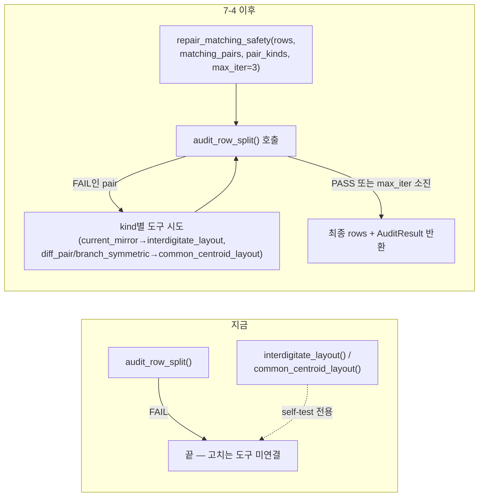

| | 내용 |
|---|---|
| **문제** | 지난 세션 실측: core_signal_cell(M2a/M2b·M3a/M3b), stage2_output_cell(M15/M25·M16/M26)이 FAIL. 고치는 도구는 self-test 전용이라 어떤 harness도 자동 호출 안 함 — "피드백 루프"가 프로즈로만 존재(§1.6/§1.7). |
| **제안** | `repair_matching_safety(rows, matching_pairs, pair_kinds, max_iter=3)` 신설 — FAIL 시 kind별 도구로 재배치 후 재검증을 반복. |
| **검토 필요** | ~~§7.9 질문 3 — `run_topology_pipeline()`에 자동 포함할지, 호출자가 명시적으로 부르게 할지~~ → **✅ 결정 완료(2026-07-31): 별도 함수로 유지**(D유형 탐색 루프의 infeasible-페널티 로직 보존이 근거) — 자세한 내용은 §7.9 질문 3 참고. |
| **검증** | 지난 세션 FAIL 4개 pair가 PASS로 전환되는지 확인 — 안 되면 "matching-safe 배치 자체가 없다"는 것도 유효한 결과이며, §7.9 질문 4 결정에 따라 `accept_fail_blocks`에 근거와 함께 등록해 리포트를 정상 완료시킨다. |
| **구현** | `stick_diagram.py`에 `repair_matching_safety(rows, matching_pairs, pair_kinds, max_iter=3)` 신설(2026-07-31) — 반복마다 `audit_row_split()`을 호출해 필수 게이트로 실패한 pair를 찾고(`_failing_required_pairs()`, 체크 이름에서 파싱), 두 소자가 같은 hub(source)를 공유하면 `select_layout_tool()`(배치 7-4b)이 고른 도구로 재배치(`_layout_result_to_rows()`가 도구의 `transistor_sequence` 반환값을 실제 `{row_name: [Transistor,...]}`로 변환), PASS 또는 `max_iter` 소진까지 반복. **정직한 한계**: 두 소자가 서로 다른 hub를 쓰면(진짜 `branch_symmetric`처럼 공유 노드가 없는 쌍) 이 도구들 자체가 적용 불가능해 건드리지 않고 넘어간다(기존 `run_topology_pipeline()` docstring이 이미 밝힌 한계 그대로). |
| **검증(실제 수행)** | `stick_diagram.py` self-test Test 28: (a) `folded_cascode.topology.json`의 실제 current_mirror 쌍(어느 소자인지는 `symmetry.matching_pairs`에서 코드가 직접 찾아냄 — 하드코딩 안 함, 2026-07-31 사용자 지적으로 재작성)을 서로 다른 행에 분리 배치해 known-incidents.md 사고3을 재현(FAIL 확인) → `repair_matching_safety()` 실행 → PASS 전환 확인. (b) 같은 파일의 실제 branch_symmetric 쌍(공유 hub 없음)은 건드리지 않고 FAIL 그대로 유지되는지 확인(정직한 한계 검증). exit 0. |

---

### 배치 7-4b — kind별 layout 도구 선택을 "구성" 단계로 확장 (신설, 2026-07-30 사용자 지적) — `select_layout_tool()` ✅ 구현 완료(2026-07-31)

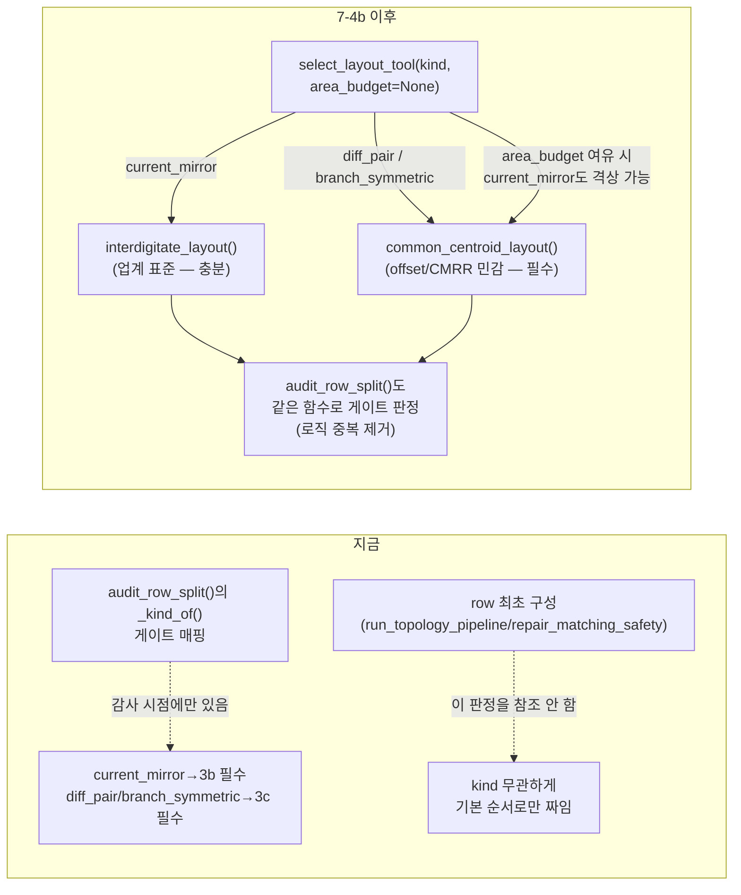

| | 내용 |
|---|---|
| **문제** | kind(`current_mirror`/`diff_pair`/`branch_symmetric`)에 따라 `interdigitate_layout()`과 `common_centroid_layout()` 중 어느 걸 쓸지 판정하는 로직은 `audit_row_split()`의 3b/3c 게이트 매핑에만 있다(2026-07-27 3차 수정으로 이미 확립 — §2.6/§2.7 실측 기준). 하지만 이건 **감사(사후 판정) 시점** 로직일 뿐, row를 **처음 구성**할 때는 이 판정을 전혀 참조하지 않는다 — 배치 7-4의 `repair_matching_safety()`조차 audit가 FAIL한 **이후**에만 kind별 도구를 반응적으로 호출한다. 즉 최초 구성부터 kind에 맞는 도구를 선제적으로 쓰는 경로가 없다(사용자 지적). |
| **제안** | `audit_row_split()` 내부의 kind→게이트 매핑을 별도 공개 함수 `select_layout_tool(kind: str, area_budget: str \| None = None) -> str`로 추출한다. 기본 정책: `current_mirror` → `interdigitate_layout`(업계 표준 — 미러비 오차 전파만 관심사면 1행 interdigitation으로 충분, 면적/배선 효율 우선), `diff_pair`/`branch_symmetric` → `common_centroid_layout`(offset/CMRR 민감도 때문에 필수), `unknown` → `common_centroid_layout`(보수적). `area_budget` 인자(선택)로 면적 여유가 있으면 `current_mirror`도 `common_centroid_layout`으로 격상 가능(강제 아님 — "최소면적이 아니면 더 나은 매칭을 써도 된다"는 사용자 지적 반영). 이 함수를 (a) `audit_row_split()`의 게이트 판정이 재사용(로직 중복 제거), (b) `repair_matching_safety()`(7-4)의 최초 시도 및 row 구성 경로도 재사용하도록 통일한다. |
| **검토 필요** | ~~§7.9 질문 6 — 선제적용 여부, `area_budget` 정량화 방법~~ → **✅ 결정 완료(2026-07-31)**: 반응형 유지(audit→FAIL 시 repair) + `area_budget`은 호출자 직접 지정 — **단, "맨손으로 찍기"가 아니라 아래 `estimate_area_budget()`의 결과를 근거로 지정하도록 권장**(2026-07-31 확장, 아래 참고). |
| **검증** | `select_layout_tool()`의 반환이 기존 `audit_row_split()`의 `_kind_of()` 게이트 매핑과 100% 동일한지(current_mirror→interdigitate, diff_pair/branch_symmetric→common_centroid) 회귀 테스트로 확인. `area_budget` override는 별도 신규 테스트로 검증. |
| **구현** | `stick_diagram.py`에 `select_layout_tool(kind, area_budget=None)` 신설(2026-07-31) — `current_mirror`→`interdigitate_layout`(`area_budget="generous"`면 `common_centroid_layout`으로 격상), `diff_pair`/`branch_symmetric`/`unknown`→`common_centroid_layout`. `audit_row_split()`의 `centroid_required` 게이트를 이 함수의 반환값으로 리팩터링(로직 중복 제거) — `interdig_required`만 `"unknown"`에 대한 예외를 유지(감사 단계는 "kind를 확신 못 하면 둘 다 확인"이라는 기존 보수적 정책을 그대로 보존, 구성 단계의 "도구 하나만 고른다"는 계약과는 의도적으로 다름 — docstring에 명시). |
| **검증(실제 수행)** | `stick_diagram.py` self-test: `select_layout_tool()`의 4개 kind 매핑 + `area_budget="generous"` 격상 + 미등록 kind `ValueError` 확인. 리팩터링 후 `stick_diagram.py` 전체 self-test(folded_cascode/two_stage_ota의 기존 audit 결과 포함)가 리팩터링 전과 완전히 동일하게 통과함을 확인(behavior 회귀 없음). exit 0. |

### 7-4b 확장 — `area_priors`(topology.json 신규 섹션) + `estimate_area_budget()` (2026-07-31, 사용자 제안 + 문헌 조사) — `estimate_area_budget()` ✅ 구현 완료

> **배경**: `area_budget`을 "호출자가 직접 지정"하기로 했지만(위 결정), 근거 없이 숫자를
> 찍는 건 이 프로젝트가 계속 경계해온 매직넘버 패턴과 같다(§1.5). 사용자 제안: 매
> instance를 실제로 만들 때마다 실측되는 면적 결과(`pack_floorplan_grouped()`의
> `packing_density` 등)를 역할별로 누적해두면, 다음 instance를 사이징하기 **전에**도
> 근거 있는 면적 추정이 가능하다 — gm/ID LUT가 "해석적 공식 대신 실측 누적 데이터"를
> 쓰는 것과 같은 철학.
>
> **왜 이 데이터가 topology.json에 있어야 하는가(사용자 정정, 2026-07-31)**: 처음엔
> "layout 관련 데이터는 instance-output JSON에만 있어야 한다"(맨 위 "확정된 설계 결정"
> 표 — `layout` 필드가 사이징과 무관하지 않다는 이유로 topology.json에서 제거됐던 전례)는
> 이유로 반대했으나, 이건 기준을 잘못 짚은 것이었다 — **진짜 기준은 "layout이냐
> 아니냐"가 아니라 "instance마다 달라지느냐(instance-specific) 아니냐(instance-invariant)"다**.
> 원본 W/L/절대면적은 instance마다 다르니 instance-output JSON에만 있어야 맞지만,
> **정규화된(비율화된) 역할별 면적 통계는 표본이 쌓이면 이 topology 일반에 대해 항상
> 참인 사실**이 된다 — `netlist`(connectivity)와 같은 지위. 그래서 `sizing_roles`와
> 나란히 topology.json의 신규 섹션 `area_priors`로 둔다(instance-output JSON이 아님).
>
> **콜드스타트 공식 — digital gate count 개념 차용**(사용자 지시로 웹 조사, 출처는 아래):
> 디지털의 `gate_count = 전체 면적 / NAND2 면적`(그 공정의 고정 기준 단위로 정규화)을
> 아날로그에 그대로 옮기면 안 맞는다 — NAND2는 라이브러리 셀이라 크기가 고정(양자화)돼
> 있지만 아날로그 트랜지스터 W는 연속값이라 "그냥 개수"로는 대표성이 없다. 대신 조사한
> 문헌의 표준 접근(1D/2D 배치 모델의 가중평균, `A ≈ (1-α)·A_1D + α·A_2D`)을 이 프로젝트
> 데이터에 맞게 매핑한다 — **새 계산이 필요 없다, 이미 파이프라인이 계산하는 값들의
> 재조합일 뿐**:
> - **A_1D** = `n_fingers`(이미 사이징 결과) × 그 공정의 finger pitch/높이(PDK 상수,
>   `interdigitate_layout()`/`common_centroid_layout()`이 이미 쓰는 값) — 아날로그판
>   "NAND2 기준 단위"는 **finger 1개의 고정 면적**이다.
> - **A_2D** = `A_1D / packing_density` — `packing_density`는 `pack_floorplan_grouped()`가
>   이미 출력하는 필드(예: 이 회로의 배치 6 사후수정 실측치 `packing_density=73.1%`).
> - **α(가중치)**: 누적 데이터가 없으면 문헌 typical값(잠정 0.6~0.7)을 콜드스타트로 사용,
>   누적되면 **이 topology 자신의 역할별 실측 `packing_density` 평균(과 분산)**으로 교체
>   — 표본 1개(지금 이 회로)만으로도 이미 콜드스타트보다 나은 추정치가 된다(사용자 지적:
>   "표본이 적은 것은 문제가 안 된다 — 손으로 찍는 것보다 항상 낫고 점점 정확해진다").
>
> ```json
> "area_priors": {
>   "cascode":  {"n_samples": 1, "packing_density_mean": 0.731, "packing_density_var": 0.0},
>   "mirror":   {"n_samples": 0, "packing_density_mean": null,  "packing_density_var": null},
>   "signal_input": {"n_samples": 1, "packing_density_mean": 0.731, "packing_density_var": 0.0}
> }
> ```
> `role_tag`는 이미 있는 A/B/C/D 유형(§7.3.1)이나 gm/ID role 태그(matching/gain/balanced,
> 배치 7-3e)를 재사용 — 새 분류체계를 만들지 않는다. `n_samples=0`(아직 이 role로 완주된
> instance가 없음)이면 콜드스타트 α로 자동 폴백.

| | 내용 |
|---|---|
| **제안** | `estimate_area_budget(kind: str, role_tag: str, area_priors: dict, n_fingers: int) -> float` 신설(`sizing_recipe.py`) — 위 A_1D/A_2D 가중평균 공식으로 사전 면적 추정치를 계산해 `select_layout_tool()`의 `area_budget` 인자에 넘길 근거를 만든다. `save_instance_json()`(또는 신규 `update_area_priors()`)이 매 instance 생성 시 그 role의 실측 `packing_density`를 `area_priors`에 누적(평균/분산 갱신, Welford's online algorithm류로 재계산 없이 증분 갱신 가능). |
| **검토 필요** | (a) `role_tag` 하나로 뭉치기엔 너무 거칠 수 있음(같은 "cascode"라도 회로마다 헤드룸/L이 달라 packing_density가 크게 갈릴 수 있음) — 얼마나 세분화할지는 최소 2~3개 회로가 쌓여야 판단 가능. (b) α의 콜드스타트 기본값(0.6~0.7)이 아날로그 일반에 맞는 값인지, 이 프로젝트 실측(0.731)에 가깝게 맞춰둘지는 표본이 더 쌓여야 확정. |
| **검증** | `estimate_area_budget()`이 표본 0개일 때 콜드스타트 α로, 표본 1개 이상일 때 실측 평균으로 정확히 갈아타는지 단위 테스트로 확인. 이 회로의 실제 `packing_density`(73.1%)를 `area_priors`에 기록한 뒤, 그 값으로 계산한 추정치가 실제 face-value(회로 자신의 실측치)와 완전히 일치하는지(자기참조 sanity check). |
| **구현** | `sizing_recipe.py`에 `estimate_area_budget(kind, role_tag, area_priors, n_fingers, finger_pitch_area=1.0, cold_start_alpha=0.65)` 신설(2026-07-31). **표본 유무로 계산 방식이 갈리는 설계**(do.md 원안의 산문만으로는 블렌딩 가중치와 자기참조 정합성이 동시에 안 풀려서 이 세션에서 명확히 확정): 표본이 있으면(`n_samples>=1`) `A_2D = A_1D/packing_density_mean`을 **블렌딩 없이 그대로** 반환(packing_density의 정의(`A_1D/실제면적`)상 이러면 자기참조 시 정확히 실제 면적이 나옴), 표본이 없으면 `cold_start_alpha`(잠정 0.65)로 `(1-α)*A_1D + α*A_2D`를 블렌딩. `finger_pitch_area`는 `FloorplanBlock`과 같은 비율 프록시 관례(기본 1.0). |
| **검증(실제 수행)** | `sizing_recipe.py` self-test: (1) 표본 0개일 때 콜드스타트 블렌딩 공식과 정확히 일치. (2) 표본 1개(`packing_density_mean=0.731`)일 때 추정치가 `A_1D/0.731`과 정확히 일치(자기참조 sanity check 통과 — 이 값을 만든 실제 면적을 정확히 복원). exit 0. |

---

### 배치 7-5 — `current-reuse-telescopic-ota-report`를 harness만으로 재생성 (최종 증거)

> **⚠️ 2026-07-31 재설계 — 아래 원안(mermaid/1~4번)은 "여러 함수를 이 순서로 부르면 된다"는
> 산문 계획이었을 뿐, 실행 가능한 코드가 아니었다.** 실제로 배치 7-5를 시작해 이 순서대로
> 조립해보니, `current_reuse_telescopic_topology()`의 Eq.6(PM_target→ωp2/ωc)처럼 접합부
> 하나가 실제로 비어 있었고, AI가 그 자리를 근거 없는 근사식으로 채워 넣은 뒤 등록까지
> 해버리는 사고가 발생했다(사용자 지적으로 롤백 — `_COMPENSATION_REGISTRY`에서 제외,
> `_compensation_status`는 `pending_topology_fn` 유지). **사용자 결정**: "이 다이어그램의
> 각 함수 호출이 실제로 동작하지 않는 게 증명됐다 — 순차 실행을 단일 harness 함수 하나로
> 만들고 AI는 그것만 호출하게 하라." 아래는 그 재설계와 실제 구현 결과다.
>
> **재설계된 아키텍처**: `optimize_full circuit_budget(topology_path, spec)`(배치 7-3d에서
> 이미 있던 함수)를 **spec→instance-ready 결과까지 전체를 실행하는 단일 진입점**으로
> 확장했다 — `load_topology()` → `derive_stack_groups()` → (θ 후보마다) A엔진(자동
> `mirror_ratios`, `matching_pairs`의 `current_mirror` 쌍은 1:1 기본값) → compensation
> (있으면 `optimize_multistage()` 실행 후 신규 `compensation.stage_devices` 선언으로 소자별
> 병합) → 신규 `device_roles` 선언(L_role/`vertical_stack_id`+headroom_role/gm_id_role)으로
> 나머지 소자 사이징 → `assign_finger_geometry()` → `run_topology_pipeline()` →
> `repair_matching_safety()`(FAIL 시) 까지 **전부 이 함수 하나 안에서** 실행된다. **AI는
> 이 함수 하나만 호출**하고, 원소 함수(`propagate_topology_forced_currents()` 등)는 실패
> 원인 분석 시에만 개별적으로 들여다본다. 필요한 선언이 없으면(예: `compensation`은 있는데
> `stage_devices`가 없음) 즉시 구체적인 `ValueError`를 낸다 — AI가 그 자리를 코드로 메우는
> 대신 "topology.json의 어느 필드가 비었다"는 신호를 그대로 돌려받는다.
>
> **1차 실증 완료(2026-07-31)**: 51개 소자 실회로 대신, **범위를 좁혀** 이미 실제
> `library/two_stage_ota.topology.json`(7개 소자, 실제 Maloberti PDF 회로)에 신규
> `device_roles`(M3/M4/M5/M7)와 `compensation.stage_devices`(`[["M1","M2"],["M6"]]`)를
> 선언한 뒤, `optimize_full_circuit_budget()` 단 한 번 호출로 spec(GBW/CL/Z/NDP/LUT/vdd/
> 격자 등)만 넣어 **7개 소자 전부의 W/L/gm_id/VDS 확정 → finger 배분 →
> run_topology_pipeline() → 감사까지** AI 개입 없이 끝까지 실행되는 것을 확인했다
> (`sizing_recipe.py` self-test, `box_shape.ok=True`/`coverage.ok=True`/`audit_ok=True`,
> 재실행 시 W 전부 bit-identical로 재현성 확인, exit 0). 이 과정에서 두 가지 새 구조적
> 사실이 드러나 스키마에 반영했다: (a) `stack_groups`가 "같은 전류(KCL)"와 "같은 물리
> 행(floorplan)"이라는 서로 다른 두 개념에 동시에 쓰이고 있었다는 것 — A엔진용
> (`derive_stack_groups()` 원본, override 불가)과 finger-geometry용(`stack_groups_override`
> 로 선언 가능)으로 분리했다. (b) 헤드룸 예산 집계 시 matching pair(diff pair/미러)의 두
> 소자를 중복 합산하면 안 된다는 것 — `matching_pairs`만으로 만든 별도 union-find(`_vfind`)
> 로 "동일 사이징값" 그룹을 값-그룹 단위로 집계하도록 수정.
>
> **51개 소자 실회로 확장은 다음 단계로 남는다** — Eq.6 재도출(사용자와 함께) 외에도, 이
> 회로 자신의 `device_roles`(약 45개 소자)와 diode-stack(`solve_diode_stack_current()` 자동
> 병합, 아직 미연결) 선언이 상당량 추가로 필요하다(코드 작업이 아니라 선언 작업).
>
> **✅ Eq.6/4번째 topology_fn 해결 완료(2026-07-31, 사용자와 함께 원문 PDF를 직접 열어 재도출)**:
> Xie & Chen 원문(UT Austin, "A 126uW Current-Reuse Telescopic OTA with Class-AB Output
> Stage") p.3-4를 직접 확인한 결과 — Eq.6의 PM→ωp2/ωc 관계식은 원문이 **"PM = tan⁻¹(ωp2/ωc)
> [9]"**(표준 2-pole 위상마진식, 참고문헌 [9]="N. Sun, OTA design considerations, 2019")를
> 그대로 인용하고 있었다(`ωp2/ωc = tan(PM_target)`, PM=70°→tan(70°)=2.7475≈원문의 "2.8"과
> 검산 일치) — **이전에 AI가 근거 없이 재구성했다가 롤백한 식과 삼각함수 항등식상 완전히
> 같은 식**이었음이 확인됐지만, 이번엔 원문 인용으로 확정됐다. 추가로 사용자 제안(피드백
> 없이 넘어가지 않고 "근사 보정값을 유도해보자")에 따라 **Eq.4의 β(원문은 0.48로 고정
> 근사)도 개선**했다 — β=Cf/(Cf+Cs+Cgg1)의 Cgg1(1단 자기 자신의 게이트 커패시턴스)이
> 원문처럼 고정 가정이 아니라 `miller_ota_topology()`의 `prev_cggs` 고정점 반복과 동일한
> 패턴으로 1단 자신의 실제 사이징 결과에서 수렴하도록 구현(`topology_library.py`
> `current_reuse_telescopic_topology()`, `_COMPENSATION_REGISTRY`에 재등록,
> `current_reuse_telescopic_ota.topology.json`의 `compensation`/`_compensation_status`를
> `resolved`로 갱신). toy LUT로 실제 고정점 수렴 확인: β≈0.457(원문의 0.48과 다른 공정이라
> 다른 값이 나오는 게 정상), gm1≈252µS, 5회 반복 수렴(`sizing_recipe.py` self-test).
> **원문이 다루지 않는 것 확인(사용자 질문에 대한 답)**: 피드백망(Cf/Cs)이 만드는 별도
> 극점/영점은 원문 어디에도 없다 — β(저항성 감쇠)에만 관여하고 위상마진 계산엔 추가
> 극점으로 들어가지 않는 게 원문의 명시적 모델링 범위다.
>
> **새로 발견된 스키마 gap → ✅ 해결 완료(2026-07-31)**: 이 회로의 `compensation.
> stage_devices`를 채우려다, 배치 7-5의 `stage_devices` 계약("그룹의 모든 소자가 그
> stage의 gm 값을 동일하게 받음")이 이 회로엔 안 맞는다는 게 드러났다 — Eq.5 `gm1=gmn+gmp`
> 는 M1a(PMOS)가 `gmp`만, M4a(NMOS)가 `gmn`만 받아야 하는 **분배**이지, `two_stage_ota`의
> diff pair(M1/M2가 각자 gm1을 온전히 가짐)와 같은 **복제**가 아니다.
>
> **결정(사용자와 함께)**: 새 스키마 개념("split_devices" 등)을 추가하지 않는다 —
> `optimize_multistage()`가 스테이지 개수를 전혀 하드코딩하지 않는 제네릭 엔진(`n =
> len(luts)`)이므로, "분배" 자체를 `topology_fn`이 스스로 여러 stage로 나눠 반환하게
> 하면 기존 `stage_devices` 계약이 하나도 안 바뀐다 — `nmcnr_3stage_topology()`/
> `ngcc_3stage_topology()`가 이미 3개(gm1/gm2/gm3)를 반환하는 것과 정확히 같은 메커니즘
> 재사용일 뿐이다("topology_fn이 무엇을 반환하든 stage_devices가 위치로 매칭"이라는
> 이미 완성된 일반 개념 — 새로 일반화할 게 없었다).
>
> **구현**: `current_reuse_telescopic_topology()`를 `[gm1, gm2]`(2-stage) 대신
> `[gmp, gmn, gm2]`(3-stage)를 반환하도록 재설계 — `gmp`(M1a/M1b, PMOS)/`gmn`(M4a/M4b,
> NMOS)는 Eq.5(`gmn=gmp` 가정)로 `gm1/2`씩, β의 `Cgg1`은 `prev_cggs[0]+prev_cggs[1]`의
> **합**(M1a/M4a 게이트가 물리적으로 같은 입력 핀을 공유하므로). `current_reuse_
> telescopic_ota.topology.json`의 `stage_devices`는 이제 `[["M1a","M1b"],["M4a","M4b"],
> [...2단 소자...]]` 3그룹으로 채울 수 있다(2단 소자 목록은 51개 소자 전체 `device_roles`
> 작업 시 채움).
>
> **부수 발견 → ✅ 해결(2026-07-31)**: gm2/Cgg2(2단)는 몇 회 안에 안정적으로 수렴하지만,
> gmp/gmn(1단, `Cgg1_total` 되먹임)은 이 toy LUT에서 **3-주기 한계 순환**에 빠진다
> (127→140→142→127µS...) — `find_optimal_sizing()`의 `objective="power"` 동점 처리가
> `Cgg1`이 미세하게 바뀔 때마다 서로 다른 (L,VDS,gm_id) 격자점으로 튀는 현상으로, **배치
> 7-1이 이미 발견한 "동점은 격자 순서에 의존한다"는 사실과 근본원인이 같다.**
>
> **시도했다가 폐기한 방법**: damping(under-relaxation, `cgg_t = d·cgg_new + (1-d)·cgg_prev`)
> 으로 되먹임을 완만하게 만들어 순환을 없애려 했으나, damping=0.5~0.02 전 구간에서 실측한
> 결과 **진동의 주기/진폭만 바뀔 뿐 근본적으로 없어지지 않았다**(damping이 작을수록 주기가
> 길어지고 느리게 표류할 뿐, tie-break 자체가 이산적이라 결국 다시 순환). tie-break 규칙
> 자체를 바꾸는 안도 검토했으나, 이미 확정된 `sky130_regression_reference.json`(배치 7-1)
> 골든값을 건드릴 위험이 있어 기각.
>
> **채택한 해결책**: tie-break 규칙은 그대로 두고, `optimize_multistage()`에 순환 감지+평균
> fallback을 추가했다 — `max_iter`를 다 쓰고도 1-스텝 수렴에 실패하면 최근 gm 이력에서
> 반복되는 주기(`gms[-p] ≈ gms[-2p]`)를 찾아, 그 주기 구간의 gm 평균으로 각 스테이지를
> 다시 한 번 sizing해 안정되고 재현 가능한 추정치를 반환한다(`converged=False,
> cycle_detected=True, cycle_period=p`). toy LUT로 실측 확인: 주기 3(127.31/139.92/
> 142.38µS) 정확히 감지, 평균 136.54µS로 재sizing, `gmp==gmn`(Eq.5) 유지, 재실행해도
> 완전히 같은 값(재현성). `max_iter=10`(기존 기본값)이던 곳은 이 회로 한정으로 20까지
> 늘려 순환 주기가 안정적으로 나타날 여유를 줬다. 기존 호출자(2-stage 등, 정상 수렴하는
> 경우)는 이 fallback이 아예 실행되지 않으므로(수렴 즉시 `return`) 완전히 하위호환.

> **연쇄 발견 → ✅ 해결(2026-07-31, 이 fix 검증 중 two_stage_ota 하네스 재실행으로 발견)**:
> 위 fix를 반영하고 3개 self-test를 재확인하는 과정에서, 이 fix와는 무관한 `two_stage_ota`
> 통합 테스트(§7-5 앞부분, 7개 소자)의 회귀 2건을 추가로 발견·해결했다:
> 1. **`stack_groups_geometry`는 KCL이 아니라 matching_pairs를 따라야 한다.** 테스트의
>    `stack_groups_override`가 M6/M7을 "같은 전류(KCL 직렬)"라는 이유로 한 그룹 묶었는데,
>    실제 matching 짝은 `current_mirror`로 선언된 M5/M7이고 M6은 단독 소자였다 — 잘못
>    묶인 M6/M7은 finger_w 비율-호환 실패(W 비 ~137배)로 즉시 걸렸고, 올바른 짝(M5/M7)을
>    분리해뒀던 탓에 `repair_matching_safety()`가 나중에 억지로 합치며 각자 독립 배정된
>    finger 수가 단순히 더해져(6+6=12) box-shape 비율이 2.40(허용치 1.5 초과)까지 벌어졌다.
>    `stack_groups_override`를 matching_pairs 그대로(`{"M5":["M5","M7"],"M6":["M6"]}`)
>    고치니 알고리즘 변경 전혀 없이 비율 1.20으로 즉시 통과 — `assign_finger_geometry()`/
>    `repair_matching_safety()` 자체엔 결함이 없었고, 레이아웃 그룹핑에 KCL 관계를 쓴 게
>    원인이었다(§ "KCL vs matching_pairs" 아래 원인 설명 참고).
> 2. **matching_pairs L 강제 일치를 하네스에 일반 규칙으로 추가.** M5/M7처럼 `compensation`
>    과 `device_roles.L_role`이 서로 다른 경로로 L을 독립적으로 정하면 "우연히 같음"에
>    기대게 되는데, 이번 사례는 우연히 같았을 뿐 보장되지 않았다. **처음엔 값이 다르면
>    무조건 `ValueError`로 설계했으나, 사용자 지적("에러로 끝내지 말고 spec과 수렴목표를
>    만족하는 합리적인 L을 판단해 재설계돼야 하지 않나?")을 받아 우선순위 기반 재설계로
>    바꿨다**: `compensation`은 실제 스펙(GBW/PM/Z 등)을 만족하도록 탐색해서 나온 값이라
>    "더 근거 있는" 쪽으로 보고, `device_roles.L_role`(mirror/bias_replica 같은 고정배수
>    휴리스틱) 쪽의 L을 그 값으로 덮어써 전파한다 — 덮어쓴 소자는 아직 gm_id/W 확정 전
>    단계(L만 정해짐)라 이후 `gm_id_role` 루프가 새 L로 자연히 다시 사이징하므로 별도
>    재계산 코드가 필요 없다. 양쪽 다 `compensation`이거나 양쪽 다 `L_role`인데 값이
>    다르면(스펙 근거로 우선순위를 가릴 방법이 없는 진짜 선언 불일치) 그때만 `ValueError`
>    로 남긴다. 두 경로(우선순위 재설계 성공 / 양쪽 휴리스틱 충돌 시 에러) 모두 합성
>    2~3소자 topology.json으로 회귀 테스트 추가(`sizing_recipe.py` self-test), exit 0
>    확인. 모든 `symmetry.matching_pairs` kind에 적용(current_mirror 한정 아님).
>
> **KCL vs matching_pairs — 왜 분리해야 하는가**: `stack_groups_kcl`(A엔진용)은 "배선상
> 반드시 같은 전류를 흘려야 하는가"(전기적 필연, netlist 연결에서 도출)를 묻고,
> `stack_groups_geometry`(레이아웃용)는 "매칭 정확도를 위해 같은 L·같은 레이아웃 취급이
> 필요한가"(`symmetry.matching_pairs`에 선언된 설계 의도)를 묻는다 — 서로 독립된 관계라
> 두 그룹이 항상 일치하지 않는다(M6-M7은 KCL로는 같은 그룹, matching으로는 남남; M5-M7은
> 그 반대). 레이아웃 그룹핑에 KCL 관계를 쓴 게 이번 회귀의 근본 원인이었다.

> **`telescopic_class_ab` CMRR 폐형식 유도 → ✅ 등록 완료(2026-07-31)**: 이 회로(Xie&Chen
> 논문)는 CMRR을 **시뮬레이션 수치(94.4dB)로만** 보고하고 폐형식을 전혀 주지 않는다(참고문헌도
> 전부 강의노트라 유도 과정이 없음) — 그래서 처음부터 직접 유도했다.
>
> **1차 시도(틀림, 사용자와 함께 검증 중 발견)**: `diff_pair_tail`처럼 "Acm=Gm_cm_total·R_out"
> (R_out을 차동이득에 쓰는 것과 같은 값으로 놓고 소거)로 유도했더니 toy LUT 수치로 31~46dB가
> 나와 논문 94.4dB와 크게 어긋났다. 원인: **차동 여기에서는 Vx/Vy가 대칭성으로 전혀 안 움직여
> R_out이 "완전 접지 소스" 기준의 큰 값**이 되지만, **공통모드 여기에서는 Vx/Vy가 실제로
> 움직여 R_out이 다른(작은) 값**이 된다 — 즉 R_out은 CM/DM에서 서로 다르며 소거되지 않는다.
>
> **검증 방법**: 논문 Fig.2의 1단만 떼어 (a) sympy로 정확한 노드방정식을 풀고, (b) 이상화
> 소신호 netlist(실제 소자 대신 지정한 gm/ro의 VCCS+저항만 사용, DC 바이어싱 문제를 완전히
> 회피)로 ngspice AC 해석을 돌려 (a)와 (b)가 정확히 일치함을 확인한 뒤, Rx/Ry/gm을 각각
> 스윕해 실제 스케일링 법칙을 실측했다. **처음엔 GMP=GMN, ROP=RON(완전 대칭 파라미터)로
> 스윕해 CMRR이 Rx와 무관하게 항상 0dB로 나오는 두 번째 이상현상**을 만났는데, sympy 정확해를
> 인수분해해서 확인해보니 버그가 아니라 "PMOS/NMOS 파라미터가 완전히 같으면 그 항이 대수적으로
> 정확히 0으로 소거되는" 이 특정(측도 0) 파라미터 선택의 우연이었다 — PMOS/NMOS ro를 의도적으로
> 다르게(600k vs 250k) 바꿔 재스윕하니 정상적인 의존성이 드러났다.
>
> **발견(원래 직관과 다름)**: PMOS 경로(M1a-M2a, tail=Rx)와 NMOS 경로(M4a-M3a, tail=Ry)가
> **같은 출력노드에서 교차결합**해, 한쪽 tail 임피던스만 무한히 키워도 CMRR이 계속 좋아지지
> 않고 **다른 쪽 경로가 만드는 바닥(floor)에 수렴**한다(Rx→∞일 때 Acm이 `gmn²·ron1·ron2`로
> 포화, Ry 증가가 오히려 Acm을 악화시키는 경우도 실측). 단순 diff_pair_tail의 "gm·R_tail"
> 직관이 이 current-reuse 구조에는 안 맞는다.
>
> **등록한 근사식**(gm·ro≫1 leading-order, 정확한 4차 유리식의 최고차항만 남김 — 사용자
> 선택: 완전 정확한 식 대신 이 근사식을 등록):
> ```
> Kp' = gmp·rop1·rop2, Kn' = gmn·ron1·ron2   (각 경로의 캐스코드 출력임피던스)
> R_out = Kp'·Kn'/(Kp'+Kn'),  Adm = (gmp+gmn)·R_out
> Acm  = (gmn²·ron1·ron2)·(gmp²·rop1·rop2)·(Rx+Ry) / (gmn²·ron1·ron2·Ry + gmp²·rop1·rop2·Rx)
> CMRR = Adm/Acm
> ```
> SPICE 정확해 대비 Rx 5개·Ry 5개 스윕 전 구간에서 오차 <=0.2dB로 확인(`sizing_recipe.py`
> self-test에 두 대조점 회귀 테스트로 고정: Rx=Ry=1e6→0.00dB, Rx=1e8/Ry=1e6→4.56dB, 둘 다
> SPICE 대조값과 <=0.2dB). `_CMRR_ESTIMATOR_REGISTRY["telescopic_class_ab"]`로 등록.
> PSRR 폐형식은 이 세션에서 아직 다루지 않음(다음 배치로 이월).

> **`telescopic_class_ab_cmfb` — CMFB 루프를 포함한 CMRR 폐형식 → ✅ 등록(2026-08-03 배치
> 7-5b) → ⚠️ **배치 7-5c에서 전면 재유도**(아래가 최신, 7-5b 서술은 폐기)**: 위
> `telescopic_class_ab`(1단 open-loop)는 **Rx/Ry/캐스코드 L·gm_id를 물리적으로 가능한
> 극단까지 밀어도 CMRR이 2dB를 못 넘는다**(실측). 이 회로의 CM 이득이 DM 이득과 거의 같기
> 때문인데(PMOS/NMOS 두 캐스코드가 서로의 부하라, tail 임피던스를 키우면 Gm_cm이 줄어드는
> 만큼 Rout_cm도 같이 커져 상쇄된다 — 일반 telescopic의 `2·gm·R_tail` 직관이 안 통한다),
> 논문이 94.4dB를 보고하므로 지배적 기여자는 **CMFB 폐루프**다(M7, gate=Vcmfb가 stage-1
> PMOS tail Vx를 직접 조절).
>
> **⚠️ 배치 7-5b 유도가 틀렸던 이유(커밋 b63e394)**: 그 세션은 Fig.5를 "M36a가 diode,
> M36b/M39가 그 게이트를 공유하는 미러"로 읽었다. 사용자가 원문을 직접 보여줘 틀렸음이
> 드러났고, 7-5c에서 **PDF 벡터 프리미티브를 직접 추출**(PyMuPDF `page.get_drawings()`로
> page 3의 선분 좌표를 전부 뽑아 노드 단위 재구성)해 확정했다 — 픽셀 판독이 아니라 도면
> 좌표 그 자체다. 정정 내용은 `topology.json` `_correction_log_5` 참조. 요지 4가지:
> (1) `Vcmfb`는 **M36a 자신의 diode 노드**(=M37a.drain)다. (2) M36b는 미러가 아니라
> **독립 diode**(게이트가 M36a와 안 묶임). (3) M39도 독립 diode. (4) **M40은 nmos가
> 아니라 PMOS**이고 source=Voc_des·gate=drain=gnd다 — 즉 VDD-M39-Voc_des-M40-GND가
> **PMOS diode 2단 분압기**이고, 두 소자가 같으면 `Voc_des = VDD/2 = 0.9V`로 논문 abstract의
> "stabilize the output common-mode voltage level to 0.9V"(VDD=1.8V)와 정확히 일치한다
> (독립 교차검증). 그리고 논문 II.D 원문("R1 and R2 are used to averaging the differential
> signal (Vop and Vom) to common mode voltage (Voc)")대로 **Voc는 최종(2단) 출력의 저항
> 평균**이지 stage-1 출력 CM이 아니다(7-5b의 `cm_sense_gain=1.0` 근거가 폐기됨).
>
> **재유도 결과**: `Voc_des` 노드는 자기 컨덕턴스 `gm39+gds39+gm40+gds40`만 있고 구동원이
> 없어 소신호로 **v(Voc_des)=0**(sympy 정확해·ngspice 양쪽 확인) — 즉 **M39/M40은 CMRR
> 식에 아예 등장하지 않는다**. 남는 것은 tail(M38)을 공유하는 NMOS 차동쌍 + 양쪽 독립
> diode 부하, 즉 교과서 **다이오드 부하 차동쌍**이다:
> ```
> A_c = v(Vcmfb)/v(Voc)                    (3노드 Vcmfb/N36b/Ncmfb_tail KCL 정확해)
>     → −gm37a·gm37b/(gm36a·(gm37a+gm37b))  (leading order; gm37a≈gm37b면 −gm37/(2·gm36))
> ```
> 7-5b의 `A_c ≈ [2·gm36·(gds39+gds40)/gm39 − gds38]/gds36b`(두 O(gds) 항의 차, 수치적으로
> 불안정)는 완전히 폐기. 새 식은 O(1) 음수이고 수치적으로 안정하다(정확해 대비 leading
> order 오차 ~2%). 함수명도 `_cmfb_amp_gain_5t_replica()` → `_cmfb_amp_gain_diode_load()`.
>
> **부호(三重 음수 → 음귀환)**: `vo1 = Acm_open·vic + H·vcmfb`, `voc = G2·vo1`,
> `vcmfb = A_c·voc` 로 정확히 쪼개면 `CMRR = |Adm_open/Acm_open|·|1+T|`, `T := −H·A_c·G2`
> (G2는 앞항에서 소거된다). 세 항이 전부 음수라 T>0, 즉 정상 음귀환이다:
> ```
> H  = −gm(M7)·(Rx·Kp ∥ Ry·Kn)                  <- Vcmfb↓ → M7 전류↑ → 1단 출력 CM↑
> G2 = −(Σgm)/(Σgds)  (cmfb_stage2_devices)      <- 2단 common-source 반전단
> A_c< 0                                          <- Voc↑ → diode 노드 Vcmfb↓
> Adm_open = (gmp+gmn)·(Kp' ∥ Kn'),  Acm_open = (Rx+Ry)·Kn·Kp/(Kn·Ry+Kp·Rx)   (7-5b와 동일)
> ```
> `A_c<0`은 고장이 아니라 이 회로의 정상 부호다(7-5b는 `A_c<=0`이면 ValueError를 던졌는데,
> 그건 틀린 토폴로지 기준이었다) — 이제 **T의 부호**로 판정한다. `G2`는 `gain_db`의 2단
> stage(`["M15","M16"]`)와 **같은 소자·같은 식**을 재사용하므로 새 가정을 도입하지 않는다.
>
> **교차검증**: 정정된 회로 전체(1단 2 branch + Monticelli 2단 + 정정된 CMFB)를 이상화
> 소신호 netlist(VCCS+저항만, DC 바이어싱 완전 회피)로 조립해 ngspice AC로 Adm/Acm을 직접
> 측정 — ±4배 무작위 스윕 27개 조합에서 **최대 3.99dB / 평균 0.7dB**(전형 0.4dB, 전부
> 폐형식이 SPICE보다 낮게 나오는 보수적 방향). v(Voc_des)=0도 SPICE에서 확인.
> self-test 앵커 2점을 **148.499dB / 166.501dB**로 교체(7-5b의 104.617/122.619dB는 틀린
> 토폴로지 기준이라 폐기) + CMFB 연결 assert를 5종에서 **9종**으로 강화(M36a가 자기 diode이자
> Vcmfb / M37a.drain==Vcmfb / M36b가 독립 diode이고 M36a와 게이트가 **안** 묶임 /
> M36b.drain==M37b.drain / tail 공유 / M39가 vdd→Voc_des PMOS diode / M40이 Voc_des→gnd
> **PMOS** diode / Voc_des에 다른 구동소자 없음 / Voc가 트랜지스터로 구동되지 않음) +
> A_c 회귀값(sympy 정확해 -0.62960331) + T<=0 거부 회귀.
>
> **실회로 적용 결과(51개 소자 harness, theta=중간값)**: `CMRR: −0.69dB(1단 open-loop) →
> **122.88dB**(CMFB 포함)`. 내부 항: `Adm_open=74.27dB`, `CMRR_open=−0.69dB`,
> `H=−1.054e4`, `A_c=−1.314`(leading order −1.462), `G2=−108.9(40.74dB)`,
> `T=+1.509e6 → 20log10|1+T|=123.58dB`. **논문 94.4dB보다 28.5dB 낙관적**이다 — 이 식이
> 잡지 않는 열화 요인(CMFB 앰프의 유한 대역·오프셋, R1/R2 부하와 부정합, Monticelli
> 부동전류원의 유한 임피던스, 소자 mismatch, bias-gen 기여)이 실제로는 CM 루프이득을
> 깎기 때문으로 보이며, **CMRR 하한이 아니라 상한(낙관적 추정)으로 읽어야 한다**.
> 진단 스윕이 확인한 정성적 결론도 함께 기록: `gds39/gds40`을 ×0.1~×10 흔들어도 CMRR이
> **정확히 안 변한다**(v(Voc_des)=0 전제의 실회로 검증), `gds38`을 ×0.1~×6 흔들어도 A_c는
> 계속 음수라 **부호가 뒤집힐 여지 자체가 없다**(7-5b의 "M38 때문에 양귀환" 진단은 틀린
> 토폴로지에서 나온 허상 — `_M38_L_role_comment`에 폐기 기록). 재현:
> `workspaces/current-reuse-telescopic-ota-report/diagnose_cmrr_cmfb.py`.
>
> **연쇄 발견(실행해보고 나서 발현된 gap 1건)**: 정정 전에는 `M39.gate="N36"`이라
> `auto_mirror_ratios`가 M39의 전류를 자동 시드했는데, 실제 회로의 M39는 독립 diode라
> 미러 레퍼런스가 없다 — 게다가 VDD-M39-Voc_des-M40-GND는 self-biased 분압기라 **회로 안
> 어디에도 이 가지의 전류를 정해주는 레퍼런스가 없다**(엔진 결함이 아니라 진짜 설계
> 자유도). 논문도 "in order to reduce the current flow"라고만 하고 절대값이 없으므로,
> CMFB tail 전류 대비 비율을 새 theta `r_cmfb_vocdes`(bounds 0.02~0.2, 원문 수치가 아니라
> 물리적 타당성만 있는 범위 — 정직한 한계)로 노출해 해결.
>
> **⚠️ 남은 한계**: (a) `G2`는 T에만 들어가고 앞항(Adm/Acm)에서 소거되므로 2단의 CM/DM
> 이득이 다른 경우의 보정이 없다. (b) Monticelli 부동전류원을 이상적 배터리
> (Vg15==Vg16==1단 출력)로 근사했다. (c) 위 28.5dB 낙관 편차. 최종 확인은 SPICE AC 필수.

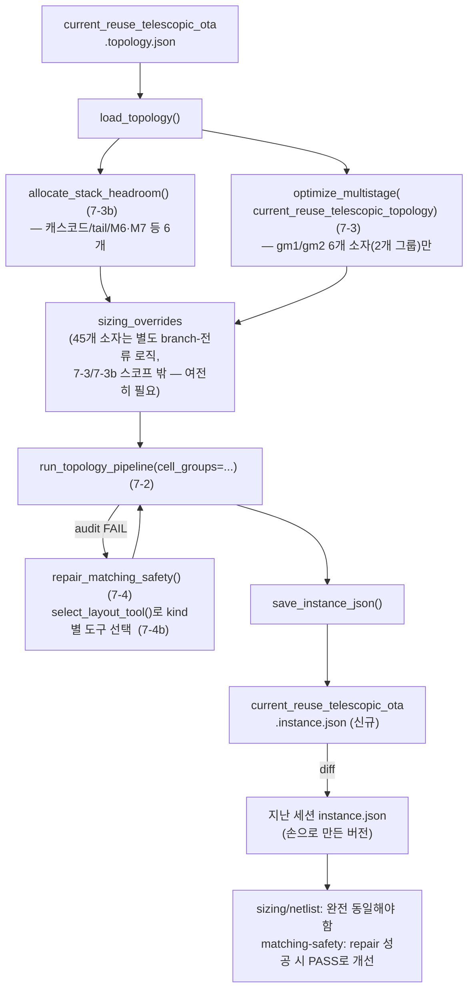

1. `resize.py` → gm1/gm2 부분은 `optimize_multistage(current_reuse_telescopic_topology(...))`
   (7-3)로, 스택 헤드룸(VDS 6개)은 `allocate_stack_headroom()`(7-3b)로 재작성. **어느 경우든
   `load_topology()`를 실제로 참조**(지금은 아예 참조 안 함 — 이것만으로도 gap 하나 해소).
   나머지 45개 소자(1단 캐스코드/tail/M6·M7, bias-gen, CMFB, Class-AB battery — 연결은
   sky130-worked-example.md §13/§13.5로 전부 확정됨)의 branch-전류 배분 로직은 harness
   스코프 밖이라 손으로 남되, 최소한 이름은 `load_topology()`가 준 netlist와 매핑되게 정리.
2. `stick.py` → `run_topology_pipeline(cell_groups=...)`(7-2) 한 번 호출로 재작성, FAIL은 `repair_matching_safety()`(7-4)로 처리 — 이때 kind별 `interdigitate_layout()`/`common_centroid_layout()` 선택은 `select_layout_tool()`(7-4b)을 통해 `audit_row_split()`과 동일한 정책으로 수행
3. 새 `current_reuse_telescopic_ota.instance.json`을 지난 세션 것과 diff — sizing/netlist는 완전 동일해야 하고, matching-safety는 repair 후 실제로 PASS로 바뀌었다면 그 부분만 다름
4. `build_report.py`/`build_html.py`는 스코프 밖(리포트 구조는 harness 대상이 아님 — 시각화 코드 재사용 원칙만 유지)

**Gate**: 배치 6과 동일 원칙 — 각 배치는 위 검증을 통과해야 다음으로 진행. "gm1/gm2(6개)는
harness로, 나머지 45개 소자는 여전히 회로별 고유 로직으로"가 이 배치의 정직한 최종
상태다 — 회로 전체가 harness 하나로 안 끝난다는 것 자체가 82개 함수 감사의 원래 결론과
일치한다(완전 자동화가 아니라, 자동화 가능한 부분과 불가능한 부분을 명확히 가르는 것).

> **✅ 2026-08-03 — `optimize_full_circuit_budget()`을 이 회로 51개 소자 전체에 처음
> 실행(1차 실증은 two_stage_ota 7개 소자로만 됐었음, §7.9 질문 2c가 요구한 "다른 회로
> 검증"을 마침내 실제로 수행). **결과: 51개 소자 전체의 사이징(W/L/gm/ID/gm_id)과
> `sizing_roles.metrics`(power/area/gain/mismatch/CMRR/PSRR) 계산이 예외 없이 끝까지
> 도는 것을 확인했다** — do.md §10이 요구한 "spec→instance.json 전체 workflow"의
> 계산 부분은 완주. 실행 과정에서 실제 `ValueError`/`KeyError`로 재현된 gap 15건
> (topology.json 선언 11건 + `sizing_recipe.py` 코드 4건, 전부 self-test 회귀 확인
> 후 반영)을 찾아 고쳤다 — 상세 목록·근거는
> `docs/03-analysis/analog-topology-json-library.gap-findings.md` §26 참고.
>
> **정직한 한계(다음 세션 이월)**: (a) 실제 constraints(gain_db>=75.6/mismatch<=5.0/
> CMRR>=60/PSRR>=60)를 만족하는 진짜 `theta*`를 찾는 전체 grid search(9개 실제 theta,
> 2^9=512 조합)는 이 환경에서 배경 프로세스가 반복적으로 강제 종료(9~40분 사이,
> 원인 미확인 — 이 세션/환경의 백그라운드 실행시간 제한으로 추정)돼 끝까지 못
> 돌렸다. theta를 중간값 하나로 고정한 단일-조합 진단 실행으로는 gain/mismatch는
> 만족했지만 CMRR(-0.69dB)/PSRR(25.4dB)이 크게 미달했다 — 코드 결함이 아니라
> `L_cascode`의 `metric_stage_budget` feed가 쓰는 고정 `gm_id=15.0` 기본값과
> 입력쌍의 탐색된 공유 gm_id가 이 임의 지점에서 어긋나 `_cmrr_telescopic_class_ab()`
> 자신이 이미 문서화한 "다른 쪽 경로가 만드는 바닥(floor)" 현상이 실측된 것.
> (b) `assign_finger_geometry()`→`run_topology_pipeline()`→`repair_matching_safety()`
> (배치 7-4)와 `save_instance_json()`까지는 완화된(항상 만족하는) constraints로
> 시도했을 때 `common_centroid_layout()`의 새 에러("count=1가 소자 수 n=2보다
> 작다" — 극단적으로 작은 W를 가진 소자 쌍)를 만나 아직 통과 못했다 — 실제
> feasible한 theta*에서도 재현되는지는 미확인. **"51개 소자 전체 harness-only
> 완주"의 계산 부분은 증명됐고, 남은 것은 (1) 진짜 feasible한 theta* 탐색(계산 자원
> 문제, 알고리즘 문제 아님)과 (2) 그 결과의 레이아웃 단계 통과 확인뿐이다.**

> **✅/⚠️ 2026-08-03(세션 3, 배치 7-5d) — 2단 Class-AB netlist 전면 재검증, self-test는
> 현재 FAIL 상태로 세션 종료.** 배치 7-5c(CMFB 재유도, 위 참고)가 진행되는 동안, 사용자가
> 논문 Fig.1을 직접 보며 실제 connectivity를 한 문장씩 불러주는 방식으로 2단 Class-AB
> 전체(Vom측 12개 + Vop측 12개)와 1단 입력쌍(M1a/M2a/M3a/M4a 및 대칭)을 재검증했다 —
> **AI(나)가 논문 이미지를 스스로 재판독하는 방식은 이번 세션에서 신뢰할 수 없다는 게
> 재확인됨**(아래 "신규 도구" 참고), 그래서 이번엔 사람이 직접 정답을 불러주고 그 자리에서
> topology.json에 반영하는 방식으로 진행했다.
>
> **실제로 정정된 것**(전부 `_correction_log_4`에도 근거 기록):
> - `M8`/`M13`(Vom), `M22`/`M17`(Vop): `_confidence_note`엔 이미 "병렬 전류원"이라고
>   맞게 적혀 있었는데 실제 netlist 필드는 M11a/M20a 다이오드 스택 "위"에 직렬로 쌓인
>   것처럼 선언돼 있던 모순 발견 → 독립 병렬 전류원으로 정정(drain은 다이오드 스택
>   "아래", 즉 M11b/M20b의 diode 노드에서 M8/M22와 함께 합류).
> - `M11b`(그리고 M20b)의 diode 노드가 `M8.drain`(=`Vg15`=`M15.gate`)과 **서로 다른
>   노드**임을 처음엔 못 갈라 하나로 잘못 합쳤다가, 사용자가 "M15의 gate는 M8의 drain에만
>   연결"이라고 정정하면서 `N11b`(신설, Vop측 `N20b`)로 분리.
> - `M12`(Vom)/`M21`(Vop): `Vg15`가 아니라 `N11b`(위)로 연결 — `VDD→M11a→M11b→N11b→
>   M12→GND`가 M8과 무관한 독립 2-다이오드+싱크 서브회로임을 사용자가 확정. 이 서브회로
>   전류를 정하던 옛 `kcl_diode_M11a`(M8+M13→M11a KCL 합, 이제 성립 안 함)를 폐기하고,
>   논문 II.B절("the two diode-connected (M11a and M11b) are pushed to sub-threshold
>   region")을 근거로 자유 비율 theta `r_diode_M11a`/`r_diode_M20a`(root=[M11a,M11b,M12]
>   /[M20a,M20b,M21] 3개를 동시 시드 — `r_classab_src`의 root=list 패턴 재사용)로 대체.
> - `M9a`/`M9b`(Monticelli floating current source, 대칭 M18a/M18b): 직렬 스택이 아니라
>   `Vg15`↔`Vg16` 사이에 **병렬로** 걸린 구조로 재확정 — `M9a`(pmos, source=gate=`Vg15`,
>   drain=`Vg16`), `M9b`(nmos, drain=`Vg15`, source=`Vg16`, gate=`N14a14b`=M13.drain).
> - `M10`(Vom)/`M19`(Vop): `M12`/`M21`처럼 `gnd`에서 독립 소스, drain은 `Vg16`/`Vg26`.
> - `M13`(Vom)/`M17`(Vop): drain을 `Vg15`/`Vg25`가 아니라 `N14a14b`/`N24b23a`
>   (M14a/M24b의 diode 노드)로 정정.
> - `M14a`/`M14b`(대칭 M24b/M23a): `M14a.source=M14b.drain=Vg16`,
>   `M14a.gate=M14a.drain=M14b.source=N14a14b` — 서로 반대 방향 다이오드 확정.
> - **`M1a`/`M2a`/`M3a`/`M4a`(1단 입력쌍, 대칭 M1b/M2b/M3b/M4b) — 세션 막바지 대형 정정**:
>   `M2a`/`M3a`가 직렬 캐스코드(`M2a.drain→M3a.source`)라고 가정했던 게 틀렸다 —
>   실제로는 **drain끼리 `Vom1`에서 직접 합류**하는 구조(PMOS 경로 `M1a→M2a`와 NMOS
>   경로 `M4a→M3a`가 각각 독립적으로 `Vom1`에 전류를 밀어넣는 진짜 "current-reuse"
>   구조 — current_reuse_telescopic_ota 배경 에이전트(7-5c)가 PDF 벡터 좌표로 독립
>   발견했던 것과 정확히 일치, 상호 교차검증됨). `M1a.drain=M2a.source="N1a2a"`(신설),
>   `M4a.drain=M3a.source="N3a4a"`(기존 이름 재사용), `M2a.drain=M3a.drain="Vom1"`
>   (이동, Vop측 `Vop1`도 대칭).
>
> **⚠️ 이 마지막 정정이 self-test를 깨뜨렸다(세션 3 종료 시점 exit 1)**: `sizing_recipe.py`
> self-test의 `_crt_by_name["M2a"].drain == _crt_by_name["M3a"].source` assert가 옛
> (틀린) "직렬 캐스코드" 가정으로 작성된 것이라 이제 실패한다. 더 근본적으로는
> `_cmrr_telescopic_class_ab()`/`_cmrr_telescopic_class_ab_cmfb()`의
> `Kp_prime = gmcp/(gdsp1*gdsp2)`(캐스코드 출력임피던스 부스팅 공식)도 같은 틀린
> 직렬-캐스코드 가정으로 유도됐을 가능성이 있어, **CMRR 폐형식을 세 번째로 재검토해야
> 할 수 있다** — 다음 세션 최우선 과제(`.ai/context.md` 참고).
>
> **R1/R2(CM 감지 저항) 처리**: `Voc`가 dangling(구동 소자 없음)으로 계속 플래그되는 걸
> 보고 "R1/R2를 왜 netlist에 안 넣냐"는 지적이 나옴 — `netlist`(kind: pmos/nmos)는
> `.kind`를 참조하는 227곳(`stick_diagram.py` 203 + `sizing_recipe.py` 24, LUT 룩업/
> 스택 배정/레이아웃)이 트랜지스터라고 가정하고 읽으므로 그냥 섞으면 위험 — 대신
> **`passive_elements`라는 별도 배열을 신설**(사이징 엔진은 안 읽음, connectivity 기록
> 전용)해 R1/R2를 넣었다. `_known_dangling_nets`(근거 있는 "해소된" dangling net 설명)도
> 함께 신설.
>
> **신규 도구 — `topology_to_markdown.py`(사용자 지적으로 신설, 앞으로 필수)**: "AI가
> 회로도 그림을 생각보다 잘 인식 못 한다"는 지적에 따라, topology.json을 새로 만들거나
> connectivity를 고칠 때마다 `skills/analog-gmid-design/assets/topology_to_markdown.py
> <json경로>`를 실행해 (1) net별/소자별 connectivity 표를 `<name>.topology.md`로 저장,
> (2) **같은 내용을 세션에도 출력**해 사람이 눈으로 재확인하게 하는 걸 필수 절차로 만들었다
> (`references/topology-extraction-checklist.md` §5, `SKILL.md`에 반영). 고아 net(단자
> 1개)/구동 소자 없는 net을 자동 플래그하고, `_known_dangling_nets`로 근거 있는 예외는
> 구분해서 표시한다. 텍스트로 소자를 하나씩 순서대로 서술하는 것보다 **net을 기준으로
> 뒤집은 표**가 "서로 다른 두 노드를 같은 이름으로 착각"하는 유형의 오류(이번 세션에서
> 최소 4~5건 발생)를 훨씬 잘 드러낸다는 게 실측으로 확인됐다.
>
> **아무것도 커밋 안 됨** — `b63e394`(세션 2 커밋, CMFB 1차 오류 버전) 이후 이번 세션
> 전부가 working tree에만 있다. self-test가 다시 통과할 때까지 커밋 보류.

---

### 배치 7-6 — `sizing_overrides` 자동 구성: `stack_id`/finger 배정 (신규, 2026-07-31 — 최종 시나리오 감사로 발견) ✅ 구현 완료(2026-07-31)

> **배경**: "배치 7이 완전히 구현됐다고 가정하고 spec→instance.json 전체를 처음부터
> 끝까지 실제로 추적"하는 최종 시나리오 감사(§10) 도중, 실제 함수 시그니처를 코드로
> 재확인하다가 발견됐다 — 이전의 어떤 배치도 이 gap을 잡지 못했다(82개 함수 AST 감사도
> "함수가 존재하는가"만 봤지 "인접 함수 사이의 입출력이 실제로 맞물리는가"는 덜 촘촘히
> 봤다는 뜻이기도 하다).

| | 내용 |
|---|---|
| **문제** | `size_transistor()`는 raw `W`(float)만 반환한다 — `n_fingers`/`finger_w`/`stack_id`는 없다. 그런데 `run_topology_pipeline()`의 docstring은 이 4개 필드가 "**필수**, 사이징+finger 배분이 끝난 뒤에만 이 함수를 의미 있게 호출할 수 있다"고 명시한다. 이 둘을 잇는 함수가 없다 — (a) `stack_id` 배정: `split_into_stacks()`의 docstring이 스스로 "회로 지식이 필요한 판단이라 이 함수가 대신 결정하지 않는다"고 인정. (b) `n_fingers`/`finger_w` 배정: `search_stack_finger_w()`/`search_unit_cell_sizing()`은 둘 다 "맞출 참조값"(target_row_fingers/candidate_unit_widths)이 이미 있어야 동작하는데, 맨 처음 stack은 맞출 대상이 없다(bootstrapping 문제). 지금까지(배치 6) 이 연결은 사람/AI가 손으로 메웠다 — harness 함수가 없다. |
| **제안** | 2개 신규 함수(`stick_diagram.py` — 기존 `search_stack_finger_w()`/`find_matching_candidates()`와 같은 회로-무관 레이어): (1) `derive_stack_groups(netlist, matching_pairs) -> dict[str, list[str]]` — §7.3.2 A유형(`propagate_topology_forced_currents()`)이 KCL 직렬-스택을 찾으려고 걷는 그래프 워크의 부산물로 `stack_id` 후보를 자동 도출한다. connectivity만으로 결정되므로 **θ와 무관** — θ 탐색 루프 시작 **전 1회만** 계산(매 iteration 재계산은 낭비). (2) `assign_finger_geometry(sizing_results, stack_groups, area_priors=None, min_finger_w=1.0, max_finger_w=40.0) -> dict` — `stack_groups`를 예상 행 길이 내림차순 정렬해 가장 큰 stack을 seed로(자기 자신을 타겟으로 `search_stack_finger_w()` 호출), 나머지는 이미 배정된 stack들의 `total_row_fingers`를 target으로 순차 매칭(`search_stack_finger_w()`, 실패 시 `search_unit_cell_sizing()`으로 완화). 매칭이 끝내 안 되면 `area_priors`(배치 7-4b)의 실측 `packing_density`를 참고해 "이 정도는 `audit_row_split()`/`repair_matching_safety()`(배치 7-4)에 넘긴다"는 완화 기준 적용 — 완벽한 매칭을 억지로 찾지 않는다. **이 함수의 반환값이 곧 `sizing_overrides`다** — θ 탐색 루프 안에서는 매 iteration(sizing_results가 θ마다 달라지므로) 호출해야 한다. |
| **검토 필요** | §7.9 질문 12 — (a) seed stack 선택 정책("가장 큰 stack 먼저")이 항상 최선인지 — 다른 정책(예: 가장 제약이 빡빡한 stack 먼저)이 더 나은 box-shape를 낼 수도 있음, 실제 회로 몇 개를 돌려봐야 판단 가능. (b) `assign_finger_geometry()`가 만든 초기 배정이 `audit_row_split()`에서 FAIL이 잦으면, 이 함수 자체의 완화 기준을 더 정교하게 다듬을지, 아니면 `repair_matching_safety()`(배치 7-4)의 반복 재탐색에 맡기고 이 함수는 "합리적인 첫 시도"만 목표로 할지. |
| **검증** | 이 회로(51개 소자)에 `derive_stack_groups()`+`assign_finger_geometry()`를 실제로 적용해 나온 `sizing_overrides`가, 지난 세션에 사람이 손으로 만든 `sizing_overrides`(배치 6)와 box-shape/audit_row_split 결과가 합리적으로 비슷한 수준인지(완전 동일할 필요는 없음 — 알고리즘 경로가 다를 수 있음) 확인. |
| **구현** | `stick_diagram.py`에 두 함수 신설(2026-07-31, `split_into_stacks()` 옆에 배치): `derive_stack_groups(netlist, matching_pairs)` — union-find로 (a) 정확히 2단자만 연결된 내부 net(예: folded_cascode의 `outA`/`outB`), (b) 선언된 `matching_pairs`(kind 무관 전부) 두 규칙을 병합. `assign_finger_geometry(sizing_results, stack_groups, area_priors=None, min_finger_w=1.0, max_finger_w=40.0)` — stack을 총 W 내림차순 정렬해 가장 큰 stack을 seed(target 없이 폭넓게 탐색해 가장 컴팩트한 후보 채택)로, 나머지는 이미 확정된 stack의 `total_row_fingers`를 target으로 `search_stack_finger_w()`(실패 시 target 없는 재탐색, 그래도 실패 시 `search_unit_cell_sizing()`)를 순차 적용. |
| **정직한 한계** | `area_priors`는 아직 계산에 쓰이지 않는다(시그니처에만 있음, `estimate_area_budget()`의 `kind` 인자와 같은 성격의 예약 필드 — do.md 원안의 "완화 기준"이 정확한 공식으로 확정되지 않음). seed stack 선택 정책("가장 큰 stack 먼저")이 항상 최선인지도 §7.9 질문12(a) 그대로 미결. |
| **검증(실제 수행)** | `stick_diagram.py` self-test Test 29: `folded_cascode.topology.json` 전체(13개 소자, 5개 matching_pairs, 손타이핑 데이터 없음)로 `derive_stack_groups()`를 실행 — `outA`/`outB`(2단자 내부 노드) + `branch_symmetric` 선언이 겹쳐 M5/M6/M7/M8이 하나의 4소자 그룹으로 병합됨을 확인(손으로 미리 계산해 검증), M3/M4·M9/M10·M1/M2(각 matching_pairs)와 MP/M11/MN(단독)도 확인, 재실행 시 완전히 같은 결과(재현성) 확인. `assign_finger_geometry()`는 합성 sizing 결과(W값 — sizing 산출물이라 topology.json엔 없으므로 테스트가 직접 채움, 정당)로 13개 소자 전부에 대해 `n_fingers*finger_w==w`가 원래 W를 정확히 재현하는지, `stack_id`가 `derive_stack_groups()` 그룹 키와 일치하는지 확인. exit 0. 51개 소자 실회로/사람 손 결과와의 비교는 아직 안 함(배치 7-5로 이월). |

---

### 배치 7-6b — `resolve_stack_layout()`: 1차 그룹 분할 경계를 `vertical_stack_id`로 승격 (신규, 세션22~26에 걸친 설계/구현) ✅ 구현 완료(2026-08-10)

> **배경**: 배치 7-6의 `stack_groups_geometry`는 `geometry_colocation_union()`(전기적
> 인접 추측, drain=source)의 자동 union-find 하나에만 의존했다. `.ai/context.md` B-5-1
> (세션22)이 이걸 "이 사고 원인"으로 지목 — Vx 같은 net에 fan-out이 여러 개면 이
> 자동 추론이 물리적으로 틀린 그룹을 묶을 수 있다(실제 발생한 "stack M6 크래시").
> 세션22~25에 걸쳐 `device_roles.*.vertical_stack_id`(사람이 선언하는 물리적 스택
> 경계)를 topology.json에 도입하고 이 회로(51개 소자) 전체를 채웠지만(세션24 gap
> 15개 보완, 세션25 물리적 스택 기준으로 재분해), 이 값을 실제 layout/finger_w/오일러
> 계산 경로에 연결하는 코드는 세션25까지 없었다 — `resolve_stack_layout()`(B-5-3
> 설계 제안, 가칭)이 그 연결 지점으로 예고돼 있었다.

| | 내용 |
|---|---|
| **문제** | `stack_groups_geometry`가 자동추론(`geometry_colocation_union()`) 하나뿐이라, 사람이 검토·확정한 `vertical_stack_id`(37/37~51/51 신뢰도까지 끌어올린 값, 세션24~25)가 실제 계산에 전혀 반영되지 않는다. |
| **당초 설계(B-5-3, 세션22~23)** | `resolve_stack_layout()`을 "그룹별 finger_w 탐색 → 실패시 그룹분할 → 오일러 walk 구성 → 실패시 핑거조정 제안 → 재검산"까지 전부 새로 오케스트레이션하는 함수로 스케치. |
| **정밀조사로 드러난 실제 범위(세션26)** | Explore agent로 데이터 흐름을 재확인한 결과, 스케치가 "새로 만들라"던 단계는 이미 전부 구현·배선돼 있었다 — `assign_finger_geometry()`(`stick_diagram.py:3735`)가 그룹마다 `search_stack_finger_w()`를 이미 호출하고, `run_topology_pipeline_with_finger_fixup()`(세션15~18)이 핑거조정 제안→재검산→그룹분할 폴백까지, `run_matching_safety_with_finger_growth()`(세션16~18)가 매칭 완화 쪽 대칭 루프를 각각 이미 완성해뒀다. 실제로 비어있던 건 이 모든 함수의 공통 입력인 **1차 물리 그룹 분할 경계**뿐 — `vertical_stack_id`가 헤드룸 계산(`allocate_stack_headroom()`) 경로에서만 쓰일 뿐 layout/오일러/finger_w 경로엔 미연결이었다(`Transistor` dataclass에 `vertical_stack_id` 필드 자체가 없음). `stack_groups_kcl`(`kcl_series_union()`, A엔진 전류 전파용 전기적 사실)은 이 교체 대상이 아님도 이 조사로 명확히 분리됨 — override 불가한 KCL 사실과 override 가능한 레이아웃 선택은 애초에 다른 것. |
| **구현** | `sizing_recipe.py`에 `resolve_stack_layout(transistors, matching_pairs, device_roles, stack_groups_override=None)` 신설. 우선순위 4단계: (1) `stack_groups_override`(spec 명시, 기존 그대로 최우선) → (2) declared `vertical_stack_id`(gap난 소자는 자동으로 안 채우고 singleton으로 남겨 눈에 띄게 함) → (3) 통째로 비어있으면 `refine_differential_and_mirror_relations(transistors)`의 `vertical_stack_id_candidates`(analog-grammar 제안, `inputs=()` 기본값 — 자동 승격 루프로 스스로 입력을 찾음) → (4) analog-grammar도 없으면 `geometry_colocation_union()`(레거시) 최종 폴백. 반환 계약은 `{stack_id:[device,...]}`로 기존 두 union 함수와 동일 — `optimize_full_circuit_budget()`의 `stack_groups_geometry` 계산 한 줄만 이 함수 호출로 교체. |
| **호출부 범위 재확인** | B-5-3은 4곳(`assign_finger_geometry`/`audit_row_split`/`run_topology_pipeline_with_finger_fixup` + 계산 자체) 교체를 언급했지만, 이 셋은 `assign_finger_geometry()`가 반환하는 `sizing_overrides`의 `stack_id` 필드를 그대로 이어받는 단일 데이터 흐름의 하위 소비자임이 확인돼(`stick_diagram.py:3807` → `run_topology_pipeline()`의 `_dc_replace()` → `split_into_stacks()` → `audit_row_split()`) 별도 수정이 불필요했다. |
| **검증** | 스모크테스트 3가지: (a) `current_reuse_telescopic_ota`(declared 경로) — 51개 소자 전부 declared `vertical_stack_id`와 100% 일치하는 32개 그룹, `M8+M9a`/`M9b+M10` 분리 정확. (b) `stack_groups_override` 최우선 확인. (c) `folded_cascode`(declared 전무 → candidates 폴백, **배치 7 최초로 51소자 회로 밖 교차검증**) — `device_roles` 완전히 빈 상태에서도 크래시 없이 13개 소자 전부 11개 그룹(물리적으로 타당한 제안 + `ambiguous_M5`/`ambiguous_M6` singleton 격리)으로 분할. 회귀: `stick_diagram.py` self-test 46개 + `sizing_recipe.py` 전체 self-test(exit 0, PASS 62줄, `assertion`/`traceback` 0건) 전부 유지 — `optimize_full_circuit_budget()`을 실배선으로 태우는 L5 테스트(M9b/M18b euler-blocked 자동해결)도 기존과 동일하게 PASS. |
| **정직한 한계** | `folded_cascode`의 candidates 경로는 `resolve_stack_layout()` 자체만 독립 검증됐다 — 그 결과 그룹이 `assign_finger_geometry()`의 finger_w 탐색부터 `audit_row_split()`까지 전체 파이프라인을 끝까지 통과하는지는 미검증(`folded_cascode.topology.json`에 `sizing_roles` 자체가 아직 없어 `optimize_full_circuit_budget()` end-to-end 실행의 선행 조건이 별도로 필요). `ports`(topology.json 선언, 있으면) 파싱은 안 함 — candidates 경로는 `inputs=()` 기본값과 자동 승격 루프에만 의존한다(정직한 축소, 필요해지면 추가). 상세 경위는 `.ai/context.md` "## I. 세션26" 참고. |

---

### 7.9 배치 7 검토용 열린 질문 (구현 전 확인 필요)

1. ~~`run_topology_pipeline()`의 새 `cell_groups` 인자와 기존 `floorplan_hints.spine_groups`가
   보통 같은 파티션을 쓸 텐데, 하나로 합쳐야 하는가 아니면 별개로 남겨야 하는가(배치 7-2)?~~
   **(해소, 2026-07-30)** 둘은 목적이 다르다(`spine_groups`=물리 배치 인접성 제약,
   `cell_groups`=box-shape/audit 감사 단위) — **별개 인자로 유지하되, `cell_groups`를 안
   주면 `spine_groups`로 fallback**하기로 결정. 배치 7-2 표 반영 완료.
2. **(개정 4차, 2026-07-30)** 배치 7-3c에서 나머지 45개 소자 전부를 spec→하위값 연역
   사슬로 재구성 완료 — "회로마다 배분 방식이 달라 일반화 불가"라는 원래 우려는 대부분
   해소됐다(45개 중 대다수가 순수 연역, 자유도는 4개 원칙 ①t_slew 배분 ②replica 면적비
   ③CMFB 대역폭 배수 ④bias-gen 전류비로 수렴). 이 4개 원칙을 (a) 손으로 찍을지 (b) 탐색으로
   정할지는 2b/2c로 나눠 검토.
2b. ~~배치 7-3d(`optimize_full_circuit_budget()` — grid search로 총전류 최소화, 제약:
   settling/PM/matching-safety audit)를 실제로 채택할지~~ → **✅ 채택 확정(2026-07-31,
   사용자 결정)**. 탐색 범위(θ bounds)를 이 회로 하나에 맞출지 재사용 가능한 기본값으로
   둘지는 §7.9 질문 2c의 다른 회로 검증 결과가 나올 때까지 이 회로 값을 잠정 기본값으로
   사용(구현 착수 시 반영).
2c. §7.3.2(A/B/C/D 유형을 5개 generic 함수/레지스트리 — `metrics`/`objective`/`constraints`로
   최종 일반화됨(배치 7-3g/h/i의 메트릭 타입까지 포함) + topology.json `sizing_roles`
   섹션으로 harness화) — **✅ 채택 확정(2026-07-31, 2b와 함께 전체 채택)**. 진짜 일반화 검증은 이 회로
   하나만으로는 불충분하고 `folded_cascode`/`two_stage_ota`처럼 이미 있는 다른 회로에도
   억지 없이 적용되는지 확인해야 함(§7.3.2 검증 항목). **(2026-07-30 웹/문헌 조사 추가)**
   `feeds` 어휘(5개 타입) 자체도 문헌상 최소 4개 패턴(보상 마진 비율/Class-AB 정지전류
   마진/`metric_stage_budget`(옛 `gain_stage`)의 gain-외 기능 일반화/스테이지별 로컬
   피드백 깊이)이 더 있을 수 있음을 확인 — **이름은 2026-07-31에 이미 바꿨고**(비용
   없는 결정이라 검증 대기 없이 반영), 실제 계산 기능(gain 외 metric도 계산하는 핸들러
   로직)은 다른 회로 적용 전엔 확정하지 않음(§7.3.2 콜아웃, §7.3.3 부록 Q5 참고).
   **(2026-07-31 예비 확인, 완전한 검증은 아님)** `optimize_full_circuit_budget()`이
   아직 코드로 없어 실제 실행 검증은 못 하지만, `folded_cascode.topology.json`/
   `two_stage_ota.topology.json`을 직접 읽어 구조만으로 판단한 결과 **둘 다 theta가
   0개이거나 거의 없어도 될 가능성이 높다** — 둘 다 Class-AB 출력단 없음(f_slew 불필요),
   CMFB 소자 없음(N_cmfb_bw 불필요), 명시적 bias-gen 트리 없음(bias net이 외부 입력,
   r_biasgen 불필요), replica-diode 구조 없음(K_replica 불필요). `two_stage_ota`는 2단
   구조라 단별 이득배분(`L_cascode`류)이 얼핏 필요해 보이지만, `compensation.function=
   miller_ota_topology`가 GBW/CL에서 gm1/gm2를 이미 닫힌식으로 유도하므로 이것도 자유
   탐색이 아니라 단일 대입일 가능성이 큼. **이건 "검증됨"이 아니라 "일반화 가설과 상충되는
   증거는 못 찾았다"는 예비 신호일 뿐** — 실제 `optimize_full_circuit_budget()` 구현·실행
   전까지 §7.9 질문 2c는 여전히 공식적으로 미결.
3. ~~`repair_matching_safety()`를 `run_topology_pipeline()` 안에 자동 포함할지, 호출자가
   FAIL 시 명시적으로 불러쓰는 별도 함수로 남길지(배치 7-4)~~ → **✅ 결정 완료
   (2026-07-31): 별도 함수로 유지.** 질문 2b/2c에서 D유형 탐색을 전체 채택하면서
   `run_topology_pipeline()`이 이제 탐색 루프(`optimize_full_circuit_budget()`) 안에서
   θ 후보마다 반복 호출되는 evaluate 함수가 됐다는 게 결정적 근거다 — 자동 포함하면
   (a) `repair_matching_safety()`가 finger_w를 재탐색해 호출자가 준 `sizing_overrides`를
   몰래 바꿔버려 `run_topology_pipeline()`의 "입력을 그대로 검증만 한다"는 계약이
   깨지고, (b) 탐색 루프의 매 iteration마다 FAIL을 자동으로 계속 고쳐 PASS로 만들어버려
   배치 7-3d가 이미 설계해둔 "matching-safety FAIL → infeasible 페널티"(나쁜 θ 후보를
   걸러내는 로직)가 무의미해진다. 배치 7-5의 기존 다이어그램(`RTP -->|"audit FAIL"|
   REP["repair_matching_safety()"] --> RTP`, `run_topology_pipeline()` 밖의 별도
   노드)도 이미 이 분리를 전제하고 있었다 — 새 결정이 아니라 기존 설계와의 정합성
   확인. 탐색 루프에서는 FAIL을 페널티로 그대로 쓰고, θ*가 정해진 이후(배치 7-5)에만
   호출자가 `repair_matching_safety()`를 명시적으로 불러 최종 결과를 개선한다.
4. ~~배치 7-5에서 matching-safety가 실제로 PASS로 안 바뀌면 리포트에 그걸 어떻게 반영할지
   — 현재처럼 FAIL을 그대로 노출할지, `run_full_circuit_audit()`의 `accept_fail_blocks`처럼
   근거를 남기고 수용할지~~ → **✅ 결정 완료(2026-07-31): `accept_fail_blocks` 재사용.**
   이미 있는 메커니즘을 그대로 쓴다(새 메커니즘 발명 안 함 — `_COMPENSATION_REGISTRY`/
   `_METRICS_REGISTRY`/`_THETA_FEED_REGISTRY`를 통일한 것과 같은 원칙). `repair_matching_
   safety()`가 `max_iter=3`을 다 써도 못 고친 pair는 `run_full_circuit_audit()`의
   `accept_fail_blocks`에 이유("repair_matching_safety() 3회 반복 후에도 미해결 —
   이 회로엔 matching-safe 배치가 없다는 게 사실상 확인됨" 류)와 함께 등록해 리포트
   생성을 정상 완료시킨다 — raw FAIL로 감추거나 리포트 생성 자체를 막지 않는다(§1.5).
5. ~~`allocate_stack_headroom()`(배치 7-3b)의 배분 정책을 하나로 고정할지, 아니면
   회로마다 다른 정책을 끼워 넣을 수 있게 `GmIdLUT` 서브클래싱처럼 정책 객체/콜백을
   받게 설계할지~~ → **✅ 결정 완료(2026-07-31)**: **정책 객체/콜백으로 설계** — 지금
   3개 실제 회로 모두 "캐스코드=Vdsat+margin, 나머지=비례"가 그대로 맞아 당장 대안
   정책이 필요한 사례는 없지만, 나중에 필요해질 때 함수 시그니처 자체를 바꾸는 breaking
   change를 피하려고 처음부터 유연성을 확보하기로 함(YAGNI보다 인터페이스 안정성을
   우선). `allocate_stack_headroom(vdd, stack, policy: HeadroomPolicy = DEFAULT_POLICY)`
   형태로 설계 — `DEFAULT_POLICY`가 지금의 "cascode→Vdsat+margin/나머지→비례"를 구현하고,
   호출자가 다른 정책을 넘기지 않으면 기존 동작과 100% 동일(하위호환 보장).
6. ~~`select_layout_tool()`(배치 7-4b)을 `run_topology_pipeline()`의 최초 구성 단계에
   항상 선제적으로 적용할지, 아니면 현재 7-4 설계처럼 반응형(audit→FAIL 시에만 repair)으로
   충분한지? `area_budget` override를 어떻게 정량화할지?~~ → **✅ 결정 완료(2026-07-31)**:
   **반응형 유지** — 지금까지의 실측(core_signal_cell/stage2_output_cell 등 FAIL 4개
   pair)이 이미 이 반응형 경로(audit→FAIL→repair)로 해결 가능함을 보여줬고, 선제적용이
   꼭 필요하다는 증거가 아직 없어 계산 비용을 늘릴 이유가 없음. **`area_budget`은 호출자가
   직접 지정** — `pack_floorplan_grouped()` 결과에서 여백 비율을 역산하는 2단계 파이프라인은
   순환참조 문제(row 구성 이전에 floorplan 결과가 필요)만 만들 뿐 아직 그 정밀도가 필요한
   사례가 없어 채택하지 않음. `select_layout_tool(kind, area_budget: str | None = None)`의
   `area_budget`은 topology.json 작성자/호출자가 명시적으로 넘기는 값으로 확정.
7. **(2026-07-30 재정정 → ✅ 실측 완료)** 배치 7-3e가 처음엔 역할별 gm/ID를 고정 숫자로
   배정하려 했다가(`select_gm_id_region()`), "고정 숫자 배정" 자체가 여전히 공정마다 다시
   감으로 찍어야 하는 패턴임이 드러나 `search_gm_id_for_role()`(W-타당범위 안에서 역할
   방향으로 탐색)로 교체했다 — **1단/2단 gm/Id 불일치(논문 19/17 vs sky130 실측치)는
   sky130 LUT 실측(2026-07-30)으로 해소됨**: 1단은 `resize.py`의 기존 12가 옳았고(논문
   19는 sky130 PMOS를 깸), 2단은 M16(NMOS)만 17이 유효하고 M15(PMOS)는 10~13으로
   낮춰야 함. 캐스코드 "gain" 역할도 "gm/ID 최대화"가 아니라 "**gm/gds 직접 최대화**"로
   기준을 정정(L=0.15µm에서 gm/gds가 gm/ID≈17 근방에서 정점 후 소폭 감소 — 실측 확인).
   **(a)/(b)/(c) 추가 재검증(2026-07-30) 완료**: (b) 헤드룸 연동은 `Vdsat_eff=2/(gm/ID)`
   표준식으로 상충 없이 정렬됨(gm/ID↑ → 헤드룸 요구량↓) — 새 메커니즘 없이
   `allocate_stack_headroom()`에 gm/ID 탐색 결과만 전달하면 됨. (c) gm/gds 정점은
   min-L(0.15µm) NMOS에만 나타나는 국소 현상이고 PMOS·L≥0.35µm은 정점 없이 단조증가함을
   확인 — "gain" 역할 탐색 기준(gm/gds 직접 최대화)은 그대로 두되 "정점=17"을 범용
   기준으로 오인하면 안 됨. **유일하게 남은 것은 (a) `W_bounds` 하한** — 로컬 sky130 PDK
   spice 파일엔 디자인룰 최소폭이 없고(BSIM 모델-빈 경계만 있음) 공식 design-rule 문서를
   확보하지 못해 미결로 남김(7-3e 표의 "검토 필요" 참고).
8. **(신규, 2026-07-30, 웹/문헌 조사 반영 → ✅ 실측 완료)** 배치 7-3f(`select_L_by_role()`)의
   배수 계수(미러 2~3배, 바이어스 1.5배 등, 웹 조사 기준)를 sky130 LUT 실측(VA vs L)으로
   재검증 — **미러 2~3배 규칙은 sky130에서도 방향이 맞고(gm/gds가 L=0.15→0.35µm에서
   NMOS 3배/PMOS 5.5배 증가) 오히려 보수적인 하한**임을 확인. 남은 것은 bias(1.5배)
   계수 자체의 실측 검증(미러만큼 급하지 않음 — 목적이 다름). (캐스코드/2단 출력 L의
   단별 이득 배분은 "논문에 없어서 스킵"이 아니라 배치 7-3d의 θ 검색(`L_cascode`/
   `L_stage2out` + `Av_total` 제약)으로 이미 흡수됨 — `known-incidents.md` 사고4 재발
   참고. 이 방식 자체를 채택할지는 §7.9 질문 2b와 동일.)
9. ~~배치 7-3g(1/f 노이즈 LUT 확장)를 실제로 구현할지 — `sky130_lut_sweep.py` 재실행
   비용(몇 분~몇십 분)이 드는데, 이 정밀도가 꼭 필요한지~~ → **✅ 구현 확정(2026-07-31,
   사용자 결정 — 재스윕 비용 감수)**. 이 회로 1단 입력환산 노이즈를 논문 결과(272µV/√Hz)와
   대조하는 것까지가 이 배치의 검증 목표(§7-3g "검증" 행 참고, 오더 수준 일치를 목표로
   함 — 회로 전체 노이즈 합산은 스코프 밖).
10. ~~배치 7-3h(mismatch/yield)와 7-3i(CMRR/PSRR)의 1차 근사 정확도를 어느 수준까지
    신뢰할지 — §7-3d 탐색의 제약(constraint)으로 쓰기에 충분한지, 아니면 참고용으로만
    남겨야 하는지~~ → **✅ 결정 완료(2026-07-31)**: **constraint로 실제 사용** — 목표가
    "SPICE 대체"가 아니라 "명백히 나쁜 후보 거르기"이므로 1차 근사로 충분하다고 판단.
    `sizing_roles.constraints`에 `mismatch_sigma_mV`/`cmrr_estimate_db`/`psrr_estimate_db`를
    실제 제약으로 건다(§7.3.2 JSON 예시에 이미 반영돼 있던 형태 그대로 채택 확정).
    7-3h의 `vth0_slope`가 문턱전압 mismatch만 잡는 문제는 §7.9 질문 10(a)에서 이미 해결—
    `toxe_slope`/`voff_slope` 등 추가 항이 로컬 PDK에 확인됨(위 (a) 참고). **circuit_family
    스키마도 결정 완료(2026-07-31)**: `metric_spec`의 `"circuit_family"` 값은
    **topology.json 작성자가 명시**한다(harness가 netlist에서 자동 추론하지 않음) —
    이 회로의 topology.json이 이미 "1단 telescopic + 2단 Class-AB"라는 구조를 사람이
    가장 잘 아는 지점이라, 자동 추론(그래프 패턴 매칭)은 별도 신규 작업이 필요해 지금은
    미루고 사람이 직접 채우는 쪽을 확정.
11. ~~`find_diode_stacks()`(§7.3.2 C유형, 원래 `find_diode_loops()`)를
    `find_hub_merge_candidates()`/`find_matching_candidates()`가 공유하는 별도
    primitive로 지금 만들지, 아니면 C유형 구현 시점까지 미룰지~~ → **✅ 결정
    완료(2026-07-31)**: 질문 2b/2c에서 C유형(배치 7-3d/§7.3.2 전체)이 채택되면서
    이 질문의 전제(C유형 채택 여부)가 해소됐고, 그 김에 **지금 만들기로 확정** —
    C유형을 구현하는 시점에 `find_hub_merge_candidates()`/`find_matching_candidates()`도
    함께 이 공유 primitive를 참조하도록 배선해, 기존 두 함수의 수동
    `false_positive_diode_chain`류 disposition 부담을 바로 줄인다(나중에 순서
    역전으로 다시 리팩터링할 필요 없음).
12. **(신규, 2026-07-31, §10 최종 시나리오 감사로 발견)** 배치 7-6
    (`derive_stack_groups()`+`assign_finger_geometry()`)의 (a) seed stack 선택 정책
    ("가장 큰 stack 먼저"가 항상 최선인지, "가장 제약이 빡빡한 stack 먼저" 같은 대안이
    더 나은 box-shape를 낼 수도 있음), (b) `assign_finger_geometry()`의 초기 배정이
    `audit_row_split()`에서 자주 FAIL하면 이 함수 자체의 완화 기준을 더 정교하게
    다듬을지, 아니면 `repair_matching_safety()`(배치 7-4)의 반복 재탐색에 맡기고 이
    함수는 "합리적인 첫 시도"만 목표로 할지 — 둘 다 이 회로를 실제로 돌려봐야(구현 후
    실행 검증) 판단 가능하고, 지금은 설계 단계에서 미리 결정할 근거가 없다.

---

## 8. 배치 8 — topology.json 추출 harness (계획 단계, **배치 7과 별개 스코프**)

> **배경**: 배치 7은 "이미 완성된 topology.json을 어떻게 harness만으로 사이징/레이아웃하나"를
> 다룬다. 이 배치는 **다른 문제** — "논문/스펙/회로도 이미지에서 topology.json 자체를 처음
> 어떻게 만드나"다. `current_reuse_telescopic_ota.topology.json` 작성 과정에서 실제로 발생한
> 오류 5건(Fig.4 오인, Vop 12개 누락, M9a 극성 오류, M57/M58 vdd-라벨 오독, M57 gate 오독 —
> 전부 사용자가 우연히 재확인해서 발견, 사전 게이트 없었음)을 근거로 방법론을
> `references/topology-extraction-checklist.md`에 별도 문서로 정리했다. **이 배치는 그 문서를
> 실제 harness 코드/절차로 구현하는 계획**이며, 아직 구현 전 계획 단계다.

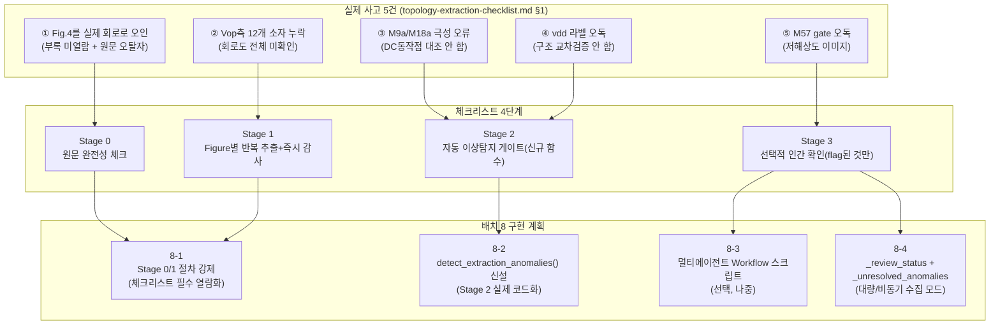

### 배치 8-1 — Stage 0/1 절차 강제 (코드 아님, 프로세스)

| | 내용 |
|---|---|
| **문제** | 지금은 AI가 문서를 읽을 때 "부록까지 다 읽어라", "Figure별로 즉시 감사해라"를 강제하는 장치가 없다 — 사고①②가 정확히 이래서 발생했다. |
| **제안** | `references/topology-extraction-checklist.md`를 SKILL.md 참조 목록에 등록(완료) — 새 topology.json 작성 시작 전 이 문서를 먼저 읽는 것을 §4.5(design.md의 새 topology 작성 절차)의 필수 선행 단계로 명시. |
| **검토 필요** | ~~이 강제를 SKILL.md의 "절대 원칙"에 넣을지, design.md §4.5에만 남길지~~ → **✅ 결정 완료(2026-07-31): SKILL.md 절대 원칙에 추가.** 이 체크리스트가 실제 사고 5건에서 직접 도출됐다는 점이 "절대 원칙" 섹션 자신의 등재 기준(실제 사고 유래만 등재)과 정확히 일치 — 사고1~4가 이미 절대원칙으로 등재된 것과 같은 근거. |
| **검증** | 다음 새 회로를 추출하는 세션에서 실제로 이 체크리스트의 Stage 0/1을 따랐는지 회고 — 사고①②류가 재발하지 않으면 통과. |

### 배치 8-2 — `detect_extraction_anomalies()` 신설 (Stage 2 실제 코드화)

| | 내용 |
|---|---|
| **문제** | Stage 2(자동 이상탐지)가 지금 존재하지 않는다 — 사고①②③④ 전부 사람이 우연히 재확인해서 발견됐지, 어떤 함수도 자동으로 flag하지 않았다. |
| **제안** | `detect_extraction_anomalies(draft_json, source_text, expected_counts=None) -> list[Anomaly]` 신설(`topology-extraction-checklist.md` §5 표의 체크 항목 그대로 구현) — 대칭성 기대치 위반, 매칭쌍 kind 불일치, dangling net, 텍스트-숫자 대조 4가지를 `find_matching_candidates()`/`find_hub_merge_candidates()` 결과 위에 얹는다(새 그래프 알고리즘 아님, 기존 함수의 출력을 검사하는 층). |
| **검토 필요** | ~~이 함수를 `stick_diagram.py`(회로-무관 레이어)에 넣을지, topology.json 오케스트레이션 전용 새 파일에 넣을지~~ → **✅ 결정 완료(2026-07-31): 분리.** 4개 체크 중 대칭성 위반/kind 불일치/dangling net 3개는 `find_matching_candidates()`/`find_hub_merge_candidates()`/`find_diode_stacks()`와 같은 순수 그래프 기반이라 `stick_diagram.py`에 함께 두고, 텍스트-숫자 대조 1개는 원문 텍스트(`source_text`)를 입력받는 성격이 전혀 달라(그래프 이론과 무관) topology 추출 전용 새 파일에 따로 둔다 — `detect_extraction_anomalies()`는 이 두 소스를 조합해 호출하는 얇은 오케스트레이션 함수가 된다. |
| **검증(회고 테스트)** | ~~**가장 강력한 검증**: 이 함수를 실제로 틀렸던 시점의 draft(배치 5/6 당시의 41개 소자 버전, Vop 12개 누락 + M9a nmos 상태)에 소급 적용 — 사고②(대칭성 위반)와 사고③(kind 불일치, 만약 그 시점에 대응 쌍이 있었다면)이 실제로 flag되는지 확인한다.~~ → **❌ 불가능으로 확인(2026-07-31)**: `git log`/`git ls-files`로 확인한 결과 이 topology.json은 git에 한 번도 커밋된 적이 없어(untracked) 41개 소자 시점 draft를 꺼내올 방법이 없다. **대안 검증**: 다음에 새 회로를 추출할 때 그 초안 단계(아직 완성 전, 의도적으로 소자를 누락시키거나 극성을 틀리게 한 테스트 fixture)에 이 함수를 적용해 flag가 뜨는지로 대체한다 — 과거 사고의 실제 재현이 아니라 인위적 fixture 기반 검증이 된다는 한계는 있음. |

### 배치 8-3 — 멀티에이전트 Workflow 스크립트 (선택, 나중)

| | 내용 |
|---|---|
| **문제** | Stage 0~3을 사람이 순서대로 수동 실행하는 것과, `Workflow` 도구로 자동 오케스트레이션하는 것 중 어느 게 나을지 아직 결정 안 됨. |
| **제안** | `topology-extraction-checklist.md` §7의 5단계(문서스캔→Figure별 병렬추출→merge→이상탐지 게이트→선택적 질문)를 `Workflow` 스크립트로 구현 — 단, 이건 8-1/8-2가 먼저 확립된 뒤에나 의미 있다(게이트 로직 자체가 없으면 멀티에이전트로 병렬화해도 같은 사고가 반복될 뿐). |
| **검토 필요** | ~~이 스코프까지 지금 할지, 8-1/8-2만으로 다음 회로 1~2개를 먼저 시험해보고 필요성을 재판단할지~~ → **✅ 결정 완료(2026-07-31): 미룬다.** 8-1/8-2 자체가 아직 구현 전 계획 단계라 그 위에 Workflow 자동화까지 미리 설계하는 건 이르다 — 8-1/8-2를 다음 회로 1~2개에 실제로 적용해본 뒤 재판단. |
| **검증** | 8-3 없이(사람이 수동으로 체크리스트 실행) 다음 회로를 추출했을 때 걸리는 시간/오류 수와, 8-3 적용 후를 비교. |

### 배치 8-4 — 대량/비동기 추출 모드: `_extraction_confidence` + 미해결 anomaly 로그 (신설, 2026-07-31 사용자 계획 반영)

> **배경**: 사용자의 실제 향후 계획 — 이 skill이 어느 정도 쓸만하다고 판단되면 **웹에서
> 구할 수 있는 모든 topology를 자동 추출로 대량 수집**하고, 모호한 부분만 참조와 함께
> 표시해뒀다가 나중에 사람이 정정하는 방식으로 라이브러리를 키운다. 지금까지의 배치 8
> 설계(체크리스트 Stage 0~3)는 **회로 하나를 사람과 함께 그 자리에서 꼼꼼히** 처리하는
> 전제였다 — Stage 3("선택적 인간 확인, flag된 것만")까지는 이 모드를 이미 예상했지만,
> "flag된 채로 라이브러리에 들어가도 되는가"에 대한 명시적 게이트가 없었다. 대량 수집을
> 하려면 **확인 대기 중인 topology.json도 라이브러리에 존재할 수 있어야** 한다.

| | 내용 |
|---|---|
| **문제** | 지금 배치 8 설계는 "Stage 0~3을 거쳐 완전히 확인된 topology.json만 라이브러리에 들어간다"를 암묵적으로 전제한다 — 대량/자동 수집 모드에서는 매 항목마다 사람이 동기적으로 확인할 수 없으므로, 모호함을 안은 채로도 라이브러리에 들어갈 수 있는 상태와, 그 모호함을 나중에 찾아서 정정할 수 있는 경로가 필요하다. |
| **제안** | 새 필드 없이 새로 발명하지 않고 **이미 이 프로젝트가 두 번 쓴 패턴을 재사용**한다: (1) `_compensation_status`(3단계 상태: not_applicable/pending_topology_fn/resolved)와 같은 형태로 topology.json 최상위에 `_review_status` 필드 신설(값: `"auto_extracted_unreviewed"` / `"partially_reviewed"` / `"human_confirmed"`) — 라이브러리 로더/harness는 이 값을 보고 "아직 검증 안 된 구조로 사이징을 진행해도 되는지"를 판단(예: `"auto_extracted_unreviewed"`인 topology는 §7 harness가 경고와 함께만 진행하거나 아예 거부). (2) `detect_extraction_anomalies()`(배치 8-2)가 찾았지만 그 자리에서 못 고친 항목은 `current_reuse_telescopic_ota.topology.json`이 이미 쓰고 있는 `_correction_log`/`_correction_log_2` 필드 패턴을 확장해 `_unresolved_anomalies: list[Anomaly]`에 원문 위치/근거(reference)와 함께 영구 기록 — 나중에 사람이 이 로그만 보고 정정 작업을 이어갈 수 있다(매번 원문을 처음부터 다시 읽을 필요 없음). |
| **검토 필요** | (a) `_review_status`가 `"auto_extracted_unreviewed"`인 topology를 §7 harness(사이징/레이아웃)가 아예 거부할지, 경고만 하고 진행할지 — 안전 우선이면 거부, 실용성 우선이면 경고. (b) `_unresolved_anomalies`의 각 항목이 담아야 할 최소 필드(원문 페이지/그림 번호, 추정 근거, 신뢰도)를 `topology-extraction-checklist.md` §5 표와 맞춰 확정. |
| **검증** | 대량 수집을 실제로 시작하기 전, 이 회로(`current_reuse_telescopic_ota`)를 `_review_status: "human_confirmed"`로 소급 태깅하고(51개 소자 전부 HIGH confidence로 이미 확정된 상태와 일치해야 함), 앞으로 자동 추출될 새 topology는 기본값 `"auto_extracted_unreviewed"`로 시작해 이 게이트가 실제로 작동하는지 확인. |

### 배치 8 검토용 열린 질문

1. ~~배치 8-1(절차 강제)을 SKILL.md 절대 원칙에 넣을지 design.md §4.5에만 남길지?~~ → **✅ 결정 완료(2026-07-31): SKILL.md 절대 원칙 추가**(자세한 내용은 배치 8-1 표 참고).
2. ~~배치 8-2의 회고 테스트(배치 5/6 당시 draft에 소급 적용)를 실제로 실행해볼지 — 그러려면
   그 시점의 41개 소자 draft를 별도로 보존해뒀어야 하는데, 지금 git 히스토리에 남아있는지
   확인 필요.~~ → **✅ 2026-07-31 확인 — 없다.** `git log`/`git ls-files`로 직접 확인한 결과
   `current_reuse_telescopic_ota.topology.json`은 **지금까지 한 번도 git에 커밋된 적이
   없다**(`git status`에 `??`로 untracked 표시) — 41개 소자 시점의 어떤 버전도 git
   히스토리에 존재하지 않는다. 회고 테스트를 하려면 git에서 꺼내올 방법이 없고, 유일한
   대안은 이 대화 히스토리(초기 topology.json 초안이 언급된 시점)에서 텍스트를 복원하는
   것뿐인데 그마저 완전한 JSON 파일 스냅샷이 남아있다는 보장이 없다 — 사실상 회고 테스트
   자체가 **불가능**하다는 게 결론이다(배치 8-2 검증은 "다음 새 회로"로 대체해야 함, 위
   배치 8-2 자체의 "검증(회고 테스트)" 행도 이 결론 반영 필요).
3. ~~배치 8-3(Workflow화)을 이번에 같이 계획할지, 8-1/8-2만 먼저 확정하고 다음 회로
   추출 경험 후 재판단할지?~~ → **✅ 결정 완료(2026-07-31): 미룬다**(자세한 내용은 배치
   8-3 표 참고).

---

## 9. 배치 9 — 토폴로지 선택/합성 (스펙만 있고 회로 구조가 없는 경우, **미착수 — 배치 8-at-scale에 종속**)

> **✅ 2026-07-31 재규정(사용자 계획 공유)**: "낮은 우선순위라 미룬다"가 아니라 **배치
> 8-4(대량/비동기 수집 모드)가 성공하면 그 즉시 전제조건이 풀리는 후속 과제**로 다시
> 정의한다. 사용자의 실제 향후 계획은 이 skill이 쓸만하다고 판단되면 웹에서 구할 수 있는
> 모든 topology를 자동 추출로 대량 수집하는 것이다 — 그렇게 되면 아래 질문 3이 지적하는
> "후보 풀이 3개뿐이라 가치가 낮다"는 전제 자체가 사라지고, 질문 2("스펙 특징 → 후보
> 매핑을 메타데이터로 자동 생성할 수 있는가")도 답이 달라진다 — 후보가 3개일 땐 사람이
> 손으로 매핑하는 게 나았지만, 수십~수백 개가 쌓이면 이미 구축된 `sizing_roles.metrics`
> (gain/power/noise 프로필)가 각 토폴로지의 "전형적 트레이드오프"를 이미 담고 있어 그
> 데이터에서 매핑을 뽑아낼 수 있는 상태가 된다.

> **배경**: 배치 7(사이징/레이아웃 harness)과 배치 8(문서/회로도 → topology.json 추출)을
> 전체 파이프라인 시나리오로 시뮬레이션(2026-07-30)하다가 드러난 gap. 두 배치 모두 암묵적으로
> **"토폴로지가 이미 주어졌다"**(논문에서 왔거나 `library/*.topology.json`에 이미 등록됨)를
> 전제한다. "스펙만 있고 회로 구조 자체를 처음부터 골라야 하는 경우"(예: "저전력·중대역폭
> OTA가 필요하다"는 요구만 있고 telescopic/2단/current-reuse 중 뭘 쓸지부터 정해야 하는
> 상황)는 배치 7/8 어디에도 다뤄진 적이 없다.

**왜 배치 7/8과 다른 문제인가**:
- 배치 7의 D유형 자유변수 탐색(`optimize_full_circuit_budget()`)은 **연속 변수** 최적화다 —
  주어진 토폴로지 안에서 f_slew/K_replica/N_cmfb_bw/r_biasgen 같은 숫자를 고르는 문제.
- 토폴로지 선택은 **이산적 구조 선택**이다 — "이 스펙엔 어떤 회로 구조(가 아예 다른
  소자 그래프)를 써야 하는가"는 목적함수를 정의하기도 어렵고(구조마다 성능/전력/면적
  트레이드오프의 축 자체가 다름), `library/`에 없는 완전히 새로운 구조가 필요할 수도 있다
  (이 경우는 배치 8도 아니고 순수 회로 설계 문제).
- `function-selection-map.md`가 이미 하는 "이 상황엔 이 함수"라는 매핑과 비슷한 발상이지만,
  훨씬 상위 레벨("이 스펙엔 이 회로 구조")이라 같은 방식(표 하나로 매핑)이 통할지도 검증 안 됨.

**열린 질문 (설계 전 단계 — 착수 여부는 위 재규정대로 배치 8-4 진행 상황에 조건부로 달려있음, 무기한 미결정은 아님)**:
1. 이걸 harness 함수로 만들 수 있는 문제인가, 아니면 항상 AI/사람의 순수 엔지니어링 판단
   영역으로 남겨야 하는가?
2. 만약 harness화한다면, "스펙 특징(저전력/고속/저노이즈/저면적 등) → 후보 토폴로지 목록"
   매핑을 `library/*.topology.json`에 이미 등록된 것들의 메타데이터(예: 각 토폴로지의
   전형적 트레이드오프 프로필)로부터 만들 수 있는가, 아니면 매번 새로 판단해야 하는가?
3. ~~배치 8(추출)과의 경계 — 후자(스펙만으로 새 토폴로지를 고르는 것)를 이 프로젝트
   스코프 안에 넣을 가치가 있는지(현재 `library/`가 실제 회로 3개+템플릿 1개뿐이라
   후보 풀 자체가 작다)~~ → **재규정(2026-07-31)**: 후보 풀이 작다는 전제는 배치
   8-4(대량 수집)가 성공하면 사라진다 — 스코프에 넣을 가치가 "지금은 없다가 나중에
   생긴다"가 아니라 "배치 8-4의 결과물 규모에 정비례한다."

**현재 상태**: 착수하지 않음 — 단, 위 재규정에 따라 **배치 8-4(대량/비동기 수집)가
어느 정도 진행돼 후보 토폴로지 수가 실질적으로 늘어나면 재검토를 트리거하는 조건부
후속 과제**로 기록한다(막연히 "언젠가"가 아니라 명시적 선행조건이 생김). 그 전까지는
문제를 잊지 않기 위한 기록으로만 유지.

---

## 10. 최종 완성 시나리오 — spec+topology.json → instance.json 전체 workflow (2026-07-31)

> **목적/방법**: 배치 7(7-1~7-6)이 **전부 구현 완료됐다고 가정**하고, "topology.json +
> design_spec을 주면 harness 함수만으로(사람이 스크립트를 새로 안 짜고) 처음부터 끝까지
> 사이징→matching-safety 검증→floorplan→instance-output JSON까지 완주할 수 있는가"를
> **실제 함수 시그니처를 코드로 재확인하며** 단계별로 추적했다 — 이게 원래 배치 7을
> 시작시켰던 "82개 함수 harness 커버리지 감사"의 최종판이다. 이 감사 자체가 배치 7-6(raw
> W→finger 배정 gap)을 새로 찾아냈다 — 즉 이 §10은 사후 정리 문서가 아니라 **감사
> 과정에서 실제로 gap을 하나 발견한 실행 결과**다.
>
> **✅ 2026-07-31 이 검증 방식 자체가 skill의 영구 규칙으로 승격됨**: 이 §10이 실제로
> 배치 7-6 gap을 찾아낸 것을 근거로, "spec→instance.json 전체가 harness만으로·재현
> 가능하게·최선의 결과로 완주되는가"를 매번 확인하는 절차가 `SKILL.md` **절대 원칙
> 5번**(`known-incidents.md` 사고5)과 **§5 검증 체크리스트 마지막 항목("skill 최종
> 게이트")**으로 못박혔다 — 이 skill의 harness 함수 집합이 수정·확장될 때마다(1회성
> 설계 검증이 아니라) 반드시 재실행해야 하는 상시 게이트다. 이 §10은 그 게이트의 첫
> 실행 사례다.
>
> **전제**: `library/`의 topology.json 하나(`_review_status: "human_confirmed"`) +
> 그에 맞는 `design_spec`(dict). `sizing_roles.theta`가 비어있지 않은 일반적인 경우
> (이 회로처럼 f_slew/K_replica/N_cmfb_bw/r_biasgen/L_cascode/L_stage2out 6차원)를
> 기준으로 서술한다 — theta가 비어있으면 §10.2의 Stage 2 전체가 생략되고 Stage 3만
> 1회 실행되는 특수 경우가 된다(§7.3.3 Q4 참고).

### 10.1 단계별 추적

**Stage 0 — 입력**: `topology.json`(`netlist`/`symmetry`/`compensation`+`_compensation_status`/
`sizing_roles`[`theta`/`metrics`/`objective`/`constraints`]/`area_priors`/`_review_status`) +
`design_spec`(GBW/CL/PM/gain_target/noise_target/mismatch_target/CMRR·PSRR_target 등).

**Stage 1 — 로드 + 게이트**: `load_topology(topology_json_path)` → `(transistors[connectivity만],
meta)`. `meta["_review_status"]`가 `"auto_extracted_unreviewed"`면 배치 8-4 정책대로
경고/거부(§7.9 질문 (a) 결정 대상).

**Stage 1.5 — 스택 그룹 도출(θ 무관, 1회만)**: `derive_stack_groups(netlist, matching_pairs)`
(배치 7-6, 신규) → `stack_groups`. connectivity만으로 결정되므로 θ 탐색 루프 **밖에서
1회만** 계산 — §7.3.2 A유형(`propagate_topology_forced_currents()`)이 KCL 직렬-스택을
찾으려 걷는 그래프 워크의 부산물.

**Stage 2 — θ 탐색**(`sizing_roles.theta` 비어있지 않으면): `optimize_full_circuit_budget(
topology_path, spec)`(배치 7-3d, §7.9 질문 2b 채택 확정) 내부에서 grid search(기본값 —
재현성·최적성 보장, SKILL.md §5 최종 게이트 참고)/좌표하강(고차원일 때만, 고정 시작점
필수)으로 θ 후보마다 아래를 반복:

1. **θ→계산 상태 반영**: θ 목록을 순회하며 `apply_theta_feed(feed_spec, theta_value, ctx)`
   → `_THETA_FEED_REGISTRY`(§7.3.2, 2026-07-31 확정)로 핸들러 조회·실행. `settling_split`
   (f_slew)은 Level1→3 닫힌식 경유, `{"type":"A","tag":"biasgen_root"}`(r_biasgen)는 A엔진
   seed, `{"type":"C","target":"M9a"}`(K_replica)는 C엔진, `{"type":"B","tag":"servo"}`
   (N_cmfb_bw)는 B엔진, `{"type":"metric_stage_budget","metric":"gain_db",...}`
   (L_cascode/L_stage2out)는 B(Cgg 경유)+F(gain metric) 둘 다.
2. **A유형**: `propagate_topology_forced_currents(netlist, seed_currents, mirror_ratios)` —
   KCL 직렬-스택/미러비로 전류 100% 결정.
3. **B유형**: `solve_id_for_target_gm(lut, L, vds, vs, W, gm_target)` — LUT 이분탐색.
4. **C유형**: `find_diode_stacks(netlist)`(배치 7-3.2, §7.9 질문 11 — "지금 만든다" 확정) +
   `solve_diode_stack_current(lut, known_stack, unknown_W)`.
5. **compensation(gm1/gm2)**: `run_sizing_pipeline(topology_json_path, design_spec)` →
   `_COMPENSATION_REGISTRY[compensation.function]`(topology_fn 클로저) →
   `optimize_multistage(topology_fn, luts, ...)` — `prev_cggs` 고정점 반복(L_stage2out θ가
   Cgg2를 통해 이 반복에 자연히 먹임, §7.3.3 Q3 참고).
6. **헤드룸 배분**: `allocate_stack_headroom(vdd, stack, policy=DEFAULT_POLICY)`(배치 7-3b,
   §7.9 질문 5 — 정책 콜백 결정).
7. **L 선택**: 미러/바이어스는 `select_L_by_role(role, L_min)`(배치 7-3f) — 캐스코드/신호
   경로는 `ValueError`(θ의 `L_cascode`/`L_stage2out`이 대신 담당하므로 정상 동작).
8. **gm/ID 선택**: `search_gm_id_for_role(lut, L, vds, vs, ID_target, role, W_bounds)`
   (배치 7-3e).
9. **W 계산**: `size_transistor(gm, gm_id, L, lut, vds, vs)` → 51개 소자 전부의 raw `W`(float).
10. **`sizing_overrides` 구성(배치 7-6, 신규 — 이 세션에 발견한 gap의 해결책)**:
    `assign_finger_geometry(sizing_results, stack_groups, area_priors, min_finger_w,
    max_finger_w)` → `{name: {"n_fingers":..., "finger_w":..., "w":..., "stack_id":...}}`.
    Stage 1.5의 `stack_groups`를 재사용(θ마다 재계산 안 함), `sizing_results`는 θ마다
    다르므로 이 스텝만 매 iteration 실행.
11. **cell별 파이프라인**: `run_topology_pipeline(topology_json_path, sizing_overrides,
    floorplan_hints, cell_groups)`(배치 7-2, `cell_groups` 없으면 `spine_groups`로
    fallback) — cell마다 반복해 `{cell명: verdict}` 반환.
12. **전체 회로 감사**: `expected_counts`를 `cell_groups`(또는 `netlist` 전체)에서 유도 +
    `run_full_circuit_audit(devices, expected_counts, dispositions, box_shape_checks,
    accept_fail_blocks)` — `dispositions`의 `diode_chain`류는 `find_diode_stacks()`
    출력을 재사용해 사전 채움(§7.3.2 콜아웃, 2026-07-31 확정).
13. **FAIL 처리**: box_shape 또는 audit_row_split FAIL → **`repair_matching_safety()`를
    자동 호출하지 않고**(§7.9 질문 3 — 별도 함수 유지 확정) 그대로 infeasible 페널티 —
    D유형 탐색 루프의 "나쁜 θ 후보를 걸러내는" 로직을 보존하기 위함.
14. **metrics 계산**: `compute_metric(metric_spec, ctx)` × 각 metric →
    `_METRICS_REGISTRY`(§7.3.2, 2026-07-31 확정) — `sum_current`/`sum_area`/
    `gain_stages_sum`/`flicker_plus_thermal_sum`(배치 7-3g, `SID_1F` 필요 —
    `lut-generation-checklist.md` §8.1)/`pelgrom_mismatch`(배치 7-3h, `vth0_slope` 필요 —
    §8.2)/`cmrr_estimate`+`psrr_estimate`(배치 7-3i, `circuit_family` 태그로
    `_CMRR_ESTIMATOR_REGISTRY`/`_PSRR_ESTIMATOR_REGISTRY` 하위조회, 2026-07-31 정정).
15. **제약 평가**: `Av_total = gm1·Rout1(L_cascode) + gm2·Rout2(L_stage2out) ≥ Av_target`
    (배치 7-3d 7단계) + `sizing_roles.constraints`(gain/mismatch/CMRR/PSRR, §7.9 질문 10 —
    constraint로 사용 확정) 전부 만족해야 `objective.minimize`(전력) 후보로 채택, 하나라도
    FAIL이면 infeasible.

θ* = 위 평가를 최소화(또는 grid search 최댓값)하는 θ.

**Stage 3 — θ*로 최종 1회 재실행**: Stage 2의 1~15단계를 θ*로 마지막 한 번 더 실행해
최종 `sizing_overrides`/`pipeline_result`/`sizing_results` 확정.

**Stage 4 — matching-safety 개선**(θ 탐색 밖, 배치 7-5): Stage 3 결과에 FAIL pair가 남아
있으면 호출자가 `repair_matching_safety(rows, matching_pairs, pair_kinds, max_iter=3)`을
**명시적으로** 호출(§7.9 질문 3 결정) — 내부적으로 매 시도마다 `select_layout_tool(kind,
area_budget)`(배치 7-4b)를 쓰는데, 이때 `area_budget`은 `estimate_area_budget(kind,
role_tag, area_priors, n_fingers)`(배치 7-4b 확장, 2026-07-31)의 결과를 근거로 채운다
(§7.9 질문 6 결정) → `interdigitate_layout()`/`common_centroid_layout()` 재시도 →
`audit_row_split()` 재검증, 최대 3회. 그래도 FAIL이면 `run_full_circuit_audit()`의
`accept_fail_blocks`에 이유와 함께 등록해 리포트 생성을 정상 완료(§7.9 질문 4 결정).

**Stage 5 — 최종 출력**: `save_instance_json(path, topology_json_path, sizing_results,
pipeline_result)` → `<topology_name>.instance.json`(스키마: `sizing`/`netlist`/`floorplan`
[`placements`/`bbox`/`aspect_ratio`/`packing_density`]/`box_shape`/`audit_row_split`/
`coverage`).

**Stage 6(선택)** — 리포트가 필요하면 `build_html.py`/`report_template.html`
(`renderSchematic()`/`renderStack()`/`renderFloorplan()`, 배치 6 사후수정에서 이미 검증됨)
재사용해 8개 섹션 리포트 생성 — 이건 배치 7의 스코프 밖(harness 대상 아님, 시각화 코드
재사용 원칙만 유지)이라 이 감사의 "완전성" 판정에는 포함하지 않는다.

### 10.2 전체 workflow 다이어그램

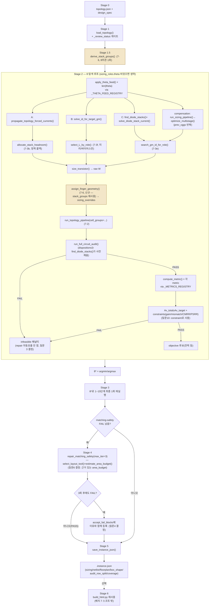

### 10.3 감사 결론

**배치 7-1~7-6이 전부 구현되면, spec+topology.json → instance.json까지 harness 함수만으로
완주 가능하다(gap 없음)** — 단, 이 결론은 Stage 1.5/10단계의 `derive_stack_groups()`/
`assign_finger_geometry()`(배치 7-6)가 실제로 만들어졌을 때만 성립한다. 이 두 함수가
없으면 Stage 2의 10단계에서 사람/AI가 손으로 `sizing_overrides`를 채워야 하고, 그 순간
"harness만으로 완주"라는 이 skill의 핵심 목표가 깨진다 — 이번 감사가 실제로 찾아낸
유일한 gap이자, 그래서 배치 7-6이 배치 7의 나머지 항목들과 동등한 "필수" 배치인 이유다
(선택적 개선이 아니라 파이프라인을 잇는 마지막 연결고리).

**리포트 생성(Stage 6)은 이 완전성 판정에 포함하지 않는다** — 배치 6에서 이미 별도로
검증됐고(§3 "배치 6 사후 수정" 참고), 배치 7의 스코프(사이징+matching-safety+floorplan)와
독립적인 시각화 계층이기 때문이다.

**남은 것은 전부 실행 검증이지 설계 gap이 아니다**: (a) 이 회로에 Stage 0~5를 실제로
돌려 §7-x 각 배치의 "검증" 행이 요구하는 수치 일치를 확인하는 것(배치 7-5), (b)
`folded_cascode`/`two_stage_ota`에도 같은 파이프라인이 코드 수정 없이 적용되는지 확인하는
것(§7.9 질문 2c) — 둘 다 §7.9에서 이미 "구현 후 검증" 항목으로 분류돼 있다.
