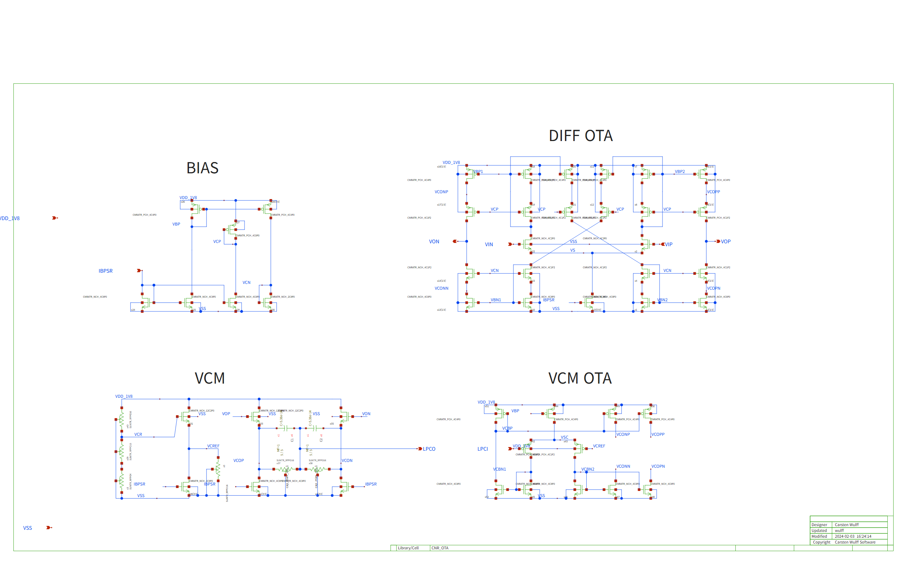

# CNR_OTA (Carsten Wulff, cnr_ota_sky130nm, sky130 xschem 회로도)

- 원문 종류: **PDF 아님** -- 공개 GitHub 저장소의 xschem 회로도(.sch)와 그 저장소가 만든 SVG 그림. 논문 원문은 없다.
- 웹 출처: https://github.com/wulffern/cnr_ota_sky130nm @ `8c839f7` (2024-03-01). 회로도 `design/CNR_OTA_SKY130NM/CNR_OTA.sch`, 그림 `documents/CNR_OTA_SKY130NM/CNR_OTA.svg`, 부하 `sim/CNR_OTA/load.spi`
- 원본 위치(판독 때 받은 사본): `C:\Users\HSLEE\Documents\Todoc\fpga\wt\_heldout\wulff\` (`CNR_OTA.sch`, `CNR_OTA.svg`, `README.md`=sim README, `summary.yaml` -- 아래 파일과 바이트 같음), 그림 PNG는 `wt\_heldout\D_cnr\D_cnr.schematic_xschem_original.png`. 나머지(최상위 README, `CNR_OTA.md`, `sim/*.spi` 등)는 2026-10-14 `raw.githubusercontent.com/wulffern/cnr_ota_sky130nm/8c839f7/<경로>`에서 그대로 받았다(`wt/_scratch_heldout_d/src/` 사본은 줄바꿈만 CRLF로 다름).
- 라이선스: 저장소 @8c839f7 최상위에 LICENSE 파일 없음(2026-10-14 GitHub tree 확인)
- 엔진 연결: `assets/heldout/cnr_ota.topology.json`, `cnr_ota.sizing_spec.json`, `cnr_ota.spec_source.md`, `cnr_ota.topology.md`
- 하위 셀(보관 안 함): `wulffern/cnr_atr_sky130nm`(CNRATR_*: MOS 1개씩), `wulffern/sun_tr_sky130nm`(SUNTR_RPPO*: res_high_po 직렬). topology는 이 셀들을 `extract_xschem.py`로 기계적으로 펼친 결과다.

## 파일

| 파일 | 원본 경로(@8c839f7) | sha256 | 내용 |
|---|---|---|---|
| `CNR_OTA.sch` | `design/CNR_OTA_SKY130NM/CNR_OTA.sch` | `e989d7dee62ee831a03f695c033e4a4aab10e57ce39caa45a8590bf2d83bec52` | xschem 회로도 원본(텍스트). topology `_src`의 `wulff/CNR_OTA.sch:<줄>`은 이 파일의 줄 번호 |
| `CNR_OTA.svg` | `documents/CNR_OTA_SKY130NM/CNR_OTA.svg` | `334f25d5e46a80d864caf2889f6eae105b2ad4f2e6186bb200215852969123a6` | 저장소가 낸 회로도 그림 |
| `CNR_OTA.png` | (위 SVG의 PNG 렌더, 판독 작업 `D_cnr.schematic_xschem_original.png`) | `a8b21a0af34151111e8f09e8467793fa4777410afc6ee2ea89f439b6672fc194` | 그림 보기용 |
| `README.upstream.md` | `README.md` | `157a0d98ae18d47ecafbc1075e5cd9ac0c56415e1c1ff6d9800ca03d62877512` | 'Signal interface' 표(VIP/VIN/VOP/VON, IBPSR 'Bias current (2 uA)') |
| `CNR_OTA.design.md` | `design/CNR_OTA_SKY130NM/CNR_OTA.md` | `c8b3b9f91ba87e5632af185f28ee49114a1186441eadcfb269c2621b8ed0f458` | 설계자 서술(BIAS, DIFF OTA, VCM OTA, VCM 블록 설명) |
| `sim/lstb.spi`, `sim/lstbcmfb.spi`, `sim/tran.spi`, `sim/xdut.spi`, `sim/lstb.meas`, `sim/lstb.yaml` | `sim/CNR_OTA/` 같은 이름 | `f0054c6b…`, `0a5d963d…`, `d75a0e55…`, `9139281a…`, `e5e4a043…`, `756a69e9…` | 저장소 시험대(루프 안정도·과도·DUT 인스턴스·측정식) |
| `sim/load.spi` | `sim/CNR_OTA/load.spi` | `58607b55ec7cecd145d91c7fe0aa236acc6631e22eebcaa87095313ecbe0d76d` | 시험 부하: `IDC 0 IBPSR dc 2u`, CL1/CL2 5p, R1~R4 |
| `sim/README.md` | `sim/CNR_OTA/README.md` | `3194116d23286a6e016117d5898e436bbf949e3e7ddd471fc3d55089b0ed2fd3` | 시뮬레이션 결과 표(idd, f3db, 이득 여유 등) |
| `sim/summary.yaml` | `sim/CNR_OTA/summary.yaml` | `3134e3f20e9ee445607547f3c449c1edd36e33e205c95cfc94955a413b5bb258` | 위 표의 spec 원본 |

## 그림

